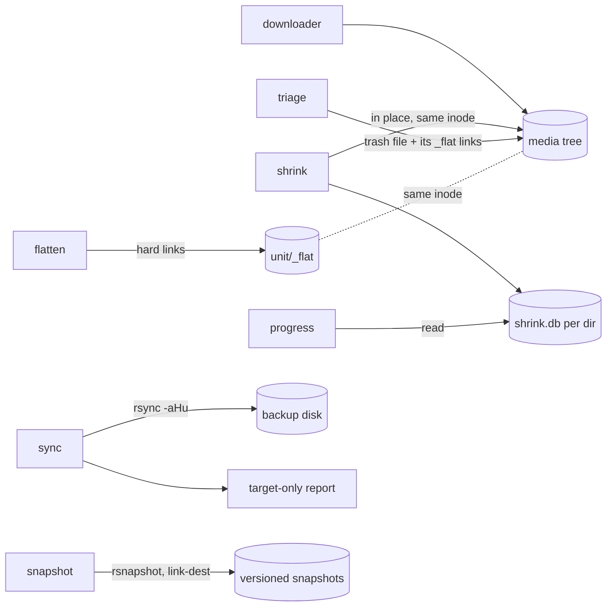

# mediatools

**Maintenance tools for large local media collections on Linux.**
Shrink videos to HEVC without losing track of what is done, review short
clips in batches, build flat hard-link views of deeply nested download trees,
back everything up to a second disk **without duplicating hard links**, and
keep versioned snapshots of it with rsnapshot.

[](https://github.com/peddanet/mediatools/actions/workflows/tests.yml)


```text
mediatools shrink    re-encode videos to HEVC in place, tracked per directory
mediatools progress  read-only report: which videos are already shrunk
mediatools triage    open short clips in batches, close a window to discard it
mediatools flatten   one flat folder of hard links per unit (<unit>/_flat)
mediatools sync      rsync backup that keeps hard links and never deletes
mediatools snapshot  versioned backups with rsnapshot on a removable disk
mediatools config    one local file for paths and names (kept outside the repo)
mediatools rename-db rename shrink databases: rename-db OLD NEW [PATH]
```

---

## Contents

- [In one minute](#in-one-minute)
- [Typical folder layout](#typical-folder-layout)
- [Safety model](#safety-model)
- [Installation](#installation)
- [First steps](#first-steps)
- [Subcommands](#subcommands)
  - [shrink](#shrink) · [progress](#progress) · [triage](#triage) · [flatten](#flatten) · [sync](#sync) · [snapshot](#snapshot)
- [Configuration](#configuration)
- [How the pieces fit together](#how-the-pieces-fit-together)
- [Data directory](#data-directory)
- [Exit codes](#exit-codes)
- [FAQ](#faq)
- [Development](#development)
- [License](#license)

---

## In one minute

You keep a local copy of videos and pictures that a download tool fetches
folder by folder - for example an archiver for a creator platform. After some months the collection has the usual problems:

| Problem | Command | Result |
|---|---|---|
| The disk is full of large H.264 videos | `shrink` | HEVC re-encode, often half the size or less, same file name |
| How much is still left to shrink? | `progress` | read-only report with a time estimate |
| Many short clips you never wanted | `triage` | watch them in batches, close a window to discard the clip |
| Every file is buried four or five folder levels deep | `flatten` | one flat folder of hard links per project, no extra space |
| The backup turns hard links into full copies, or deletes too much | `sync`, `snapshot` | rsync backup that keeps hard links; versioned snapshots |

**The key idea:** the download tool decides by *file name* whether it already
has a file. mediatools therefore never takes a name away. A shrunk video keeps
its name, a discarded clip leaves an empty placeholder under its name, a flat
view consists of additional names (hard links), and `sync` never deletes. The
next download run fetches only what is really new - not the large originals
again, not the clips you discarded.

> **Before you start:** `shrink` re-encodes *lossy* and then replaces the
> original. There is no undo except a backup. Make a backup first (`sync` or
> `snapshot`) and try `shrink --keep-copies` on a test folder to judge the
> quality - see [First steps](#first-steps).

```text
mediatools shrink    re-encode videos to HEVC in place, tracked per directory
mediatools progress  read-only report: which videos are already shrunk
mediatools triage    open short clips in batches, close a window to discard it
mediatools flatten   one flat folder of hard links per unit (<unit>/_flat)
mediatools sync      rsync backup that keeps hard links and never deletes
mediatools snapshot  versioned backups with rsnapshot on a removable disk
mediatools config    one local file for paths and names (kept outside the repo)
mediatools rename-db rename shrink databases: rename-db OLD NEW [PATH]
```

## Typical folder layout

mediatools makes no assumption about a particular platform. It works on a
**collection root** whose direct sub-directories are called **units** (one per
project, campaign or channel); everything below a unit may be nested
arbitrarily (illustrative example):

```text
collection/                      <- collection root ([collection] root)
└── projectA/                    <- unit
    ├── posts/members/987654321 2024-05-01 10-00-00/Videos/making_of_part1.mp4
    ├── posts/public/Images/cover_2024.jpg
    ├── attachments/...
    └── _flat/                   <- created by flatten: hard links of all media
```

At a few hundred thousand files the three pain points of the table above add
up: disk space, browsing and backups. `mediatools` addresses each with one
subcommand, and all subcommands share one set of rules (which directories are
never entered, how files are identified, where logs go).

## Safety model

| Rule | Where it is enforced |
|---|---|
| Originals are replaced only by a **validated** encode (exit code, video stream, duration) | `shrink` |
| Copy-back and database entry are never separated by an interruption | `shrink` |
| `_flat` and `newShrinkedFiles` are never entered by any scan | all |
| `flatten` writes **only** inside `<unit>/_flat/`; originals are never touched | `flatten` |
| Nothing is removed without an explicit confirmation; default is the trash | `triage` |
| A player that exits immediately is treated as an error, its file is kept | `triage` |
| `rsync --delete` is **never** used; target-only files are reported, not removed | `sync` |
| A newer file on the receiving side is never overwritten (`rsync -u`) | `sync` |
| Empty placeholders are never copied over a full file (`rsync --min-size=1`) | `sync` |
| Every run writes a time-stamped log; every flatten run a reversible plan | all |
| `snapshot` refuses to adopt or sync a directory that is not a copy of the source (dry-run probe) | `snapshot` |
| `snapshot` aborts if a run would remove more files than `max_deletions` from the newest snapshot | `snapshot` |

## Installation

Everything except the system packages in step 1 runs as a **normal user**.

### 1. System packages

| Tool | Needed by | Debian/Ubuntu package |
|---|---|---|
| Python ≥ 3.10 (standard library only) | all | `python3` |
| ffmpeg, ffprobe with libx265 | shrink, triage | `ffmpeg` |
| VLC or mpv | triage | `vlc` / `mpv` |
| gio (trash) | triage | `libglib2.0-bin` |
| rsync ≥ 3.0 | sync, snapshot | `rsync` |
| rsnapshot ≥ 1.4 | snapshot | `rsnapshot` |
| git, Python venv module | installation option A | `git`, `python3-venv` |
| pipx | installation option B | `pipx` |

```bash
sudo apt install ffmpeg vlc libglib2.0-bin rsync rsnapshot git python3-venv
ffmpeg -hide_banner -encoders | grep libx265      # must print a libx265 line
```

`sudo` is needed because apt writes to `/usr` and the package database. You
only need the packages of the subcommands you use.

Hard links require a Linux file system such as ext4, btrfs or XFS on both
sides of a `sync`. exFAT, FAT and NTFS cannot store hard links.

### 2. Install a release

mediatools is always installed from a **release tag** (`vX.Y.Z`) on GitHub,
never from the working files of a clone. `mediatools --version` therefore
shows exactly the release you installed.

**Option A - installer (recommended)**

```bash
curl -fsSLO https://raw.githubusercontent.com/peddanet/mediatools/main/install.sh
bash install.sh                  # newest release; bash install.sh --list shows all
mediatools --version             # e.g. "mediatools 1.2.0"
```

The installer needs `git` and the Python venv module
(`sudo apt install git python3-venv`). It

1. reads the release tags from GitHub and picks the newest one (or the one
   given: `bash install.sh v1.2.0`),
2. installs that release into a virtual environment of its own,
   `~/scripts/mediatools.d/venv`,
3. links the command to `~/scripts/mediatools` (`BIN_DIR=~/.local/bin bash
   install.sh` for another place; the directory must be in `PATH`),
4. checks that the installed program reports the version of the tag.

**Update** to the newest release: run `bash install.sh` again.
Maintainers who receive hotfixes as patch archives
(`mediatools-hotfix-X.Y.Z-patch.tar.gz` in `~/Downloads`) use
`mediatools update` instead: it applies the archives in the clone
(`~/Projects/mediatools`) through pull requests, tags the release, installs
it and tidies the download folder (details in the developer documentation).
**Remove**: `rm -rf ~/scripts/mediatools.d/venv ~/scripts/mediatools`
(configuration and logs in `~/scripts/mediatools.d` stay).

**Option B - pipx**

```bash
pipx ensurepath                  # once: puts ~/.local/bin into PATH, then open a new terminal
pipx install git+https://github.com/peddanet/mediatools.git@v1.2.0
```

Replace `v1.2.0` with the newest tag from the
[releases](https://github.com/peddanet/mediatools/tags). Update by
installing the new tag with `pipx install --force ...@vX.Y.Z`; remove with
`pipx uninstall mediatools`.

Ubuntu 24.04 and later block `pip install --user` for the system Python
(PEP 668); both options use a virtual environment instead.

### 3. Where mediatools keeps its files

Configuration, logs, state, reports and (option A) the installed release are
stored in one directory, default `~/scripts/mediatools.d` (see
[Data directory](#data-directory)). To use another place, set
`MEDIATOOLS_HOME` **before** installing, for example in `~/.profile`:

```bash
echo 'export MEDIATOOLS_HOME="$HOME/.local/share/mediatools"' >> ~/.profile
```

## First steps

Nothing below changes a file until you confirm a question.

```bash
mediatools config --set collection.root=~/Videos/collection   # your collection root
mediatools config                                             # check the effective values
mediatools progress                                           # how much is still H.264?
mediatools triage --dry-run --max-seconds 30                  # how many short clips, how long?
mediatools flatten --dry-run                                  # what would _flat contain?
```

Judge the shrink quality on a copy before touching the collection:

```bash
mkdir -p ~/shrinktest && cp ~/Videos/collection/projectA/some/video.mp4 ~/shrinktest/
mediatools shrink --keep-copies ~/shrinktest                  # result in ~/shrinktest/newShrinkedFiles/
```

`--keep-copies` leaves the originals untouched and records nothing. Compare
both files in a player; if the quality is too low, use a smaller `--crf`
(for example 24).

Then make a backup and start the real work:

```bash
mediatools sync                          # back up; asks for the disk, shows a dry run first
mediatools triage --max-seconds 30       # discard unwanted short clips first
mediatools shrink                        # asks, then runs in the background; 'mediatools stop' stops cleanly
mediatools flatten                       # create the flat hard-link views
```

Every command also accepts an explicit path instead of `[collection] root`.

## Subcommands

### shrink

Re-encodes every video below `PATH` with libx265 and **keeps the file
name**, so download tools that skip existing names do not fetch the large
original again.

```bash
mediatools shrink [PATH] [--order largest|smallest|path] [--min-seconds S] [--foreground]
                  [--keep-copies] [--crf 28] [--threads N] [--ext mp4] [-y] [-v]
mediatools attach        # (alias: front) watch a shrink running in the background
mediatools update        # apply delivered release patches from ~/Downloads, then install
mediatools stop          # ask it to finish its current file and end
mediatools status        # running? which release, current or not, which log
```

1. **Plan.** All videos are checked against the database of their
   directory. *The database always has precedence:* a recorded file counts
   as processed, whatever its codec. Matching is by **file name within the
   directory**, so databases written before the collection was moved stay
   valid. Videos that are already HEVC are reported separately (recorded
   without encoding, not counted in volume and time; codecs are cached).
   Then the run reports files, volume, the estimated time and the
   expected size afterwards (both measured on earlier files), lists
   leftover `newShrinkedFiles/` folders of aborted runs, and asks once.
   Leftovers are deleted only after a yes.
2. **Order.** Largest files first by default (most space saved early);
   `--min-seconds 60` leaves short clips for a `triage` session first.
3. **Per file:** already HEVC → recorded only; otherwise encode into
   `newShrinkedFiles/`, validate, copy over the original *in place* (same
   inode, so `_flat` links see the new content), record.

Three progress lines show the whole run (percentage by volume, files,
source GiB, remaining time), the current file (percentage, size, encoded
part, remaining time) and the disk space (read, written and freed, for this
run and overall); the speed is measured in this and earlier runs:

~~~text
total [###.....................]  12.4 % | 380/3076 files | 189.2/1525.8 GiB source | ETA 9d23h
file   35 % of 2.40 GiB (0.84 GiB encoded) | 17m left | example_clip.mp4
space  this run: 189.2 GiB read -> 30.3 GiB written = 158.9 GiB freed | overall: ...
~~~

The GiB of the first line are what was *read*, not what was freed, and
they count this run only; the space line tells the two apart.

Each finished video adds a row to a framed result table (terminal and
`reports/shrink_results_<ts>.txt`); long paths wrap inside their cell:

~~~text
results (also in reports/shrink_results_<ts>.txt):
┌──────┬───────┬──────────┬──────────┬─────────┬──────────┬──────────┬────────┬──────────┐
│   no │ end   │   source │   result │   ratio │   length │     took │ status │ file     │
├──────┼───────┼──────────┼──────────┼─────────┼──────────┼──────────┼────────┼──────────┤
│    1 │ 10:25 │  2815 MB │   284 MB │  10.1 % │ 26.5 min │ 21.3 min │ shrunk │ unit_a/  │
│      │       │          │          │         │          │          │        │ Videos/  │
│      │       │          │          │         │          │          │        │ long     │
│      │       │          │          │         │          │          │        │ clip     │
│      │       │          │          │         │          │          │        │ name.mp4 │
├──────┼───────┼──────────┼──────────┼─────────┼──────────┼──────────┼────────┼──────────┤
│    2 │ 10:25 │  2303 MB │        - │       - │ 60.0 min │  0.5 min │ FAILED │ unit_b/  │
│      │       │          │          │         │          │          │        │ clip.mp4 │
└──────┴───────┴──────────┴──────────┴─────────┴──────────┴──────────┴────────┴──────────┘
~~~

While shrink runs, sleep and idle actions are blocked by a systemd
inhibitor lock (`systemd-inhibit --what=sleep:idle`), released when the run
ends - no wrapper command is needed.

| Key | Effect |
|---|---|
| `mediatools stop` (any terminal) | finish the current file, record it, stop |
| terminal closed | nothing - the run continues in the background; `mediatools attach` shows it again |
| Ctrl+C in `mediatools attach` | leaves the view only; the run continues |
| Ctrl+C once (`--foreground` only) | the same as `mediatools stop` |
| Ctrl+C twice (`--foreground` only) | abort the current file at once - its original stays untouched |

**Background mode.** After the confirmation, `shrink` moves into the
background: the prompt returns, the terminal may be closed, and the run
continues in a session of its own. `mediatools attach` (alias `front`)
shows the last log lines, every new line and the progress lines;
Ctrl+C leaves the view. `--foreground` keeps the run in the terminal as
before.

The next run continues with the files left; a power failure at any moment
loses no file. Overwriting an original is protected by a journal: the
validated output and a marker file are flushed to disk before the copy
starts, so if the machine fails during the copy, the next run repeats it
from the complete output before anything else. A file that ffmpeg cannot
encode is logged and skipped (exit code 2).

By default ffmpeg and the x265 encoder use all logical CPUs but one and run
with the lowest CPU priority (`nice` 19), so the desktop stays responsive
(`--threads N` to change the thread count).

| Option | Meaning |
|---|---|
| `--order` | `largest` (default), `smallest` or `path` (directory order) |
| `--min-seconds S` | leave out videos shorter than S seconds (durations cached) |
| `--keep-copies` | leave originals untouched, keep shrunk copies for review, record nothing |
| `--crf N` | libx265 constant rate factor, default 28 |
| `--threads N` | CPU threads for decoding and the x265 pool, default logical CPUs - 1 |
| `--ext LIST` | extensions to process, default `mp4` |
| `-y` | skip the confirmation question |

### progress

```bash
mediatools progress [PATH] [--ext mp4]
```

Read-only. Counts processed videos (recorded in the database of their
directory), those recorded with a different size since, and those still to
do with their volume; estimates the encoding time from the speed measured by
earlier `shrink` runs; reports database rows without a matching file. The
three lists go to the [data directory](#data-directory).

### triage

```bash
mediatools triage [PATH] [--max-seconds 60] [--min-seconds 0] [--batch 10]
                         [--player vlc] [--audio] [--delete] [--no-placeholder]
                         [--include-kept] [--dry-run] [-y]
```

1. Counts the videos with a duration between the two thresholds and reports
   number, batches, total length and a rough review-time estimate, then asks
   whether to start (`--dry-run`: report and list only; `-y`: no start
   question). Durations are cached, so a second count is fast.
2. Opens a batch, **one player process per video** (muted, looping).
3. **Close the window = remove the video. Leave the window open = keep it.**
   Then press Enter.
4. The script lists *remove / keep / player error* and asks for confirmation
   (always, also with `-y`).
5. Removed: the file **and its `_flat` hard links** (otherwise no space would
   be freed). By default an **empty placeholder (0 bytes)** is left under the
   original name, so a downloader that skips existing names does not fetch
   the video again; `--no-placeholder` removes the name completely. Every
   removal is recorded in `state/triage_discarded.tsv`. Kept files are
   remembered and not shown again.

Placeholders are ignored by `shrink`, `progress`, `flatten` and `triage`, and
`sync` never copies them over the full file on the backup (`--min-size=1`).
Whether a downloader really skips a 0-byte file depends on the downloader -
check it once with one video before a large session.

VLC is started with `--no-one-instance --no-playlist-enqueue`; a player that
exits within three seconds counts as an error and its file is kept. Trashed
files can be restored with `gio trash --list` / `gio trash --restore URI`.

### flatten

```bash
mediatools flatten [PATH] [--dry-run] [--prune] [--no-abbrev] [--ext LIST] [-y]
mediatools flatten --undo PLAN.tsv
```

`PATH` is the master level; each direct sub-directory is a **unit**. For every
media file of a unit a hard link is created in `<unit>/_flat/`. The link name
encodes the original location:

```text
projectA/posts/members/987654321 2024-05-01 10-00-00/Videos/clip.mp4
projectA/_flat/posts__members__987654321 2024-05-01 10-00-00__Videos__clip.mp4
```

The file system's name limit is read at run time (`statvfs`; eCryptfs with
encrypted names allows 143 bytes, ext4 255). Names that do not fit are
shortened step by step:

| Level | Rule | Example |
|---|---|---|
| 0 | full path, `__` separated | `posts__public__Videos__a.mp4` |
| 1 | configured folders abbreviated, id/date compacted | `p__m__987654321-20240501T100000__V__making_of_…_a1b2c3.mp4` |
| 2 | level 1 + front of the file stem cut, tail (id) kept | `p__m__987654321-20240501T100000__V__~project_part_one_…_a1b2c3.mp4` |
| 3 | directory part hashed | `27613887__~making_of_…_a1b2c3.mp4` |

Examples for a 100-byte limit with `abbreviations = posts=p, members=m, Videos=V`.

Every link is listed in `<unit>/_flat/_index.tsv` (link name → original
path), and any link can be traced by inode: `find UNIT -samefile LINK`.
Re-runs only add what is missing; a replaced source is re-linked; `--prune`
removes links whose source is gone. Each run saves a plan; `--undo PLAN`
removes exactly the links of that plan.

### sync

```bash
mediatools sync [SOURCE] [TARGET] [--reverse] [--find-duplicates] [--no-report]
                                [--report-only] [-y]
```

Without `TARGET` you are asked which mounted disk to use; the choice is
remembered. The transfer is

```bash
rsync -aHu --no-inc-recursive --min-size=1 --exclude=newShrinkedFiles/ --exclude='*.part' SOURCE/ TARGET/
```

preceded by a dry run with a summary and a confirmation. Before that the
target is checked: not nested with the source, a file system that can store
hard links, and a real hard-link test.

After the transfer a report lists **files that exist only in the target**:

| Status | Meaning |
|---|---|
| `unique` | the only copy - keep unless you know it is obsolete |
| `duplicate` | identical content exists elsewhere on the target |
| `hardlinked` | just another name of a file that is still present |

`--find-duplicates` additionally lists groups of identical files stored in
different inodes (space a deduplication could reclaim). Nothing is deleted.

Run the same command with `--reverse` (or swapped arguments) to copy back.
Because nothing is deleted, a reverse run also restores files you removed on
purpose on the other side - check the dry-run summary.

### snapshot

Versioned backups with [rsnapshot](https://rsnapshot.org/) on a disk that is
not always attached. Every snapshot is a complete directory tree; unchanged
files are hard links to the previous snapshot, so each snapshot costs only
the changed files. Deletions in the source leave the newest snapshot but stay
in the older ones.

```bash
mediatools snapshot check                      # read-only: config, disk, tools, probe
mediatools snapshot adopt /media/USER/DISK/X   # one time: existing copy becomes snapshot 1
mediatools snapshot init                       # or: start with an empty snapshot root
mediatools snapshot run [--dry-run] [-y]       # probe, sync, rotate due levels
mediatools snapshot status                     # list snapshots and last rotations
mediatools snapshot install-trigger            # run automatically when the disk is mounted
```

- **adopt** renames an existing copy on the disk into rsnapshot's layout -
  no data is copied - after a dry-run probe has confirmed that it really is a
  copy of the source. The first state is additionally kept as `stand0`
  (hard-link copy, never rotated away).
- **run** compares source and newest snapshot first, writes the list of files
  that would leave the newest snapshot to `reports/`, refuses if the disk is
  too small or more than `max_deletions` files would go, then runs
  `rsnapshot sync` and rotates: `alpha` every run, `beta` weekly, `gamma`
  monthly, `delta` yearly - measured from the last rotation, because the
  disk is not always attached.
- **install-trigger** writes a systemd *user* unit that is started by the
  disk's mount unit; it runs with `-y`, which aborts instead of asking.

## Configuration

Paths and names that describe a concrete collection are not part of the code.
They live in `~/scripts/mediatools.d/mediatools.ini` (or
`$MEDIATOOLS_HOME/mediatools.ini`), created by `mediatools config --init`:

```ini
[collection]
root = ~/Pictures/collection

[sync]
source = ~

[shrink]
db_name = shrink.db

[flatten]
abbreviations = Videos=V, Images=I, Audios=U

[snapshot]
source = ~/Pictures/collection
disk = /media/USER/BACKUP
root = rsnapshot
retain_alpha = 7
retain_beta = 4
retain_gamma = 12
retain_delta = 2
exclude = newShrinkedFiles/
max_deletions = 500
```

`mediatools config` prints the effective values. If the database name is
changed, `mediatools rename-db OLDNAME NEWNAME [PATH]` renames existing
databases (and their `.bak_*` backups) in one pass without further questions
and stores the new name as `[shrink] db_name`; `--dry-run` lists them first.

Every command takes an explicit path, which always wins over the file. To
change a default permanently:

```bash
mediatools config --set collection.root=~/Pictures/other   # shrink, triage, flatten, ...
mediatools config --set sync.source=~                      # default source of sync
```

## How the pieces fit together



## Data directory

All logs and state live in `$MEDIATOOLS_HOME` (default
`~/scripts/mediatools.d`):

```text
mediatools.ini   configuration
venv/      installed release (install.sh)
logs/      <command>_<YYYY-MM-DD_hh-mm-ss>.log
state/     triage_kept.tsv, triage_discarded.tsv, triage_durations.tsv,
           shrink_codecs.tsv, shrink.pid, shrink.stop (only while stopping),
           shrink_throughput.json, sync_targets.json, snapshot_levels.json
plans/     flatten_<ts>.tsv  (input for --undo)
reports/   shrink_results_*.txt, progress_*.txt, sync_target_only_*.tsv, snapshot_removals_*.txt
snapshot/  rsnapshot.conf (generated), rsnapshot.log
```

## Exit codes

| Code | Meaning |
|---|---|
| 0 | success (also: user declined at a confirmation) |
| 1 | error or interrupted |
| 2 | `shrink`: at least one file could not be encoded |
| 130 | `triage` interrupted with Ctrl+C |

## FAQ

**Does `_flat` double the disk usage?** No. A hard link is a second name for
the same data. `du` counts it once; `tree --du` counts it per name.

**Does `sync` copy `_flat` twice?** No, as long as source and `_flat` are in
the same run (`-H` only sees hard links inside the transfer set) and the
target file system supports hard links.

**Why does `sync` not delete files on the backup?** Deliberately. A
single-copy mirror is the last line of defence; deletions are left to a
human, supported by the target-only report. `snapshot` is the alternative
that does propagate deletions, because older snapshots keep the files.

**Is it tied to one platform?** No. Folder abbreviations, the database name
and all paths come from the configuration file; the defaults are generic.

## Development

```bash
pip install -e '.[dev]'                  # pytest, pylint, mypy, pycodestyle, bandit
git config core.hooksPath .githooks      # pre-push hook runs the gates
tools/check.sh                           # privacy, format, lint, types, security, tests
                                         # (needs ffmpeg, rsync, rsnapshot installed)
python3 tools/gen_docs.py                # UML class diagrams + API reference
```

Inside the development venv `mediatools` runs the code of the clone, and
`mediatools --version` says so: `mediatools 1.2.0 (source checkout
~/Projects/mediatools, not an installed release)`. The installed release
(`~/scripts/mediatools`) is not affected by anything in the clone.

Branching: `main` holds releases only (tag `vX.Y.Z`), `develop` integrates,
work happens on `feature/*` branches with pull requests into `develop`.
Details in [CONTRIBUTING.md](CONTRIBUTING.md).

Coding standard: one class per module, Google-style docstrings for every
class, method and function (checked by pylint's `docparams` extension),
maximum line length 100, standard library only, external programs called
without a shell.

```text
src/mediatools/
├── cli.py                  Cli               argument parsing and dispatch
├── core/                   Config, DataDir, RunLog, MediaTypes, MediaProbe, TreeWalker, Prompt,
│                           VersionInfo
├── shrink/                 ShrinkDatabase, DatabaseRenamer, HevcEncoder, Shrinker, ProgressReport
├── triage/                 CandidateFinder, PlayerSession, FlatLinkResolver,
│                           FileRemover, KeptList, Triage
├── flatten/                FlatNamer, FlatIndex, FlatPlan/PlanEntry, Flattener
├── sync/                   FsCheck, TargetPicker, RsyncRunner, TargetReport, Syncer
└── snapshot/               SnapshotSettings, RsnapshotConf, SyncProbe, LevelSchedule,
                            Snapshotter, SystemdTrigger
```

Documentation:

| Document | Content |
|---|---|
| [`docs/handbook.md`](docs/handbook.md) | user handbook: installation, every subcommand, safety design |
| [`docs/developer.md`](docs/developer.md) | architecture, UML class/sequence/state/activity diagrams, data formats, testing, release |
| [`docs/api.md`](docs/api.md) | API reference generated from the docstrings |

## License

MIT, see [LICENSE](LICENSE).
