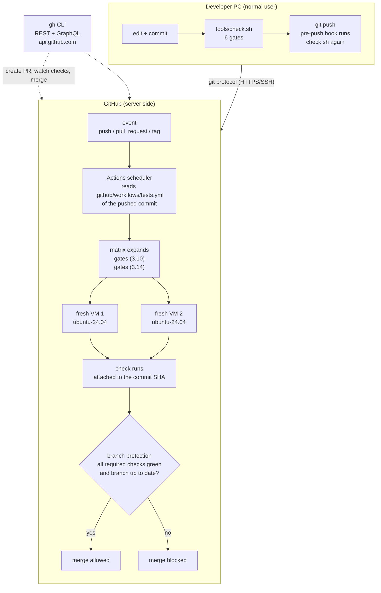
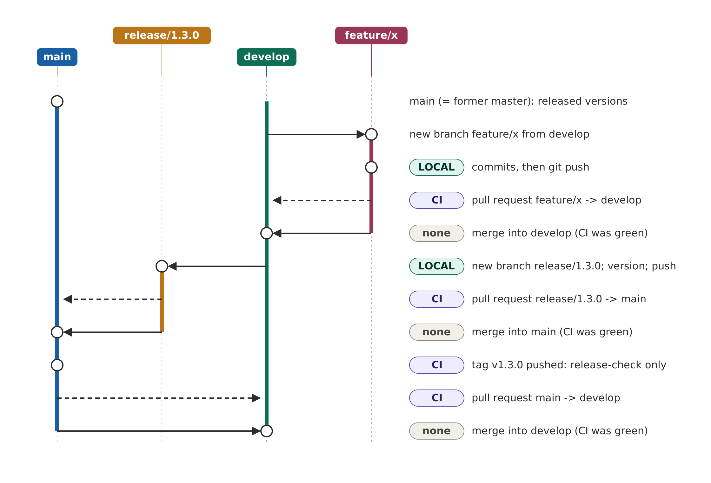
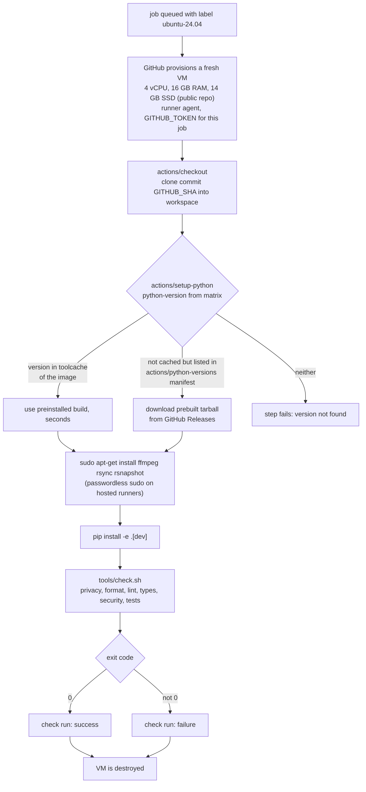
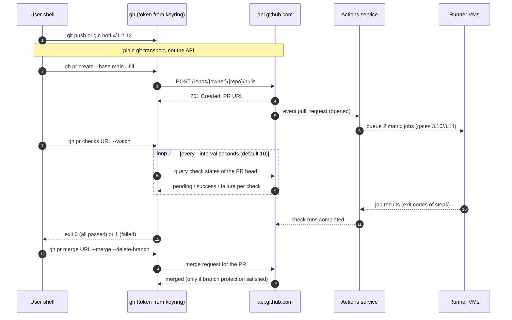

# How to read this document

This guide lives in the repository as `docs/ci-guide.md` with the PDF
next to it; it is built and checked like the other documents (section
"Building the documentation" in `docs/developer.md`), so it belongs to the
release it describes.

All commands on the developer PC run as a **normal user**. `git` changes
only the clone, `gh` acts on GitHub with the user's own token. Neither
needs `sudo`. The only place where `sudo` appears is inside the workflow
file: it runs on GitHub's virtual machine, not on the PC.

Two numbers recur everywhere and are worth fixing first:

| Term | Value in mediatools |
|---|---|
| Repository | `github.com/peddanet/mediatools`, **public** |
| Workflow file | `.github/workflows/tests.yml`, workflow name `quality-gates` |
| Gate script | `tools/check.sh` (privacy, format, lint, types, security, tests) |
| Test matrix | CPython 3.10 and 3.14 on `ubuntu-24.04` (since 1.5.1; 3.10, 3.12, 3.13, 3.14 before) |
| Required checks | `gates (3.10)`, `gates (3.14)` |

# The big picture: executed twice, not mirrored

The phrase "the local run is mirrored on the server" is imprecise. The
server never sees the local result. What happens is:

1. **Locally**, `tools/check.sh` runs before each push (pre-push hook,
   activated once with `git config core.hooksPath .githooks`). It runs in
   the PC's environment: one Python version, the locally installed tools.
   It is a **filter for the developer**, and it can be bypassed with
   `git push --no-verify`.
2. **On GitHub**, the push or the pull request is an **event**. GitHub
   reads the workflow file *from the pushed commit*, starts one fresh
   virtual machine per job, checks out exactly that commit, installs the
   tools and runs the **same** `tools/check.sh` again, once per Python
   version. The result is stored as a **check run** on the commit SHA. This
   run is **authoritative**: branch protection only accepts it.

{height=17cm}

The identity of the script is what makes the local run a good
*prediction* of the server run. Differences remain and explain the rare
"green locally, red on GitHub" case:

| Aspect | Local (pre-push) | GitHub (CI) |
|---|---|---|
| Machine | own PC, state accumulates | fresh VM per job, deleted afterwards |
| Python | the one in the local venv | 3.10 and 3.14, one VM each |
| Tools | as installed (`pip install -e ".[dev]"`) | installed anew on every run |
| Files | working tree incl. untracked files | only what is committed |
| Privileges | normal user | user `runner` with passwordless `sudo` |
| Bypass | `--no-verify` | none (rule applies to admins too) |

The "Files" row is the most frequent cause of a difference: a test that
reads an untracked local file passes locally and fails on GitHub.

# The workflow file, line by line

GitHub looks for YAML files in `.github/workflows/` of the commit that
triggered the event. The mediatools workflow (excerpt, comments removed):

~~~yaml
name: quality-gates
on:
  push:
    tags: ["v*"]
  pull_request:
    branches: [main, develop]
  workflow_dispatch:
~~~

| Key | Meaning |
|---|---|
| `name` | display name; also used by `gh workflow run quality-gates` |
| `on.push.tags` | run when a tag `v*` is pushed (release); only `release-check` runs then |
| `on.pull_request.branches` | run for a PR whose **target** is `main` or `develop`; the run tests the merge result of PR head and target |
| `workflow_dispatch` | allows a manual start: `gh workflow run quality-gates --ref BRANCH` |

No branch has a push trigger (since 1.2.13). Work branches are tested
through their pull request. A merge into `main` or `develop` produces the
tree its pull request already tested (`strict` branch protection, no direct
pushes), so a run after the merge would only repeat that test; until 1.2.12
these two extra runs per release existed and made the Actions list hard to
read. Chapter 4 shows every run per branch.

~~~yaml
jobs:
  gates:
    if: github.ref_type != 'tag'
    runs-on: ubuntu-24.04
    strategy:
      fail-fast: false
      matrix:
        python: ["3.10", "3.14"]
    steps:
      - uses: actions/checkout@v5
      - uses: actions/setup-python@v6
        with:
          python-version: ${{ matrix.python }}
          cache: pip
          cache-dependency-path: pyproject.toml
      - name: system tools
        run: sudo apt-get update && sudo apt-get install -y ffmpeg rsync rsnapshot xvfb
      - name: python tools
        run: pip install -e ".[dev]"
      - name: quality gates (format, lint, types, security, tests)
        run: tools/check.sh
~~~

| Key | Meaning |
|---|---|
| `jobs.gates` | job id; the check names become `gates (3.10)` and `gates (3.14)` (job id plus matrix value) |
| `if: github.ref_type != 'tag'` | the gates do not run for a tag push: the tagged merge commit has the tree its pull request already tested |
| `runs-on` | runner **label**: selects the machine type (chapter 5) |
| `strategy.matrix.python` | one job per list element, all started in parallel; the oldest supported and the newest version, the pre-push hook covers the PC's version in between |
| `fail-fast: false` | a failing version does not cancel the other one; default would be `true` |
| `uses:` | runs a published **action** (a versioned program from another repository); `checkout@v5` runs on Node.js 24 |
| `cache: pip` | `setup-python` keeps pip's download cache between runs, keyed on the hash of `pyproject.toml` |
| `${{ matrix.python }}` | expression; replaced by `3.10` or `3.14` in the respective job |
| `run:` | shell command on the VM (bash on Linux runners); a non-zero exit code fails the step and the job |

The second job only runs for release tags, and it is the only job of a
tag run:

~~~yaml
  release-check:
    if: startsWith(github.ref, 'refs/tags/v')
    runs-on: ubuntu-24.04
    steps:
      - uses: actions/checkout@v5
        with:
          fetch-depth: 0
      - name: tag is on main
        run: git merge-base --is-ancestor "$GITHUB_SHA" origin/main
      - name: tag matches version
        run: |
          v=$(sed -n 's/^__version__ = "\(.*\)"/\1/p' src/mediatools/__init__.py)
          test "v$v" = "$GITHUB_REF_NAME" || { echo "tag $GITHUB_REF_NAME != v$v"; exit 1; }
~~~

Until 1.5.0 the tag run repeated all gate jobs first (`needs: gates`);
since 1.5.1 it only checks the tag, which shortens every release by one
full gate run. `fetch-depth: 0` fetches the full history (default is only the one
commit), which `git merge-base` needs. `GITHUB_SHA` and `GITHUB_REF_NAME`
are environment variables that GitHub sets in every job (commit and tag
name). Tags are not covered by branch protection, therefore this job is
the guard against a tag on the wrong commit or with the wrong version.

# Branches and gate runs side by side

## `main` is the former `master`

The original git-flow model (Driessen, 2010) calls the branch with the
released versions `master`. GitHub creates new repositories with the
default branch `main` since 1 October 2020; existing repositories keep
their name. Name and role are the same: in mediatools `main` holds only
released states, each tagged `vX.Y.Z`. There is no separate `master`.

| Branch | Role | Created from | Goes into |
|---|---|---|---|
| `main` (= `master`) | released versions, each tagged | - | - |
| `develop` | integration of finished work | `main` | `main` via a release |
| `feature/x` | one piece of work | `develop` | `develop` (pull request) |
| `release/X` | version number, CHANGELOG, PDFs | `develop` | `main` (pull request) |
| `hotfix/X` | urgent fix of a release | `main` | `main` (pull request) |
| `merge/hotfix-X` | helper of `mediatools update` for the back-merge | `main` | `develop` (pull request) |

## Reading the lane diagrams

Every branch is a vertical lane; time runs downwards. A **solid arrow** is
a git operation from one branch to another (create a branch, merge). A
**dashed arrow** is a pull request: the proposal to merge, which GitHub
tests before the merge button is unlocked. The badge on the right names
the gate run of the step:

| Badge | Where | What |
|---|---|---|
| **LOCAL** | this PC, pre-push hook | `tools/check.sh` with the Python of the venv, on the working tree; can be bypassed with `--no-verify` |
| **CI** | GitHub, fresh VM per job | `tools/check.sh` with Python 3.10 and 3.14 on the committed tree (pull requests); for a tag only `release-check`; binding for branch protection |
| **none** | - | no test: the pull request tested the same tree before |

{width=100%}

{width=100%}

| Flow | LOCAL runs | CI runs on GitHub |
|---|---|---|
| feature | 1 | 1 (pull request into `develop`) |
| release | 1 | 3 (pull request into `main`, tag, pull request `main` -> `develop`) |
| hotfix (`mediatools update`) | 2 | 3, printed as `CI 1/3` ... `CI 3/3` |

## What `mediatools update` prints

Since 1.2.13 the script announces every run before it waits for it and
closes with a table of all CI runs (also when a step fails):

~~~text
--- local gates (pre-push hook): tools/check.sh on this PC with Python 3.13.x;
    GitHub starts no run for this push (hotfix/1.2.13 has no push trigger)
--- 1.2.13 CI 1/3: pull_request on hotfix/1.2.13 (commit 3f2a9c1)
    checks:  merge result of hotfix/1.2.13 and main, Python 3.10/3.14
    purpose: required check: branch protection allows the merge into main only when green
    run:     https://github.com/peddanet/mediatools/actions/runs/<id>

CI runs on GitHub:
  run              trigger                                    result     url
  1.2.13 CI 1/3    pull_request hotfix/1.2.13                 success    https://...
  1.2.13 CI 2/3    push v1.2.13                               success    https://...
  1.2.13 CI 3/3    pull_request merge/hotfix-1.2.13           success    https://...
~~~

# The runner: which machine, how much of it, who pays

## What a job gets

Each job runs on a **fresh virtual machine** that is created for the job
and deleted afterwards; nothing survives from one job or run to the next
(caches and artifacts must be stored explicitly). The machine carries a
runner agent that executes the steps, and a short-lived token
(`GITHUB_TOKEN`) valid only for this repository and this job.

{height=20cm}

| Property | Standard Linux runner, public repository |
|---|---|
| Hardware | 4 vCPU, 16 GB RAM, 14 GB SSD |
| Hardware (private repository) | 2 vCPU, 8 GB RAM, 14 GB SSD |
| Operating system | image `ubuntu-24.04` (= `ubuntu-latest`), Azure kernel |
| User / privileges | user `runner`, **passwordless sudo** |
| Preinstalled | compilers, Docker, `gh`, several Python/Node/Go versions ("toolcache") |
| Max. job duration | 6 h, then the job is terminated (adjustable down with `timeout-minutes`) |
| Max. run duration | 35 days including waiting |
| Concurrency (Free plan) | 20 jobs at a time across all repositories, 5 of them macOS |
| Matrix size | max. 256 jobs per run |

## Can one choose the machine? Can one "request resources"?

One chooses a **label**, not resources. Each label stands for a fixed
machine size and image:

| Label | Machine |
|---|---|
| `ubuntu-latest`, `ubuntu-24.04`, `ubuntu-22.04` | Linux x64 VM |
| `ubuntu-24.04-arm`, `ubuntu-22.04-arm` | Linux arm64 VM |
| `ubuntu-slim` | single-CPU **container** instead of a VM, short jobs only |
| `windows-latest`, `windows-2025`, `windows-2022` | Windows Server VM |
| `macos-latest`, `macos-15`, `macos-26` ... | macOS VM (Apple silicon) |
| custom name | **larger runner** (more vCPU/RAM, GPU), configured in the account, **always billed** |
| `self-hosted` + own labels | own machine with the runner agent installed |

There is no key like "give me 8 GB for this step". More resources mean a
different label: a larger runner (paid, Team/Enterprise plans) or an own
machine (self-hosted). `runs-on` may itself use the matrix
(`runs-on: ${{ matrix.os }}`), so one workflow can test Linux, Windows and
macOS in one run.

Image contents change weekly; GitHub announces removals in advance in the
`actions/runner-images` repository. The exact image version of a run is
printed in the "Set up job" section of its log.

## Cost

| Repository | Standard runners | Larger runners |
|---|---|---|
| **public** (mediatools) | free, no minute limit | billed |
| private, Free plan | 2,000 min/month included, 500 MB artifact storage | billed |
| self-hosted (any) | free (own hardware and electricity) | - |

For mediatools one run of the matrix costs nothing. The only practical
limit is the concurrency of 20 jobs and the 6 h per job.

# Python versions

## How a version gets onto the VM

`actions/setup-python` resolves the requested version in this order:

1. **Toolcache** of the image: a few recent CPython versions (and PyPy)
   are preinstalled; using one takes seconds.
2. **Manifest download**: if the version is not preinstalled but is listed
   in `versions-manifest.json` of the repository `actions/python-versions`,
   a prebuilt archive is downloaded from GitHub Releases and installed.
3. Otherwise the step fails with "version not found".

The action then puts this Python first in `PATH`, so `python` and `pip` in
all following steps are that version.

## Which versions can be written into the matrix

| Syntax in `python-version` | Effect |
|---|---|
| `"3.13"` | newest available 3.13.x |
| `"3.13.9"` | exactly this patch release (if in the manifest) |
| `"3.x"` | newest stable 3.x |
| `">=3.10 <3.14"` | SemVer range, newest match |
| `"3.15"` + `allow-prereleases: true` | alpha/beta/rc, if the final is not yet out |
| `"3.13t"` | free-threaded build (no GIL), 3.13 and later |
| `"pypy3.10"` | PyPy implementation |
| `"graalpy-24.1"` | GraalPy implementation |
| `python-version-file: .python-version` | read the version from a file in the repository |

Version strings must be **quoted**: unquoted `3.10` is the YAML number
3.1. Every value in the list creates one more job; adding a version costs
one more VM per run, which is free for a public repository.

Not possible: an arbitrary version that is in neither the toolcache nor
the manifest (very old releases, own builds). For those there are two
ways: build/install it in a step yourself (slow), or run the job in a
container image that contains it (chapter 7).

## The matrix of mediatools

**Python 3.10 reached its end of life in October 2026** (final release
3.10.22 on 2026-10-01). GitHub removes end-of-life versions from the
images with advance notice (Python 3.9 was removed on 2026-01-12) and
announces a removal from the manifest about six months ahead. 3.10 will
therefore work for some time, but not indefinitely.

Since 1.5.1 the matrix is 3.10 and 3.14 (from 1.2.13 to 1.5.0 it was
3.10, 3.12, 3.13, 3.14); the action is `actions/setup-python@v6`. The
oldest and the newest supported version catch most version-dependent
errors; the pre-push hook adds the version of the developer PC. 3.10
stays as long as `requires-python = ">=3.10"` must hold for a target
system (Ubuntu 22.04 ships 3.10 as system Python). The required checks of
the branch protection are `gates (3.10)` and `gates (3.14)` (chapter 9).

# Docker containers

Containers can be used in three ways; all three require a **Linux**
runner (on GitHub-hosted runners: Ubuntu).

## The whole job in a container: `jobs.<id>.container`

~~~yaml
jobs:
  gates-container:
    runs-on: ubuntu-24.04          # the VM only serves as Docker host
    container:
      image: python:3.13-slim      # any image from Docker Hub or ghcr.io
    steps:
      - uses: actions/checkout@v4
      - run: apt-get update && apt-get install -y ffmpeg rsync rsnapshot
      - run: pip install -e ".[dev]" && tools/check.sh
~~~

All `run:` steps then execute **inside** the image. Consequences:

* No `setup-python`: the Python of the image is used. This is the way to
  test a version or distribution that the manifest does not provide, e.g.
  exactly the Debian or Ubuntu release of a target machine
  (`image: ubuntu:22.04`, `debian:13`).
* Commands run as the image's default user, usually root; `apt-get` works
  without `sudo` (which is mostly not even installed).
* The default shell is `sh`, not `bash`; `tools/check.sh` is unaffected
  because of its own shebang line, inline `run:` scripts with bash syntax
  need `shell: bash` (and bash in the image).
* The image is pulled on every run; large images cost time.

## Additional containers beside the job: `services`

`services:` starts further containers (database, cache, mail server) for
the duration of the job, for integration tests. A job in a container
reaches a service by its label as host name; a job directly on the VM
reaches it via `localhost` and a mapped port. mediatools needs none.

## Docker inside steps

Docker is preinstalled on the Ubuntu images, so a step may simply call
`docker build` or `docker run`. This is the usual way to build and push
images of an own project.

## Choice for mediatools

`setup-python` on the VM is the faster and simpler variant for "does the
code work with Python 3.x". A container job is worth it only for the
question "does it work on exactly distribution X with its packaged
ffmpeg". Both can coexist in one workflow as separate jobs.

# The `gh` tool and the GitHub API

## Two different channels

| Channel | Used by | Carries |
|---|---|---|
| git protocol (HTTPS or SSH) | `git push`, `git fetch` | commits, branches, tags |
| GitHub API (`https://api.github.com`) | `gh`, the web UI, actions | everything else: PRs, checks, runs, settings |

`git push` does not use the API; it only transports objects. Everything
GitHub-specific (pull requests, checks, branch protection, workflow
runs) exists only in the API. `gh` is a client for that API.

## REST and GraphQL

GitHub offers two API styles:

* **REST (v3)**: one URL per resource, HTTP verbs for actions, e.g.
  `GET /repos/{owner}/{repo}/pulls`,
  `PUT /repos/{owner}/{repo}/branches/{branch}/protection`.
* **GraphQL (v4)**: one URL `POST /graphql`; the request contains a query
  that names exactly the fields wanted, several objects in one call.

The `gh` subcommands (`gh pr`, `gh run`, ...) use whichever fits
internally. `gh api` gives direct access to both: an endpoint path means
REST, the word `graphql` means GraphQL.

~~~bash
# REST: list the last three workflow runs (normal user)
gh api 'repos/{owner}/{repo}/actions/runs?per_page=3' \
       --jq '.workflow_runs[] | [.name, .head_branch, .conclusion] | @tsv'

# GraphQL: names of the last three releases
gh api graphql -F owner='{owner}' -F name='{repo}' -f query='
  query($owner:String!, $name:String!) {
    repository(owner:$owner, name:$name) {
      releases(last:3) { nodes { tagName } } } }'
~~~

| Option | Meaning |
|---|---|
| `{owner}`, `{repo}`, `{branch}` | placeholders, filled from the clone in the current directory |
| `-X, --method` | HTTP method, default `GET` (`POST` as soon as fields are given) |
| `-f key=value` | string field |
| `-F key=value` | typed field (numbers, `true`, `@file` reads a file) |
| `--input file` | request body from a file, `-` = standard input |
| `--jq expr` | filter the JSON answer with jq syntax |
| `--paginate` | fetch all pages of a long result |
| `-i, --include` | print HTTP status and headers |
| `--verbose` | print the full request and response |

## Authentication

`gh auth login` (normal user, once per machine) runs a browser flow and
obtains an OAuth token. The token is stored in the **system credential
store**; on Linux that is the Secret Service (GNOME Keyring, KWallet),
whose files live in the user's home directory. Only if no credential store
is available does `gh` fall back to a plain text entry in
`~/.config/gh/hosts.yml`; the option `--insecure-storage` forces that.
This matters for the rule "passwords only inside the encrypted home": the
keyring variant complies; check with

~~~bash
gh auth status           # shows account, scopes and where the token is stored
~~~

If the environment variable `GH_TOKEN` (or `GITHUB_TOKEN`) is set, `gh`
uses it instead of the stored token. Inside a workflow this is the way to
use `gh`: `env: GH_TOKEN: ${{ github.token }}`.

Every API call carries the token in the `Authorization` header over HTTPS.
GitHub checks the token's permissions on the repository; branch
protection is enforced by the server, so no client (web, `gh`, `curl`)
can bypass it.

## The calls made by `apply-release.sh`

| Command | What it does via the API |
|---|---|
| `gh pr list --head hotfix/X --base main --state open --json url` | look for an already open PR (makes the script re-runnable) |
| `gh pr create --base main --title "Hotfix X" --fill` | create the PR; this **event** starts the matrix |
| `gh run list ... --commit SHA` / `gh run view ID` | find the run of the pushed commit, its URL and its state |
| `gh pr checks URL --watch` | poll the check state every 10 s until all are done |
| `gh pr merge URL --merge --delete-branch` | merge commit into `main`, delete the remote branch; refused if protection is not satisfied |
| `gh run list --branch vX --event push --limit 1 --json databaseId` | find the run started by the tag push |
| `gh run watch ID --exit-status` | follow that run; non-zero exit status if it fails |

{width=100%}

Exit codes of `gh pr checks`: 0 all checks passed, 1 at least one
failed, 8 checks still pending (without `--watch`).

A short network loss must not stop an update half way. Since 1.2.14 the
script therefore treats the calls in two groups. **Reading calls**
(`gh run list`, `gh run view`, `gh pr list`) are repeated up to five times,
10 s apart (`gh_read`). **Watching** (`gh pr checks --watch`,
`gh run watch`) ends with a non-zero code both for a red run and for a
lost connection; the script then asks GitHub for the state of the run:
`completed success` continues, `completed` with any other result stops
the update, anything else (still queued or running) resumes watching, at
most five times. Calls that change something (`gh pr create`,
`gh pr merge`) are not repeated blindly; after a failure the whole update
is started again, which is safe because every step can be repeated (an
open PR is reused, the hotfix branch is rebuilt).

Useful options of `gh pr checks`: `--fail-fast` (stop watching
at the first failure), `--required` (only required checks),
`--interval N`.

\needspace{20\baselineskip}

# Branch protection and status checks

Branch protection is a server-side rule per branch, set once with a REST
call (normal user, repository owner):

~~~bash
gh api -X PUT "repos/peddanet/mediatools/branches/main/protection" --input - <<'EOF'
{ "required_status_checks": { "strict": true,
    "contexts": ["gates (3.10)", "gates (3.14)"] },
  "enforce_admins": true,
  "required_pull_request_reviews": { "required_approving_review_count": 0 },
  "restrictions": null, "allow_force_pushes": false, "allow_deletions": false }
EOF
~~~

| Field | Effect |
|---|---|
| `contexts` | names of the checks that must succeed; they must match the job names exactly |
| `strict: true` | the PR branch must be **up to date** with the target before merging; otherwise it must be updated and tested again |
| `enforce_admins: true` | the owner is bound too |
| `required_pull_request_reviews` | changes only through a PR; 0 approvals because there is a single maintainer |
| `allow_force_pushes` / `allow_deletions` | history of `main`/`develop` cannot be rewritten or deleted |

Consequences: a check name that is no longer produced (e.g. after
removing 3.10 from the matrix) blocks every merge until the rule is
updated; a new matrix entry is not required until it is added to
`contexts`. Job names should be unique across all workflows, otherwise the
check result is ambiguous.

# Self-hosted runners and Forgejo

A **self-hosted runner** is the GitHub runner agent installed on an own
machine; jobs select it with `runs-on: [self-hosted, linux, ...]`. It is
free of charge, has the hardware one provides and keeps its state
between jobs (no fresh VM; cleaning up is the owner's job). For a public
repository it is a security risk: a pull request from a stranger can
execute code on that machine. For mediatools it is not recommended.

**Forgejo Actions** (local server) uses a very similar YAML syntax. It
reads workflows from `.forgejo/workflows/`; if that directory does not
exist, it falls back to `.github/workflows/`. The Forgejo server does not
run jobs itself: a separately installed **Forgejo Runner** fetches and
executes them. There, a `runs-on` label maps to a container image (e.g.
`docker://node:20-bookworm`), i.e. every job is a container job in the
sense of chapter 7. Forgejo states that its Actions are designed to be
familiar to GitHub users but not to be compatible; workflows have to be
tested there before they are relied on.

\needspace{18\baselineskip}

# Cheat sheet

\needspace{14\baselineskip}

All commands run as a normal user in the clone.

~~~bash
gh run list --limit 5                          # last runs of the repository
gh run view RUN_ID                             # jobs and their result
gh run view RUN_ID --log-failed                # only the logs of failed steps
gh run rerun RUN_ID --failed                   # rerun only failed jobs
gh run watch RUN_ID --exit-status              # follow a running run
gh workflow run quality-gates --ref BRANCH     # start manually (workflow_dispatch)
gh pr checks --watch --fail-fast               # checks of the PR of the current branch
gh api repos/{owner}/{repo}/branches/main/protection --jq .required_status_checks
gh auth status                                 # who am I, where is the token
~~~

# Glossary

Action
:   Reusable program referenced with `uses:` (e.g. `actions/checkout@v4`);
    the part after `@` is a tag or commit of the action's repository.
    [Docs](https://docs.github.com/en/actions/concepts/workflows-and-actions/custom-actions)

Branch protection
:   Server-side rule that restricts pushes and merges on a branch.
    [Docs](https://docs.github.com/en/repositories/configuring-branches-and-merges-in-your-repository/managing-protected-branches/about-protected-branches)

Check run
:   Result of one job, attached to a commit SHA; shown in the PR and
    evaluated by branch protection.

Event
:   Occurrence that starts workflows (`push`, `pull_request`,
    `workflow_dispatch`, ...).
    [Docs](https://docs.github.com/en/actions/reference/workflows-and-actions/events-that-trigger-workflows)

GITHUB_TOKEN
:   Token created per job, valid for the repository only, expires at the
    end of the job.
    [Docs](https://docs.github.com/en/actions/tutorials/authenticate-with-github_token)

GraphQL
:   Query language of GitHub API v4; one endpoint, client names the
    fields. [Docs](https://docs.github.com/en/graphql)

Job
:   Unit of work on one runner; jobs of a run execute in parallel unless
    linked by `needs`.

Label
:   Name in `runs-on` that selects a runner type.
    [Docs](https://docs.github.com/en/actions/reference/runners/github-hosted-runners)

Larger runner
:   GitHub-hosted runner with more resources than standard; always billed.

main
:   Branch with the released versions; the same as `master` in older
    git-flow texts (GitHub default name since 2020-10-01).
    [Changelog](https://github.blog/changelog/2020-08-26-set-the-default-branch-for-newly-created-repositories/)

Matrix
:   Expansion of one job definition into several jobs, one per value
    combination.
    [Docs](https://docs.github.com/en/actions/how-tos/write-workflows/choose-what-workflows-do/run-job-variations)

Pull request
:   Request to merge one branch into another; GitHub tests the merge result
    before the merge is allowed.
    [Docs](https://docs.github.com/en/pull-requests/collaborating-with-pull-requests/proposing-changes-to-your-work-with-pull-requests/about-pull-requests)

REST
:   Resource-oriented GitHub API v3.
    [Docs](https://docs.github.com/en/rest)

Run
:   One execution of a workflow, triggered by one event.

Runner
:   Machine with the runner agent that executes a job; GitHub-hosted or
    self-hosted.

Service container
:   Additional container started beside a job (`services:`).
    [Docs](https://docs.github.com/en/actions/tutorials/use-containerized-services/use-docker-service-containers)

Toolcache
:   Directory of preinstalled tool versions on the runner image, used by
    the `setup-*` actions.

Workflow
:   YAML file in `.github/workflows/` that defines events and jobs.
    [Docs](https://docs.github.com/en/actions/reference/workflows-and-actions/workflow-syntax)

# Sources

* actions/checkout, release v5.0.0 (runtime Node.js 24; removes the
  "Node.js 20 is deprecated" annotation of v4):
  <https://github.com/actions/checkout/releases/tag/v5.0.0>
* actions/setup-python, README, *Caching packages dependencies* (`cache: pip`,
  `cache-dependency-path`, `pyproject.toml` as dependency file):
  <https://github.com/actions/setup-python#caching-packages-dependencies>
* GitHub Docs, *GitHub-hosted runners reference* (labels, hardware,
  fresh VM per job, sudo):
  <https://docs.github.com/en/actions/reference/runners/github-hosted-runners>
* GitHub changelog 2020-08-26, *Set the default branch for newly-created
  repositories* (`master` -> `main` from 2020-10-01):
  <https://github.blog/changelog/2020-08-26-set-the-default-branch-for-newly-created-repositories/>
* GitHub Docs, *Actions limits* (6 h per job, 35 days per run, 256 matrix
  jobs, concurrency per plan):
  <https://docs.github.com/en/actions/reference/limits>
* GitHub Docs, *Usage limits, billing and administration* (free for
  public repositories and self-hosted runners):
  <https://docs.github.com/en/actions/reference/usage-limits-billing-and-administration>
* GitHub Docs, *About billing for GitHub Actions* (included minutes,
  larger runners billed):
  <https://docs.github.com/en/billing/managing-billing-for-github-actions/about-billing-for-github-actions>
* GitHub Docs, *Running variations of jobs* (matrix, fail-fast,
  max-parallel, include/exclude):
  <https://docs.github.com/en/actions/how-tos/write-workflows/choose-what-workflows-do/run-job-variations>
* GitHub Docs, *Running jobs in a container*:
  <https://docs.github.com/en/actions/how-tos/write-workflows/choose-where-workflows-run/run-jobs-in-a-container>
* GitHub Docs, *Creating PostgreSQL service containers* (Linux only,
  networking of service containers):
  <https://docs.github.com/en/actions/tutorials/use-containerized-services/create-postgresql-service-containers>
* GitHub Docs, *Use GITHUB_TOKEN for authentication in workflows*:
  <https://docs.github.com/en/actions/tutorials/authenticate-with-github_token>
* GitHub Docs, *About protected branches* (strict/loose checks, unique
  job names):
  <https://docs.github.com/en/repositories/configuring-branches-and-merges-in-your-repository/managing-protected-branches/about-protected-branches>
* actions/setup-python, README and advanced usage (version syntax,
  free-threaded, PyPy, GraalPy, version file):
  <https://github.com/actions/setup-python>
* actions/python-versions (manifest of downloadable builds, removal
  notice six months ahead):
  <https://github.com/actions/python-versions>
* actions/runner-images (image contents, announcements; issue #13468
  removal of Python 3.9 on 2026-01-12):
  <https://github.com/actions/runner-images>,
  <https://github.com/actions/runner-images/issues/13468>
* Python Developer's Guide, *Status of Python versions* (3.10 end of life
  October 2026): <https://devguide.python.org/versions/>
* GitHub CLI manual, `gh api`, `gh auth login`, `gh pr checks`:
  <https://cli.github.com/manual/gh_api>,
  <https://cli.github.com/manual/gh_auth_login>,
  <https://cli.github.com/manual/gh_pr_checks>;
  local help texts of `gh` 2.89.0 (flags and exit codes verified
  2026-11-10)
* cli/cli pull request #7023 (token moved from `hosts.yml` to the system
  keyring): <https://github.com/cli/cli/pull/7023>
* Forgejo documentation, *Forgejo Actions user guide* (runner required,
  fallback to `.github/workflows`, not designed to be compatible):
  <https://forgejo.org/docs/latest/user/actions/overview/>
