# Purpose and audience

The user handbook (`docs/handbook.md`) explains *how to use* mediatools.
This document explains *how it is built*: which class does what, how the
classes interact at run time, which files they read and write, and which
rules every change has to follow.

# Repository layout

~~~text
mediatools/
  README.md                 project page (GitHub)
  CHANGELOG.md              release history
  CONTRIBUTING.md           rules for contributions
  LICENSE                   MIT
  pyproject.toml            packaging, pytest and pylint configuration
  install.sh                installs a release tag into a venv (~/.local/bin/mediatools)
  .github/workflows/        CI: one step per gate (tools/check.sh --only) on Python 3.12 and 3.14
  .githooks/pre-push        runs tools/check.sh before every branch push
  src/mediatools/           package (one class per module)
  src/mediatools/gui/       Tk window (mediatools gui)
  tests/                    pytest suite
  tools/check.sh            quality gates (activates the development venv itself)
  tools/release.sh          integration and releases, one CI run each (git-flow)
  tools/same-code.sh        bit-identity check of branches and tags (tree hashes)
  tools/review.sh           four-eyes review of two refs in Beyond Compare
  tools/output.sh           shared console look (title, stage, PASS/FAIL/SKIP, bar)
  tools/pytest_progress.py  progress bar and slowest tests of pytest (loaded by conftest)
  tools/after-install.sh    called by release.sh after install.sh: reload, status
  tools/gen_docs.py         UML class diagrams + API reference from the code
  docs/handbook.md          user handbook (+ PDF)
  docs/developer.md         this document (+ PDF)
  docs/api.md               generated API reference
  docs/img/                 Mermaid sources (*.mmd) and rendered PNG
~~~

# Coding standard

## Rules

1. **One class per module.** The module name describes the class
   (`shrink/database.py` contains `ShrinkDatabase`).
2. **Google-style docstrings** on every module, class, method and function,
   including private ones: summary line, `Args:`, `Returns:` or `Yields:`,
   `Raises:` where applicable; classes list their instance variables in
   `Attributes:`.
3. **Comments** explain *why* a block exists wherever this is not obvious
   from the code (e.g. "writes into the existing inode", "in-place
   assignment prunes the walk").
4. **pylint 10.00/10** for `src`, `tests` and `tools`; maximum line length
   100. The configuration lives in `pyproject.toml`.
5. **Standard library only.** External programs (ffmpeg, ffprobe, rsync,
   gio, players) are called with argument lists, never through a shell.
6. **Dependency injection.** Logger, prompt, probe, player, remover and
   file-system helpers are constructor arguments, so tests can replace them.
7. **Plan before action** for numerous or irreversible changes: analyse,
   summarise, confirm, execute.

## Docstring example

~~~python
def name(self, parts: list[str]) -> tuple[str, int] | None:
    """Build the flat name for a relative path.

    Args:
        parts: Path components below the unit; the last element is the
            file name.

    Returns:
        ``(flat_name, level)``, or None if no level fits the limit.
    """
~~~

## pylint configuration

~~~toml
[tool.pylint.main]
load-plugins = ["pylint.extensions.docparams", "pylint.extensions.docstyle"]

[tool.pylint.format]
max-line-length = 100

[tool.pylint.parameter_documentation]
default-docstring-type = "google"
accept-no-param-doc = false
accept-no-raise-doc = false
accept-no-return-doc = false
accept-no-yields-doc = false

[tool.pylint.design]
max-args = 10                 # collaborators are injected (testability)
max-positional-arguments = 10
max-attributes = 12
max-locals = 22
min-public-methods = 1
~~~

The design limits are raised deliberately: constructors receive their
collaborators as arguments instead of creating them, which costs arguments
but makes every class testable in isolation. The only remaining inline
suppression is `consider-using-with` for the long-lived player processes in
`PlayerSession.open`, which must outlive the method.

# Architecture

## Layers

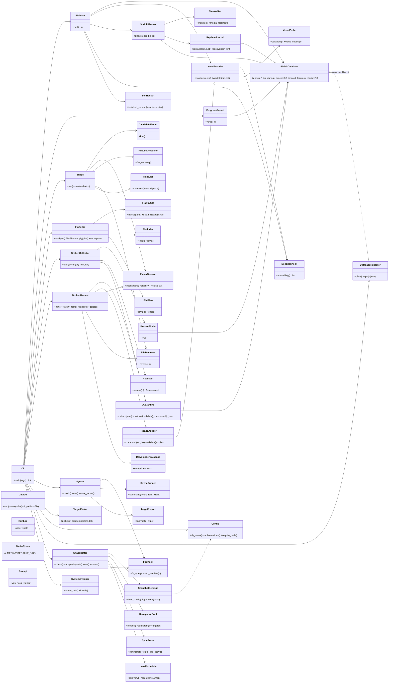{width=58%}

| Layer | Package | May import |
|---|---|---|
| interface | `mediatools.cli` (`Cli`) | all packages |
| window | `gui` | `core`, `shrink` (space totals), the parser of `cli` |
| features | `shrink`, `triage`, `broken`, `flatten`, `sync`, `snapshot` | `core`; `snapshot` also `sync.fscheck`; `broken` also `shrink` (database, encoder) and `triage` (player, remover) |
| foundation | `core` | standard library only |

The feature packages do not import each other, with two exceptions:
`snapshot` reuses `sync.FsCheck` (file-system type, free space, nesting),
and `broken` builds on the shrink database and encoder (`ShrinkDatabase`,
`HevcEncoder`) and on the player and remover of triage (`PlayerSession`,
`FileRemover`) instead of duplicating them; nothing imports `broken`
except `cli`.
Shared knowledge -- reserved directory names, media extensions, data
directory, configuration -- lives in `core`.
`triage` cooperates with `flatten` only through the file system (inodes in
`_flat`), not through imports.

## Package `core`

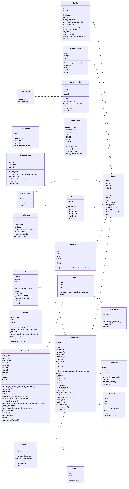{width=58% height=19cm}

| Class | Responsibility |
|---|---|
| `MediaTypes` | extensions, `_flat` / `newShrinkedFiles` names, `SKIP_DIRS` |
| `Config` | local INI file: collection root, database name, abbreviations, snapshot settings; error messages name key and expected format |
| `DataDir` | folders: XDG layout (config, state, data, cache; since 1.5.0, cache since 1.14.0), one folder from `$MEDIATOOLS_HOME`, or the old `~/scripts/mediatools.d` while it still holds data; `sub()` puts `plans`/`releases` into the data folder, the rest into the state folder; `cache_file()` returns a cache path and moves an old copy from `state/` once |
| `DataMigration` | `mediatools where --migrate`: moves the old folder's data into the XDG folders; refuses while another mediatools process runs or a target exists; leaves `WHERE-IS-THE-DATA.txt` |
| `PlacesReport` | `mediatools where`: every folder and file location with the layout in use |
| `PrivacyLists` | `mediatools privacy`: paths and sizes of the deny/allow list, `--edit` in `$EDITOR`, creates them with modes 700/600 |
| `RunLog` | logger to terminal and time-stamped file |
| `MediaProbe` | ffprobe: duration, codec, video stream |
| `SelfRestart` | switch of a running shrink to the installed release: `--version` probe, command line (`--foreground -y --continue-log`), `os.execv` (same PID) |
| `DecodeCheck` | `verify()`: full decode of an output, any error line or timeout = failure; `unusable()`: trial decode of the first 10 s (`ffmpeg -t 10 -i FILE -f null -`); 10 or more error lines = data not decodable; no verdict if ffmpeg is missing or times out |
| `DurationCache` | ffprobe durations keyed by path, size and mtime (shared by triage and shrink) |
| `ProgressBar` | two-line terminal display (run and current file), pending stop, status file for `attach` |
| `RunStatus` | `mediatools status`: running release from the last version line of the job's log, installed release, advice (up to date / reload / restart), pending requests |
| `RunControl` | PID/stop/restart/status files of a running job, refuses a second live job of the same name, hands its registration over on a release switch, background mode (fork, `setsid`), sleep lock in the working process |
| `AttachView` | `mediatools attach`: log backlog, new lines, progress lines; Ctrl+C leaves the view |
| `SleepInhibitor` | systemd sleep/idle inhibitor lock for the lifetime of a job |
| `TreeWalker` | sorted `os.walk` that never enters reserved/hidden dirs |
| `Prompt` | yes/no and text questions, `--yes` support |

## Package `shrink`

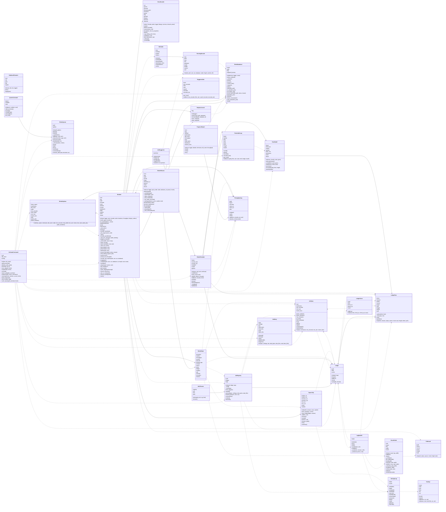{width=95% height=19cm}

| Class | Responsibility |
|---|---|
| `ShrinkDatabase` | database per directory (name configurable), matching by file name, schema migration, UPSERT |
| `DatabaseRenamer` | one-time renaming of databases and their backups, never overwrites |
| `HevcEncoder` | ffmpeg in its own process group, progress, abort, validation of exit code, size (at least 2 % of the input), stream, duration and full decode of the output (`DecodeCheck.verify`); message file kept on failure |
| `ShrinkPotential`, `PotentialGroup` | estimate of the remaining potential by level, playing time and bit rate; output share per bit-rate class from the ledger (since 1.9.0, levels since 1.11.0) |
| `HevcEncoder` stream handling | `-map 0 -c copy -c:V libx265`: only video streams that are not cover pictures are re-encoded; `lost_streams()` compares `MediaProbe.stream_counts()` of input and output (since 1.12.0; `RepairEncoder.KEEP_STREAMS = False`) |
| `TimeModel` | encoding time `took = a + b_q x length` fitted on the ledger (shared fixed part, one slope per bit-rate class, closed-form least squares); the fixed part counts as measured only with at least 20 videos shorter than 5 min, otherwise times are a range (since 1.11.1) |
| `ShrinkQueue`, `QueueCommand` | the shrink queue (`<state>/shrink_queue.json`, mode 600) and the command `queue`; `ShrinkQueue.continue_after()` replaces the process of a normally ended shrink job by the next queued job (`os.execv`), like a release switch (since 1.13.0) |
| `JobSuggester`, `SuggestedJob` | concrete jobs (level, `--min-seconds`) from the groups of an estimate, greedy by GiB per hour (since 1.13.0) |
| `EstimateCommand` | the read-only command `estimate`: levels `L1` ... `Ln` (`--up`, `--up-to`) planned in one walk of the outermost folder, one name per inode, combined probing via `ShrinkPlanner.prefetch_both` and `MediaProbe.duration_and_codec` (since 1.9.0, levels since 1.11.0) |
| `ShrinkPlanner` | planning phase: recovery, leftovers, database and failure rows, regrown originals (larger than recorded, not HEVC: planned again), minimum duration, HEVC set-aside, order |
| `ReplaceJournal` | crash-safe in-place copy-back with marker file, recovery after a crash |
| `Shrinker` | per-file decision (HEVC, trial decode, encode), serial or parallel encodes (`--jobs`), ledger and job registry, failure rows, kept ffmpeg messages, two-stage Ctrl+C, stop request via `RunControl`, summary |
| `ProgressReport` | read-only done/changed/todo lists, orphan rows, time estimate |
| `ShrinkOptions` | settings of a run (order, minimum duration and size, date filter, parallel encodes, review mode, DB name) |
| `JobSpec` | the set of a job: root and filters; key, options, membership of a ledger row |
| `Ledger`, `LedgerRow`, `LedgerSums` | append-only `ledger.tsv`, one row per finished video; sums per job, session, total |
| `LogBackfill` | rebuilds ledger rows from the result tables of old shrink logs (wrapped paths, MB sizes) |
| `JobRegistry`, `JobEntry` | remembered jobs in `state/jobs.json`: settings, remainder, progress; jobs of old logs taken in once |
| `JobChooser` | selection of an earlier job for a plain `mediatools shrink` |
| `SlotTable`, `RunningEncode` | bookkeeping of parallel encodes: free slots, running futures, inodes, folders |
| `ThroughputLog` | measured encoding speed and size ratio for estimates |
| `SpaceTally` | read, written and freed space of the session and in total (space line), from the ledger or the logs |
| `SavingsLog`, `Savings` | freed space per session, per day and in total, read from the result tables of the shrink logs (`mediatools savings`) |
| `ShrinkState` | typed collection of the run helpers (caches, throughput, result table, trial decode) |
| `FileResult` | outcome of one video (status, sizes, times) |
| `ResultTable` | framed per-file result table: terminal, log, `reports/shrink_results_<ts>.txt` |

## Package `triage`

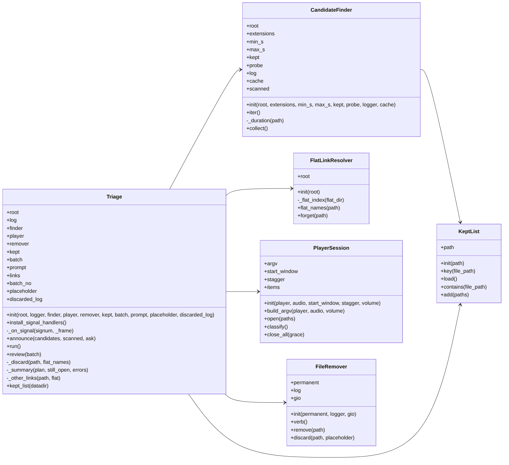{width=95% height=19cm}

| Class | Responsibility |
|---|---|
| `CandidateFinder` | search of videos within a duration range; `collect()` counts first |
| `PlayerSession` | one player process per video, classification |
| `FlatLinkResolver` | `_flat` names of a file by inode |
| `FileRemover` | `gio trash` or permanent deletion; `discard()` leaves a 0-byte placeholder |
| `KeptList` | decisions across sessions |
| `Triage` | batch workflow |

## Package `broken`

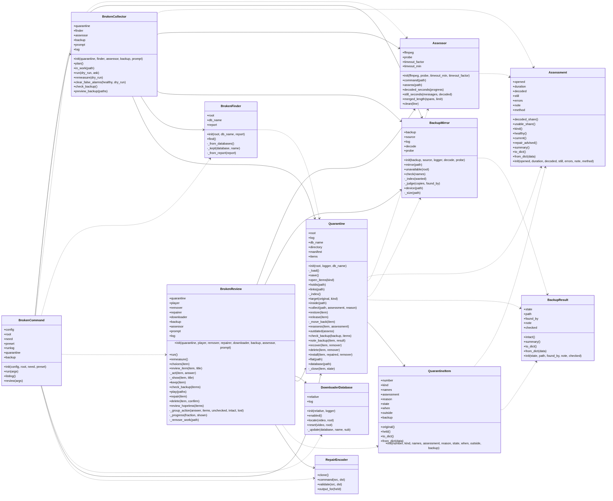{width=95% height=19cm}

| Class | Responsibility |
|---|---|
| `BrokenFinder` | videos recorded as `BROKEN` (not kept after a review) and videos of a report file |
| `Assessor` | one full decode with `freezedetect` and `blackdetect`: decoded seconds, still seconds (merged intervals), error lines |
| `Assessment` | measurement and class (hopeless / promising), usable share, repair advice |
| `Quarantine`, `QuarantineItem` | `_broken/<class>/<relative path>`, all hard link names, manifest (JSON Lines, mode 600), restore, release, re-measure, backup result, recover, delete, install of a repair |
| `BackupMirror`, `BackupResult` | backup disk as mirror of the home: availability (exists, other file system, mirror of the root present), same path first, then search by name in the whole backup; a copy counts only after a full decode without errors |
| `QuarantineSet` | the `_broken` of the given path plus every `_broken` with a manifest below it; new finds go to the first (since 1.8.0) |
| `AssessmentStore` | stored measurements in `<state>/state/assessments.json` (size, modification time, method); reused while unchanged, `--recheck` measures again (since 1.8.0) |
| `BrokenCollector` | find, measure (stored or new), list, confirm, move, check the backup where needed; removes the entries of false alarms; re-measures videos measured by 1.7.0 and reports every result; leaves videos with output in the work folder alone |
| `BrokenCommand` | the command: collect, backup check, review (terminal or GUI), listing |
| `RepairEncoder` | `HevcEncoder` with error-tolerant input; output must decode without errors, length and size are not compared |
| `DownloaderDatabase` | marks a deleted video as not downloaded in a downloader's SQLite table `medias` |
| `BrokenReview` | dialogue (terminal or GUI): promising first (play, check backup, recover, repair, keep, delete - repair and delete only after a backup check without intact copy), then the hopeless group |

**Questions in the GUI.** `Prompt.choose`, `yes_no` and `pause` print,
when `MEDIATOOLS_GUI=1` (set by `JobRunner`), one line
`@@mediatools-choice {json}` before the question: question, choices
(`[answer, label]`), default. `ConsoleView.take_questions` hides that line
(also when it arrives in pieces) and opens a `ChoiceDialog` with one button
per answer; a click sends the answer like typed input. At the end of input
`choose` returns the given end answer (e.g. quit), so a closed input never
loops.

## Package `flatten`

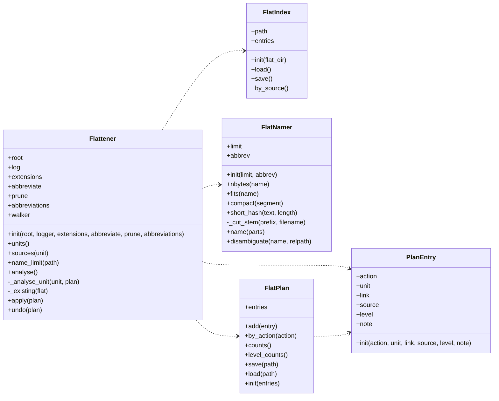{width=95% height=19cm}

| Class | Responsibility |
|---|---|
| `FlatNamer` | names within the byte limit, levels 0..3, disambiguation |
| `FlatIndex` | `_flat/_index.tsv`, atomic save |
| `PlanEntry` | one planned or executed flatten action |
| `FlatPlan` | actions, counts, TSV persistence |
| `Flattener` | discovery, analysis, apply, undo |

## Package `sync`

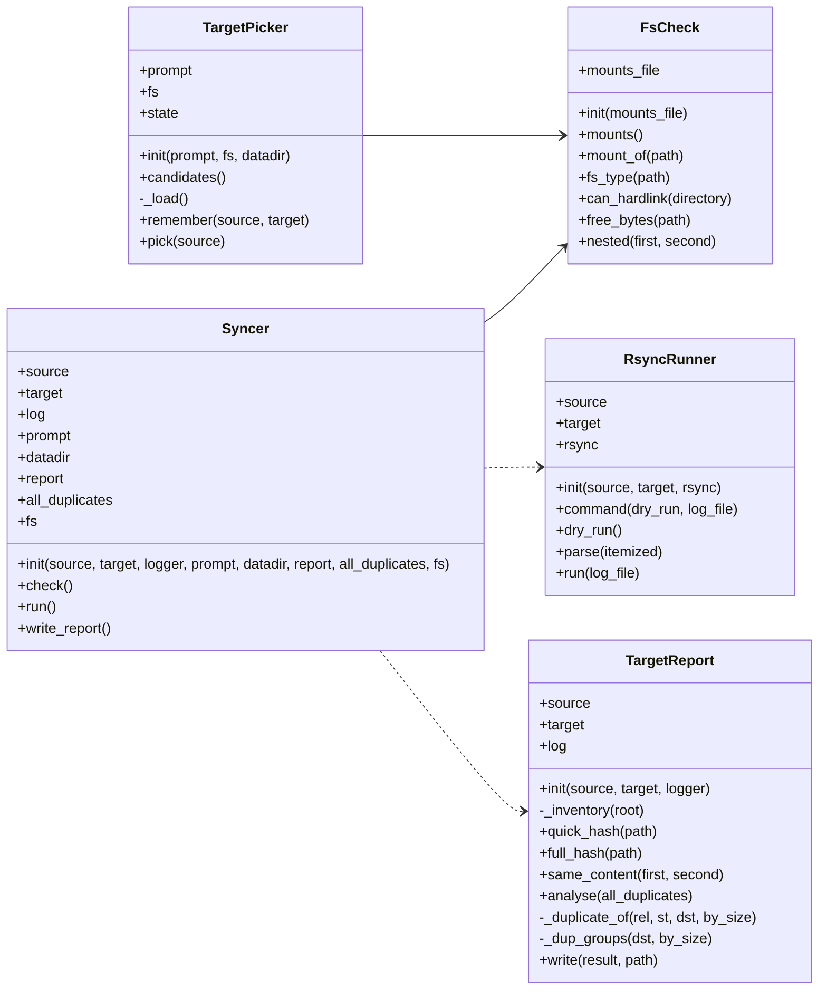{width=95% height=19cm}

| Class | Responsibility |
|---|---|
| `FsCheck` | mount table, fs type, practical hard-link test, nesting |
| `TargetPicker` | interactive disk choice, remembered per source |
| `RsyncRunner` | rsync command, dry-run parsing, real run |
| `TargetReport` | target-only files, duplicate detection by hash |
| `Syncer` | checks, dry run, confirmation, transfer, report |

## Package `snapshot`

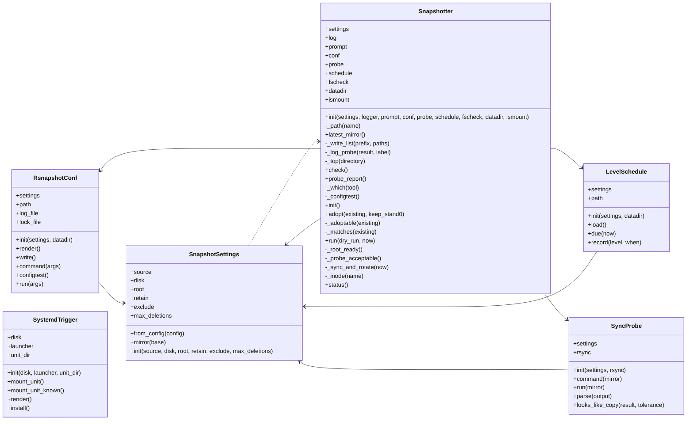{width=95% height=19cm}

| Class | Responsibility |
|---|---|
| `SnapshotSettings` | validated `[snapshot]` values, mirror path inside a snapshot |
| `RsnapshotConf` | generated `rsnapshot.conf`, `configtest`, rsnapshot calls |
| `SyncProbe` | rsync dry run: transfer volume, removals, plausibility |
| `LevelSchedule` | which higher levels are due, state file |
| `Snapshotter` | check, adopt, init, run, status |
| `SystemdTrigger` | user unit bound to the disk's mount unit |

## Package `update`

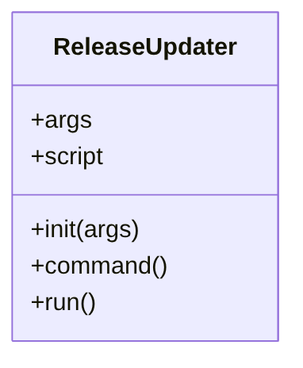{width=40%}

| Class | Responsibility |
|---|---|
| `ReleaseUpdater` | `mediatools update`: runs the bundled `apply-release.sh` with `MEDIATOOLS_VENV` and `MEDIATOOLS_VERSION` of the running program (see "Applying delivered patch archives") |

## Package `gui`

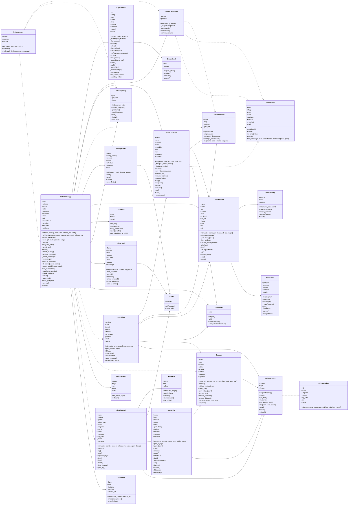{width=95% height=19cm}

| Class | Responsibility |
|---|---|
| `GuiLauncher` | `mediatools gui`: checks display and Tk, opens the window or writes the menu entry |
| `CommandCatalog` | reads subcommands and options from the argument parser of `Cli` |
| `CommandSpec`, `OptionSpec` | one subcommand / option: argv, shell line, read-only check |
| `JobRunner` | runs `python -m mediatools ...` as a child in its own process group (with `MEDIATOOLS_GUI=1`); output, answers, SIGINT/SIGTERM |
| `ChoiceDialog` | dialog of an announced question: one button per answer, keys, Enter for the default |
| `ShrinkMonitor`, `ShrinkReading` | reads PID file, status file, log end and throughput totals; stop and reload requests |
| `FormStore` | last values per form in `state/gui.json` |
| `DesktopEntry`, `Opener` | menu entry (`.desktop`) with check and repair, `xdg-open` |
| `Appearance` | ttk style on `clam`, font scale and scheme `auto`/light/dark (`[gui]`), follows the desktop |
| `SystemLook` | scheme and accent colour of the desktop from the XDG settings portal (`gdbus`) |
| `JobList` | list of the shrink jobs with progress, scrollable; selection fills the shrink form; *Remove*, *Remove finished* (`JobRegistry.remove`) |
| `QueueList` | the shrink queue in the shrink tab: running job first, then the waiting jobs with progress; *Continue*, *Add*, *Change*, *Remove*, *Up*, *Down* (since 1.13.1) |
| `JobDialog` | window with every job so far (`JobList`) and the shrink form; adds to the queue, changes a waiting job (`ShrinkQueue.replace`) (since 1.13.1) |
| `UpdateBar` | notices a newer installed release, offers a restart |
| `MediaToolsApp` | main window: a tab per command, savings, config editor, file browser |
| `CommandForm`, `ConsoleView` | form of a command; live output with answer line and cancel |
| `ShrinkPanel`, `SavingsPanel`, `ConfigPanel`, `FilesPanel` | shrink dashboard, savings table, INI editor, data folder browser |
| `CopyMenu` | right-click menu *Copy* / *Copy all* and Ctrl+C for every label, list and text area of the window (class bindings, installed once by the app; since 1.16.0) |
| `LogArea` | end of the shrink log in the shrink tab: scrolls both ways, follows new lines only while it shows the end, otherwise keeps the line at its upper edge (since 1.15.4) |

The GUI has no function of its own. It runs the command line as child
processes (`JobRunner`) or makes the same request files (`RunControl`), so
the window can never behave differently from a terminal. Only the widget
classes import `tkinter`; they hold their `ttk.Frame` as `frame`
(composition instead of subclassing the deep Tk class tree), and the
command line keeps working where `python3-tk` is missing.

## Package `cli`

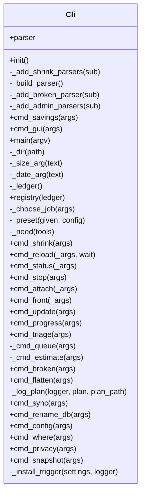{width=60% height=19cm}

`Cli` builds one `argparse` sub-parser per subcommand; `main()` dispatches
to `cmd_<name>(args)`, which creates the objects of that feature, wires
them and returns the exit code.

Arrows in the class diagrams: `-->` the class receives or creates the
collaborator in its constructor; `..>` the class uses it inside a method.
The diagrams are generated by `tools/gen_docs.py` from the code, so they
cannot drift from the implementation.

# Dynamic behaviour

## shrink

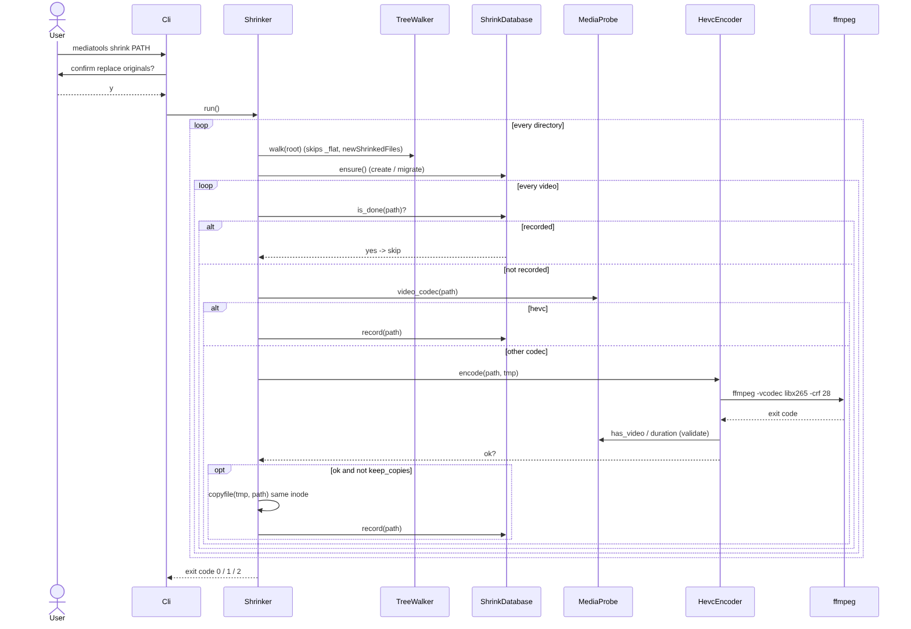{width=92%}

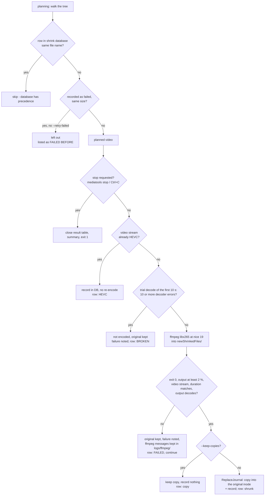{width=62%}

Invariants:

* the database is consulted before anything else;
* copy-back uses `shutil.copyfile`, which writes into the existing inode;
* copy-back and `record()` are not separated by a stop check.

## triage

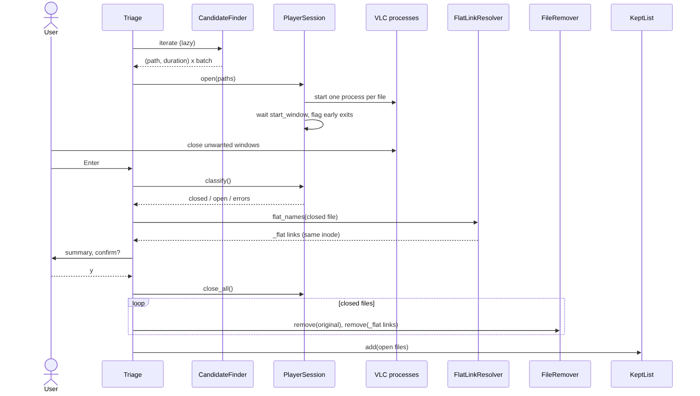{width=92%}

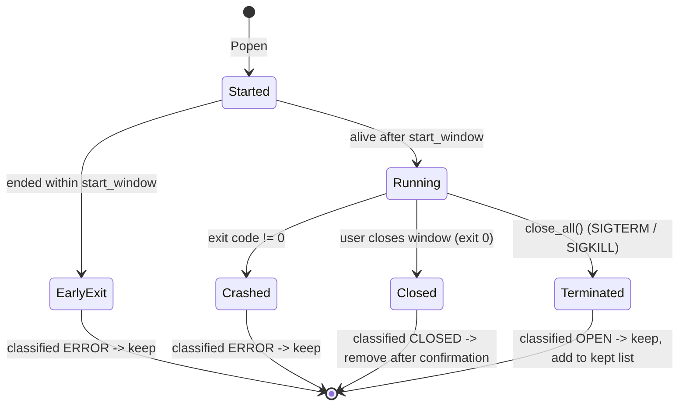{width=80%}

## broken

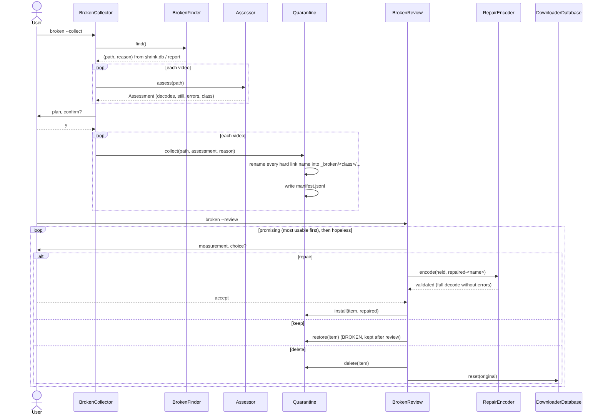{width=92%}

## flatten

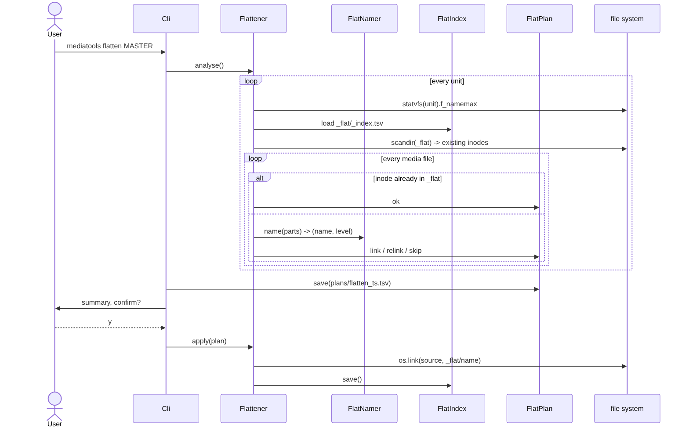{width=92%}

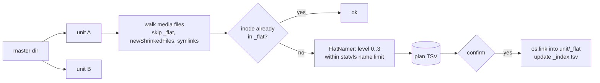{width=92%}

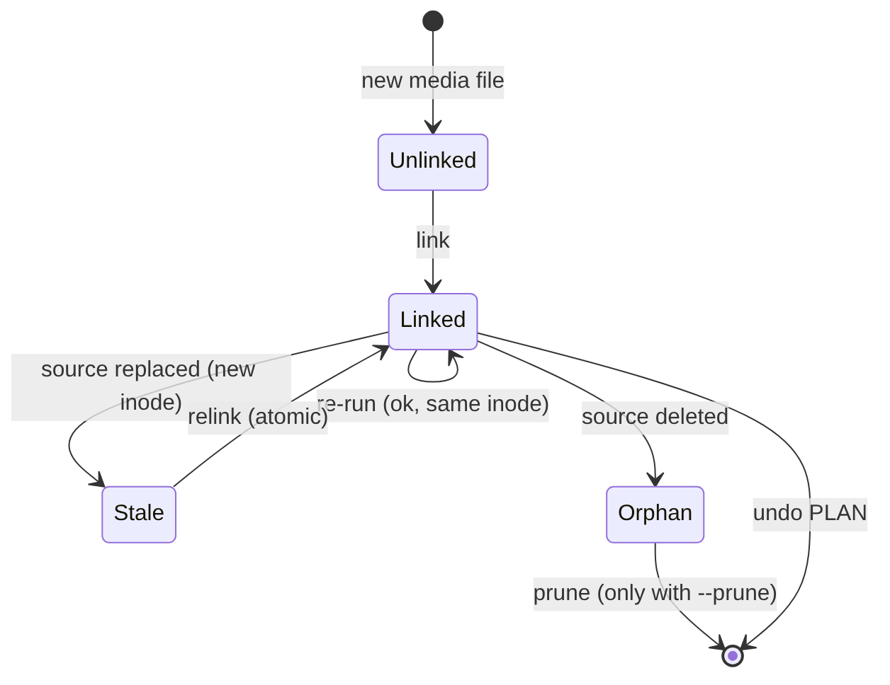{width=70%}

## sync

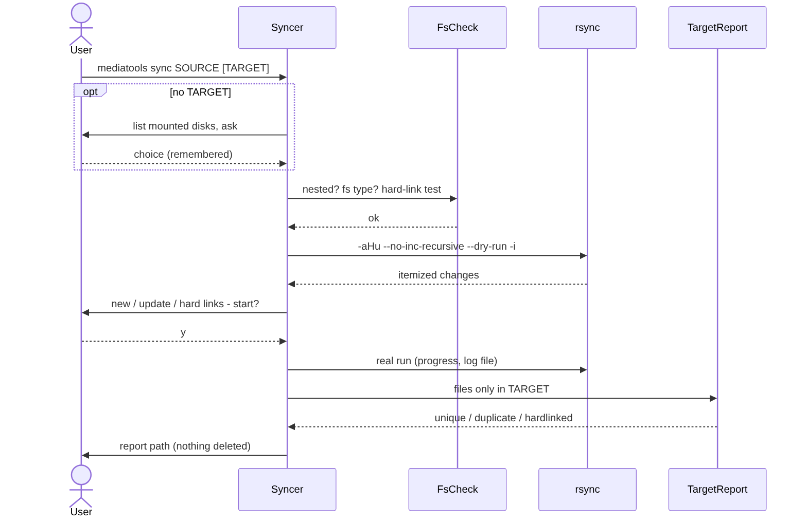{width=92%}

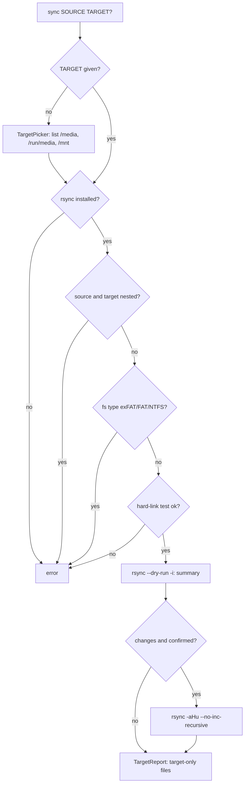{width=40%}

## snapshot

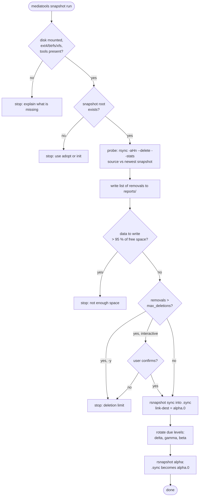{height=20cm}

Invariants:

* nothing on the disk is changed before a probe has run;
* `adopt` only renames within one file system and only after the probe has
  shown that at most 25 % of the source volume differs;
* `stand0` is a hard-link copy of `alpha.0`, never a rename (the next sync
  needs `alpha.0` as link destination);
* a level counts as rotated only if the inode of `<level>.0` changed.

# Data formats

~~~text
<data>/mediatools.ini                 Config           INI, see the handbook
<dir>/<db_name>                       ShrinkDatabase   SQLite, files(path PK, size, modified),
                                                       failures(name PK, size, status, reason, at)
<dir>/<db_name>.bak_<ts>              ShrinkDatabase   copy before schema migration
<unit>/_flat/_index.tsv               FlatIndex        link name TAB relative source path
<data>/plans/flatten_<ts>.tsv         FlatPlan         action unit link source level note
<data>/state/triage_kept.tsv          KeptList         path TAB size TAB mtime
<data>/state/triage_discarded.tsv     Triage           time TAB size TAB path
<cache>/triage_durations.tsv          DurationCache    path TAB size TAB mtime_ns TAB seconds
<cache>/shrink_codecs.tsv             CodecCache       path TAB size TAB mtime_ns TAB codec
<state>/state/shrink_queue.json.next  ShrinkQueue      marker of "Stop, then next" (used once)
<state>/state/shrink_queue.json.current ShrinkQueue    entry of the running queue job + "pid" (put back if it does not end normally)
<data>/state/sync_targets.json        TargetPicker     {source: target}
<root>/_broken/manifest.jsonl         Quarantine       one JSON object per video: number, kind, names
                                                       [[original, quarantined], ...], assessment,
                                                       reason, state, when, outside (mode 600)
<state>/state/assessments.json        AssessmentStore  {path: {size, mtime, assessment, measured}}
                                                       (mode 600)
<data>/reports/progress_*_<ts>.txt    ProgressReport   one path per line
<data>/state/shrink_throughput.json   ThroughputLog    {bytes, seconds}
<data>/ledger.tsv                     Ledger           when session status source result seconds
                                                       length mtime path (TAB, mode 600)
<data>/state/jobs.json                JobRegistry      {key: {spec, settings, last, todo_bytes,
                                                       todo_files}}
<dir>/newShrinkedFiles/<n>.replace    ReplaceJournal   journal marker during copy-back
<data>/logs/ffmpeg/<ts>_<n>.ffmpeg.log Shrinker         complete ffmpeg messages of a failed encode
<data>/reports/sync_target_only_*.tsv TargetReport     status size path same_as
<data>/logs/<command>_<ts>.log        RunLog           timestamp level message
<data>/snapshot/rsnapshot.conf        RsnapshotConf    generated, tab separated
<data>/state/snapshot_levels.json     LevelSchedule    {level: ISO time}
<data>/reports/snapshot_*_<ts>.txt    Snapshotter      removed paths, one per line
<disk>/<root>/<level>.<n>/...         rsnapshot        snapshot; source at localhost/<path>
<disk>/<root>/stand0/...              Snapshotter      first state, kept permanently
~~~

All text files are UTF-8; file names that are not valid UTF-8 are written
with `surrogateescape`, so they round-trip unchanged.

# Error handling, signals, exit codes

| Situation | Behaviour |
|---|---|
| missing external tool | `Cli._need` raises `SystemExit` with the tool names |
| ffmpeg fails / output invalid (size, stream, duration, decode) | file logged as FAILED, failure row, message file kept, original kept, run continues, exit 2 |
| trial decode finds undecodable data | file set aside as BROKEN before encoding, failure row, original kept, run continues, exit code unchanged |
| video failed in an earlier run, size unchanged | left out in planning unless `--retry-failed` |
| second `mediatools shrink` while one is alive | refused before planning, exit 3 |
| `mediatools reload` while a shrink runs | switch after the current file (`Shrinker.RESTART` = 4, internal), process replaced by the installed release; a release that does not start: request dropped, run continues |
| switch cannot exec | message on stderr, exit 1; the next `mediatools shrink` continues with the files left |
| Ctrl+C in shrink | flag set; current ffmpeg stops; original untouched; exit 1 |
| Ctrl+C in triage | all players closed, nothing removed, exit 130 |
| link creation fails | logged, counted as `error`, flatten exits 1 |
| rsync exit 24 (vanished files) | accepted as success |
| target cannot hold hard links | sync refuses before copying anything |
| configuration value missing or invalid | `SystemExit` naming key, file and expected format |
| snapshot probe implausible | adopt/run refuse; top-level listings shown |
| deletion limit exceeded with `-y` | snapshot run aborts, exit 1 |

# Testing

## Strategy

* **Unit tests** per class with real files in `tmp_path`.
* **Test doubles** replace interaction: `FakePrompt` (fixed answers),
  `FakePlayer` (first window "closed"), the `fake_player` fixture (a shell
  script that behaves like a GUI player: SIGUSR1 = window closed, exit 0).
* **Integration tests** use the real ffmpeg, rsync and rsnapshot; they are
  skipped via `needs_ffmpeg` / `needs_rsync` / `needs_rsnapshot` when the
  tool is missing. Snapshot tests replace the mount check
  (`ismount=`) and the mount table (`FsCheck(mounts_file)`), so they run in
  a temporary directory.
* **End-to-end tests** call `Cli().main([...])`.
* Every test gets its own `MEDIATOOLS_HOME` (autouse fixture `datadir`).

## Coverage of the safety rules

~~~text
database precedence, HEVC skip, inode kept   test_shrinker_full_cycle
truncated output rejected                     test_encoder_rejects_duration_mismatch
progress is read-only                         test_progress_is_read_only
early player exit never deletes               test_player_early_exit_is_error
_flat link removed with the original          test_triage_removes_original_and_flat_link
no removal without confirmation               test_triage_not_confirmed_removes_nothing
database rows of a moved collection count     test_database_matches_by_name_after_move
1st Ctrl+C finishes, 2nd keeps the original   test_first_ctrl_c_finishes_current_file,
                                              test_second_ctrl_c_aborts_without_touching_original
'mediatools stop' finishes the current file   test_stop_command_finishes_current_file_and_ends
no stop file without a running job            test_no_stop_file_without_a_running_job
interrupted copy-back is completed            test_interrupted_replacement_is_completed
private terms never reach a push              test_finds_terms_in_files_paths_and_messages
placeholder left, never overwrites a file     test_triage_removes_original_and_flat_link,
                                              test_placeholder_never_overwrites
placeholder never replaces a backup copy      test_sync_placeholder_keeps_backup_copy
originals untouched by flatten                test_flatten_never_touches_originals
hard links preserved, nothing deleted         test_sync_preserves_hardlinks_and_never_deletes
newer receiver file kept (rsync -u)           test_sync_update_does_not_overwrite_newer_target
wrong directory never adopted                 test_adopt_refuses_wrong_directory
adopt copies nothing, removals kept in stand0 test_adopt_then_run_keeps_removed_files
deletion limit stops unattended runs          test_adopt_then_run_keeps_removed_files
unmounted disk stops every action             test_check_requires_mounted_disk
database rename never overwrites              test_renamer_renames_and_respects_conflicts
~~~

# Quality gates

All gates live in one script, `tools/check.sh`. The pre-push hook and the CI
workflow call the same script, so a green local run predicts a green
pipeline. Everything runs as normal user; no root privileges are needed.
A full run requires ffmpeg, ffprobe, rsync, rsnapshot and Tk for Python
(`python3-tk`): without them the integration and GUI tests would be
skipped and the coverage would drop, so the script stops with an
installation hint instead. The GUI tests need a display; the script
always restarts itself under `xvfb-run` (package `xvfb`), a virtual X
server that draws into memory - also when a desktop is running, because
**tests never touch the real desktop or session** (dev-conventions
handover v8): `tests/conftest.py` gives the run its own
`XDG_RUNTIME_DIR` (temporary folder) and a `WAYLAND_DISPLAY` name that
does not exist, drops `DISPLAY` unless `tools/check.sh` set up Xvfb
(`MEDIATOOLS_XVFB=1`), and gives every test its own data folders
(`MEDIATOOLS_HOME`, `XDG_*_HOME`). Every wait for a child process has a
time limit (`CHILD_TIMEOUT`, 300 s): on timeout the child is killed and
the test fails with its output instead of blocking the run.

~~~bash
python3 -m venv .venv && .venv/bin/pip install -e '.[dev]'   # once: development venv
git config core.hooksPath .githooks     # once per clone
sudo apt install shellcheck             # once: gate "shell" (apt writes to /usr)
tools/check.sh                          # all gates
tools/check.sh --fast                   # without the test gate
tools/check.sh --only lint              # one gate (CI runs one step per gate)
tools/check.sh --yes                    # no question: tests on the free threads
~~~

The output follows the common console look of all tool projects
(dev-conventions bundle v21, `tools/output.sh`): a block title with commit
and Python version, one numbered stage per gate (`▶ [4/7] lint`) with one
result line (`✔ PASS` / `✘ FAIL` / `– SKIP`, one fact, duration), the end
of the output of a failing gate, and a result block `DONE` / `FAILED`. The
privacy gate reports its counts (`413 terms, 26 allowed, 0 findings`). The
test gate shows a progress bar instead of pytest's dots (the last column is
the module running now; pytest's own `[100%]` is switched off with
`-o console_output_style=classic`) and lists the five slowest tests and the
three slowest modules at the end (`tools/pytest_progress.py`, loaded by
`tests/conftest.py`; `PYTEST_PROGRESS=0` switches it off). The coverage
table is printed only when the coverage is below 90 %. Colours appear
in a terminal only; `NO_COLOR` switches them off, `FORCE_COLOR` on. Before
every question (number of test workers) the terminal bell rings and a
desktop notice appears (`attention`; `NO_NOTIFY=1` switches the notice off).

**Parallel tests** (dev-conventions bundle v21): pytest-xdist runs the
tests with `-n N --dist loadscope` (the tests of one module stay on one
worker). In a terminal `tools/check.sh` asks `N of M threads free (load L)
- run the tests on N workers? [Y/n]`, where free = threads minus the
rounded load of the last minute, at least 1; without a terminal (pre-push
hook, `release.sh --yes`) or with `--yes` it takes the free threads without
asking; in CI (`CI=true`) all threads of the runner (4 on public
repositories). `CHECK_WORKERS=N` fixes the number, `CHECK_WORKERS=0` or `1`
runs them one after another; without pytest-xdist they run one after
another with a note. All workers share the virtual display of `xvfb-run`.
Measured in the development sandbox (2 threads): 92 s one after another,
40 s on 4 workers.

**Tests of unchanged bundle files are skipped.** `tools/bundle.sha256`
(manifest of the dev-conventions bundle, `sha256sum` format) lists the
files copied byte for byte (`tools/release.sh`, `tools/output.sh`,
`tools/same-code.sh`, `tools/review.sh`, `tools/pytest_progress.py`,
`tools/bundle_tests.py`, `tests/test_release_tools.py`,
`tests/test_review.py`). While all match, `tools/bundle_tests.py` marks
the two test files as skipped - they repeat what the dev-conventions
repository tests at its tag. One changed file runs everything;
`CHECK_BUNDLE_TESTS=1` runs them anyway; check by hand with
`sha256sum -c tools/bundle.sha256`. `src/mediatools/update/output.sh` stays
equal to `tools/output.sh` (a test enforces it).

**Check cache** (dev-conventions `templates/check-cache.sh`): after a full
green run the key *tree of the working copy + Python version + hash of the
installed packages* is appended to `.git/checked-trees` (last 50 kept).
The working-copy tree is computed with a temporary index (`git add -A`,
`git write-tree`), so uncommitted and untracked files count and
`.gitignore` is honoured. For a known key only `privacy` and `shell` run
again - the privacy scan also reads commit messages and tags, which change
without the tree. `CHECK_FULL=1` forces a full run, CI (`CI=true`) always
runs in full, and without `.git` (unpacked archive) nothing is cached.

`tools/check.sh` uses an active venv; otherwise it activates `.venv` of
the project for its own run only - the calling terminal is unchanged and no
`deactivate` is needed. CI has neither and installs the tools directly.
Nothing is created or installed by the script.

| No. | Gate     | Tool        | Pass criterion                                     |
|-----|----------|-------------|----------------------------------------------------|
| 0   | privacy  | privacy_scan | no locally listed term in files, paths, commits, identities; every identity address no-reply; fails (exit code 2) without local terms (skipped only in CI) and while lists of the layout before 1.5.0 exist |
| 0   | shell    | shellcheck  | no finding in `install.sh`, `tools/*.sh`, the hook and the update script |
| 1   | format   | pycodestyle | PEP 8 layout, max line length 120                  |
| 2   | lint     | pylint      | 10.00/10, docparams/docstyle (Google style)        |
| 3   | types    | mypy        | no error; `check_untyped_defs`, `warn_unreachable` |
| 4   | security | bandit      | no finding                                         |
| 5   | tests    | pytest      | all pass, branch coverage >= 90 %                  |

**Privacy gate.** `tools/privacy_scan.py` searches all tracked files (PDFs
via `pdftotext`), file paths and commit messages for terms that would allow
conclusions about the processed data. The terms are never in the
repository; they come from the deny list
`~/.config/mediatools/privacy/denylist.txt` (one term per line; with
`MEDIATOOLS_HOME` set: `$MEDIATOOLS_HOME/privacy_denylist.txt`) and from the
unit directory names below `[collection] root`.
Matching ignores case and whole words only (`cat` does not match `concatenate`);
terms shorter than three characters are ignored.

**Without local terms the gate fails** (exit code 2): a scan without terms
checks nothing, and a green run must not claim a check that did not
happen (also in a sandbox without lists). Only in CI (`CI=true`, set by
GitHub Actions), which has no local list by design, it is skipped and
says so. Samples of both lists are in `examples/privacy/`
(CONTRIBUTING.md, "Local files of a developer").

**Identities.** Author and committer of every commit and the tagger of
every annotated tag are searched for the terms, and every e-mail address
must be a no-reply address (`*@users.noreply.github.com`,
`noreply@github.com`, `noreply@anthropic.com`) or stand alone on a line of
the allow list. A finding names the commit or tag and shows the address
masked (`p***@g***.com`). Reason: commits made with a private global git
identity put the address into the public history.

Ordinary words can be on the deny list and still be needed in technical
text. Instead of rewording, such uses are permitted by **allowed phrases**
in the allow list next to it (`privacy/allowlist.txt`, same format, one
phrase per line). They are blanked out before the search: the term stays forbidden
everywhere else. Both lists stay outside the repository; the folder has
mode 700, the files mode 600.

~~~bash
mediatools privacy                 # both paths and the number of entries
mediatools privacy --edit deny     # open in $EDITOR (nano if unset), created if missing
mediatools privacy --edit allow
python3 tools/privacy_scan.py
~~~

`tools/privacy_scan.py` resolves the lists with `DataDir` from the source
tree of the clone, so it finds them in the same place as the installed
program. While `~/scripts/mediatools.d/privacy_denylist.txt` or
`privacy_allowlist.txt` still exist (layout before 1.5.0), the gate
refuses instead of scanning: a gate must not pass silently because its
input moved. `mediatools where --migrate` moves them.

Notes on the configuration (`pyproject.toml`):

- **bandit** skips B404 and B603: the package calls ffmpeg, ffprobe, rsync,
  the player and gio deliberately via `subprocess` with fixed argument
  lists and never with `shell=True`. B324 (SHA-1) was fixed with
  `usedforsecurity=False`; the hash only shortens file names.
- **pytest** turns `ResourceWarning` and unraisable exceptions into errors.
  This gate found two real leaks during development: SQLite connections that were
  committed but never closed (`with sqlite3.connect()` does not close),
  and log handlers of recycled loggers that were dropped without `close()`.
- **coverage** compares with two decimals (`precision = 2`); with the
  default precision 0, 79.66 % is rounded to 80 % and passes a threshold of
  80 % although the report prints "FAIL".
- **mypy** runs in the moderate mode above; `--strict` is not a gate yet
  (34 findings, mostly missing generic parameters in tests).
- `python3 tools/gen_docs.py` followed by an unchanged `git status` shows
  that diagrams and API reference are up to date.

The pre-push hook (`.githooks/pre-push`) runs only when branches are
pushed, not for tag-only pushes. `git push --no-verify` bypasses it in an
emergency; CI still enforces all gates.

# CI runs: which run checks what

The background (runner machines, Python versions, containers, `gh` and the
GitHub API, branch protection, costs) is explained in `docs/ci-guide.md`
(PDF next to it); this section is the short reference.

The same `tools/check.sh` runs in two places: **locally** in the pre-push
hook (one Python version, the working tree of this PC) and **on GitHub**
(fresh virtual machine per job, one job per Python version 3.12 and 3.14,
only committed files). Only the GitHub result counts for branch
protection. Since 1.2.13 GitHub starts a run for exactly two events:

| Event | Run on GitHub | Checks | Purpose |
|---|---|---|---|
| pull request into `main` or `develop` | `gates (3.12)`, `gates (3.14)` | the commit `tools/release.sh` built locally (release commit or feature merge) | required check: `main`/`develop` take only a commit whose checks passed |
| push of a tag `v*` | `release-check` only (since 1.5.1) | tag on `main`, tag = `__version__`; the gates ran on the pull request for the same commit | release gate |
| push of a branch (any) | none | - | work branches are checked through their PR; the direct push to `main`/`develop` carries exactly the commit its PR already tested |
| `gh workflow run quality-gates --ref BRANCH` | the gates | that branch | manual run for a branch without PR |

The two diagrams show the branches as parallel lanes (`main` = former
`master`). Time runs downwards. A solid arrow is a git operation from one
branch to another (create a branch, merge); a dashed arrow is a pull
request, i.e. the proposal to merge, which GitHub tests before the merge
is allowed. The badge on the right names the gate run of the step:
**LOCAL** = pre-push hook on this PC (one Python version), **CI** = run on
GitHub (Python 3.12 and 3.14; for a tag only `release-check`), **none** =
nothing is tested at this step because the pull request tested the same
commit, or the step is local and the next push is checked. Every step is
done by `tools/release.sh` (section "Release procedure").

{width=100%}

{width=100%}

Count per flow:

| Flow | Full local gate runs | CI gate runs on GitHub |
|---|---|---|
| feature only (`--merge-only`) | 1 (gates of `release.sh`; the pre-push hook finds the tree in the check cache: privacy and shell only) | 1 (PR into `develop`) |
| feature + release, or release of `develop` | 1 (gates on the release tree; pre-push hook as above) | 1 (PR into `main`) + `release-check` of the tag (seconds) |
| hotfix | 1 | 1, or 2 at the same time while `develop` collects features (second state as `merge/vX.Y.Z`) + `release-check` |

Up to 1.16.0 (dev-conventions bundle v20) a release needed three CI runs
on two contents (PR into `main`, the tag, `merge/vX.Y.Z` into `develop`),
because GitHub's merge button wrote a new merge commit that `develop` had to
receive through a third pull request, plus a second full local run on the
release tree. Since 1.17.0 everything is built locally and only the
published commit is checked. If GitHub refuses the direct push (a branch
rule wants pull requests), `tools/release.sh` falls back to that older way
and says so (section "Branch protection").

Before 1.2.13 the workflow also ran on every push to `main` and `develop`.
These two runs per release tested a tree already tested by the pull request
(and, on `main`, the very commit the tag run tests a minute later); nobody
waited for them, they only made the Actions list harder to read.

# Branching model

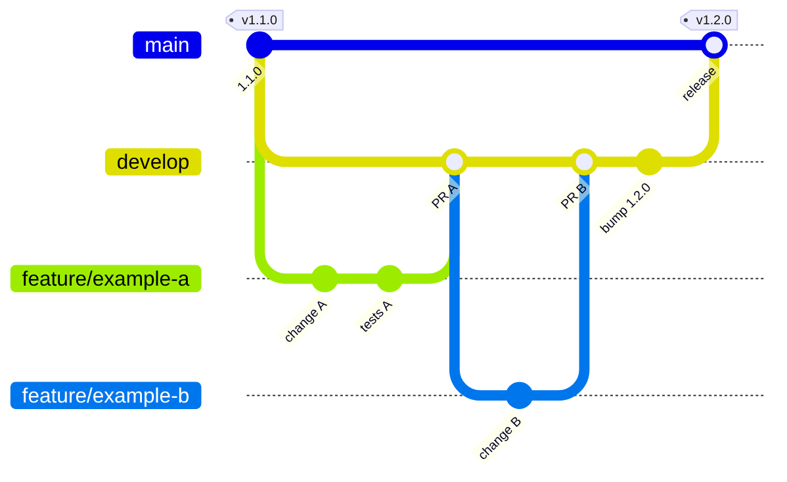{width=95%}

| Branch        | Purpose                               | From      | Into               |
|---------------|---------------------------------------|-----------|--------------------|
| `main`        | released states only, each one tagged | -         | -                  |
| `develop`     | integration of finished features      | `main`    | `main`             |
| `feature/<x>` | one feature or fix                    | `develop` | `develop` (PR)     |
| `hotfix/<x>`  | urgent fix of a release               | `main`    | `main` + `develop` (PR) |
| `release/X.Y.Z` | short-lived: carries the locally built release commit to its PR checks (`release.sh`) | `develop` | `main` (PR checks, then direct push) |
| `merge/vX.Y.Z`  | short-lived: second `develop` state of a hotfix, or the fallback merge back (`release.sh`) | `main` | `develop` (PR) |

**`main` is the branch called `master` in older git-flow texts.** git-flow
(Driessen, 2010) names the release branch `master`; GitHub creates new
repositories with the default branch `main` since 1 October 2020. Name and
role are the same: `main` holds only released states, every one tagged
`vX.Y.Z`. There is no separate `master` in this repository.

Roles: developers work on `feature/*`; `tools/release.sh` integrates a
feature into `develop` and cuts a release when the **integrator** answers
the questions (or passes part and message, as `mediatools update` does).

CI (`.github/workflows/tests.yml`) runs the gates on pull requests into
`main` and `develop` (section "CI runs" shows every run per branch). Branch pushes start no run. A branch without a pull request
can be checked on demand: `gh workflow run quality-gates --ref BRANCH`.
For a tag `v*` only the job
`release-check` runs; it verifies that the tagged commit lies on `main` and that the
tag equals `v` + `__version__`.

## Branch protection

`main` and `develop` are protected on GitHub: they take only a commit
whose required checks `gates (3.12)` and `gates (3.14)` passed, reported by
GitHub Actions (app id 15368; with "any source" anybody with write access
could set such a status by API), the rule applies to administrators too,
no force push, no deletion. A pull request is **not** required by the
classic protection (dev-conventions bundle v21): `tools/release.sh` opens
one anyway to get the checks, and GitHub then accepts the direct push of
exactly that commit. Set once per branch by the repository owner (normal
user; `gh` acts with the owner's token):

~~~bash
for branch in develop main; do
gh api -X PUT "repos/peddanet/mediatools/branches/$branch/protection" --input - <<'EOF'
{
  "required_status_checks": {
    "strict": true,
    "checks": [
      { "context": "gates (3.12)", "app_id": 15368 },
      { "context": "gates (3.14)", "app_id": 15368 }
    ]
  },
  "enforce_admins": true,
  "required_pull_request_reviews": null,
  "restrictions": null,
  "allow_force_pushes": false,
  "allow_deletions": false
}
EOF
done
~~~

The check names must match exactly the jobs the workflow produces: a name no
job produces any more blocks every push, a new matrix entry is not
required until it is listed. After a change of the Python matrix the
command above is run again with the new list.

With a protection that still demands a pull request
(`required_pull_request_reviews` set, as up to 1.16.0) `tools/release.sh`
keeps working through its fallback (merge on GitHub, `merge/vX.Y.Z`), with
three CI runs per release. Collaborators, if there ever are any, get a
ruleset "review by owner" on `main` and `develop` (pull request with one
approval, bypass "Repository admin - always"): their changes are reviewed,
while the owner's `release.sh` still pushes directly after green checks;
rulesets and the classic protection add up, the strictest rule applies.
Zero required approvals protect against nobody: the author approves his own
pull request. Tags are not affected by branch protection; `release.sh`
pushes the tag together with `main` and `develop`.

## Feature cycle

~~~bash
git switch develop && git pull --ff-only && git switch -c feature/<name>
# ... edit, test, CHANGELOG line under [Unreleased], commit ...
tools/release.sh                       # rebase, gates, then the questions
~~~

"Build the release now? [y/N]" `n` and then `y` merges the feature into
`develop` only (local merge, push, pull request checks, direct push); `y`
merges and releases at once, with one gate run and one CI run.
The remote feature branch is deleted after the merge; the local one with
`git branch -d feature/<name>`.

# Building the documentation

~~~bash
sudo apt install pandoc texlive-xetex texlive-latex-extra fonts-dejavu librsvg2-bin
npm install -g @mermaid-js/mermaid-cli
~~~

`sudo` is needed because apt and a global npm installation write to system
directories. The build itself runs as normal user:

~~~bash
cd ~/Projects/mediatools
python3 tools/gen_docs.py
python3 tools/gen_lanes.py
cd docs/img && for f in *.mmd; do mmdc -i "$f" -o "${f%.mmd}.png" -s 2 -b white; done
for f in lanes_*.svg; do rsvg-convert -z 2 "$f" -o "${f%.svg}.png"; done
cd .. && pandoc developer.md api.md -o developer.pdf --pdf-engine=xelatex \
  --highlight-style=tango --resource-path=.
pandoc handbook.md -o handbook.pdf --pdf-engine=xelatex --highlight-style=tango \
  --resource-path=.
pandoc ci-guide.md -o ci-guide.pdf --pdf-engine=xelatex --resource-path=.
~~~

# Release procedure

Done by `tools/release.sh` (GitHub variant of the script of the
dev-conventions handover; tests in `tests/test_release_tools.py`). It runs
as normal user; `git` and `gh` (logged in once: `gh auth login`) act on
the clone and on GitHub with the integrator's account. Since 1.17.0
(bundle v21) it builds every merge, the release commit and the tag
locally, as on Forgejo, lets GitHub check exactly the commit to be
published once, and then pushes that commit directly.

~~~bash
tools/release.sh [patch|minor|major] [-m MESSAGE] [--yes] [--merge-only]
~~~

1. **Start checks:** clean working tree; branch type (`feature/*`,
   `develop`, `hotfix/*`; `main` refused); `gh` logged in; local `main`
   and `develop` equal `origin`; `develop` contains `main`;
   `__version__` equals the newest tag.
2. **Feature:** rebase onto `develop`, question "Build the release now?"
   (a part on the command line answers it). Without a release: gates,
   question "Merge feature/x into develop (push, PR, checks)?", local
   `--no-ff` merge into `develop`, its pull request checks that commit,
   then `develop` is pushed. With a release: the local merge into
   `develop` joins the release, and the gates run only once, on the
   release tree.
3. **Release:** version from the newest tag and the part; non-empty
   `[Unreleased]` and message; on `release/X.Y.Z` (hotfix: on the hotfix
   branch) set `__version__` and the heading `## [X.Y.Z] - <date>`, run the
   gates, commit `mediatools X.Y.Z`; local `--no-ff` merge into `main`
   with the subject `mediatools X.Y.Z: <message>`, annotated tag with the
   same text, `develop` moved to the same commit (hotfix while `develop`
   collects features: `develop` gets a local merge of `main`).
4. **Question** "Publish vX.Y.Z (GitHub checks it once, then main, develop
   and the tag)?", then: push `release/X.Y.Z`, pull request into `main`,
   wait for its required checks (progress line per CI job, see
   `docs/ci-guide.md`); a second `develop` state is pushed as
   `merge/vX.Y.Z` and checked at the same time.
5. **Publish:** `git push --atomic origin <commit>:main <commit>:develop
   vX.Y.Z` - all or nothing, never forced; the pull request then shows as
   merged and the helper branches are deleted; wait for `release-check` of
   the tag. Fallbacks: GitHub refuses the direct push (a rule wants pull
   requests) -> the pull request is merged on GitHub, the merge commit is
   tagged and `develop` comes back through `merge/vX.Y.Z` (one more CI run,
   as up to 1.16.0); `main` or `develop` on origin moved meanwhile ->
   nothing is published, local `main`/`develop` go back to origin, the tag
   is deleted, the work branch keeps its commits.
6. **Bit-identity:** `tools/same-code.sh main develop vX.Y.Z` (after a
   hotfix while `develop` collects features: `main vX.Y.Z`).
7. **Install:** question, `./install.sh vX.Y.Z`,
   `~/.local/bin/mediatools --version`, `tools/after-install.sh` (reload
   of a running shrink, status).

Every question rings the terminal bell and raises a desktop notice with
`notify-send -u critical` when a desktop session exists (`attention` of
`tools/output.sh`; `NO_NOTIFY=1` switches the notice off), so a question
does not wait unnoticed in a background window. `CHECK_CMD`,
`INSTALL_CMD`, `RELEASE_WAIT` (longest wait for the registration of the
checks, default 600 s), `RELEASE_POLL` (seconds between two questions to
GitHub, default 5), `RELEASE_HEARTBEAT` (seconds between progress lines,
default 30) and `RELEASE_RETRY_PAUSE` (seconds between the up to five
attempts of `gh pr create` and `gh pr merge`, default 10) replace the gate
script, the installer and the pauses; the tests use them. Questions are
English and answered with `y` (`j` is accepted too). `tools/release.sh`,
`tools/same-code.sh`, `tools/review.sh`, `tools/output.sh`,
`tools/pytest_progress.py`, `tools/bundle_tests.py`,
`tests/test_release_tools.py` and `tests/test_review.py` are copies of the
dev-conventions bundle v21 and stay byte-identical to it
(`sha256sum -c tools/bundle.sha256`). Merge commits (no squash, no rebase)
keep every commit; `git log --first-parent main` lists exactly the
releases.

# Applying delivered patch archives

`mediatools update` runs the shell script
`src/mediatools/update/apply-release.sh`, shipped inside the package, so
every installed release carries it:

~~~bash
mediatools update --list     # installed and newest release, archives; nothing changes
mediatools update            # step 1, then one question per archive
mediatools update -y         # no questions
~~~

| Step | What happens |
|---|---|
| 1 newer release | installed release (`~/.local/bin/mediatools --version`, else the caller's version) against the newest tag of the repository (`git ls-remote`); newer: `./install.sh vX.Y.Z` of the clone, or without a clone pip into the venv of the running program (`MEDIATOOLS_VENV`); then `mediatools reload` |
| 2 inventory | `mediatools-feature-<name>.tar.gz` / `mediatools-hotfix-<name>.tar.gz` in `~/Downloads` (`--downloads DIR`), newest copy per archive, named by the `branch` in its `patch.info` (so browser copies `... (1).tar.gz` or `...1.tar.gz` count as the same archive); versioned archives of released versions are shown as *released*, older copies and files with the same content as a newer one as *old copy*, files with the same content as an archive in the releases folder as *applied* (never offered again), all removed at the end; versioned archives above the installed release are *refused* (format before 1.14.0) |
| 2 per archive | `patch.info` read; question; `base` branch fast-forwarded to `origin`, its tree (or the listed blobs) compared with `base_tree` (or the "before" blobs); `git switch -c <branch> <base>`; `git am`; result compared with `tree` (or the "after" blobs); `tools/release.sh <part> -m <message> --yes`, for `release=none` `--merge-only --yes`; archive to the releases folder |
| end | archives with `release=none` are applied one after the other; the run ends after the first archive that releases, because the next one is built on its result |

`patch.info` (written by the delivering side, `key=value`):

~~~text
branch=feature/<name>            or hotfix/<name>
base=develop                     or main (hotfix)
base_tree=<tree hash of base>    or one line per file: blob=<path> <before> <after>
tree=<tree hash after git am>
release=minor                    patch | minor | major | none
message=<one-line release message>
~~~

Every guard stops loudly ("✘ STOP  ...") and leaves the clone as it was; a
patch that does not apply is aborted, its branch removed. The script
copies itself to `/tmp` and runs from there, because switching branches
and the installation rewrite it while bash reads it. It finds the clone
next to itself (source checkout) or uses `~/Projects/mediatools`
(`--repo DIR`), logs to `~/.local/state/mediatools/logs/apply-release_<ts>.log`
and runs as a normal user; root would leave root-owned files in the clone.
The output uses the common console look: it sources `output.sh` next to
itself (`src/mediatools/update/output.sh`, a copy of `tools/output.sh`, kept
equal by a test, because the installed package has no `tools/`). Colours
appear in the terminal only; the log file is written without them. The
question per archive is "Apply <branch> and release it as <part>? [y/N]"
(`release=none`: "Merge <branch> into <base> (no release)? [y/N]").

# Adding a subcommand

1. Create `src/mediatools/<feature>/` with one class per module and an
   `__init__.py` that exports the classes.
2. Import only from `mediatools.core`.
3. Add a sub-parser in `Cli._build_parser` and a method `cmd_<name>` that
   wires the objects and returns an exit code.
4. Add tests (unit, integration, CLI).
5. Run the quality gates; regenerate diagrams and API reference.
6. Document the command in `README.md`, `docs/handbook.md` and here.
7. Nothing to do for the GUI: its form is read from the new sub-parser.
   Add the name to `CommandCatalog.SKIP` or `MediaToolsApp.PANEL_COMMANDS`
   only if the command must not get a form of its own.

# Glossary

**Bandit** -- static security analyser for Python (PyCQA).
[bandit configuration](https://bandit.readthedocs.io/en/1.9.3/config.html)

**Activity diagram** -- UML diagram of a decision flow (here Mermaid
flowcharts). [UML specification (OMG)](https://www.omg.org/spec/UML/)

**Dependency injection** -- collaborators are passed in instead of being
created inside a class.

**docparams** -- pylint extension that checks parameter, return, yield and
raise documentation.
[pylint docparams](https://pylint.readthedocs.io/en/latest/user_guide/checkers/extensions.html)

**git-flow** -- branching model with the long-lived branches `main`
(releases) and `develop` (integration) plus short-lived feature, release
and hotfix branches (V. Driessen, 2010).
[A successful Git branching model](https://nvie.com/posts/a-successful-git-branching-model/)

**Google-style docstring** -- docstring layout with `Args:`, `Returns:`,
`Raises:` sections.
[Google Python Style Guide](https://google.github.io/styleguide/pyguide.html)

**Integrator** -- role that reviews and merges pull requests into
`develop` and cuts releases (merge into `main`, tag).

**mypy** -- static type checker for Python.

**pre-push hook** -- script in the hooks directory (`core.hooksPath`) that
git runs before a push; a non-zero exit code aborts the push.

**Branch protection** -- GitHub rule that blocks direct pushes, force
pushes and merges without passing status checks on a branch.
[About protected branches](https://docs.github.com/en/repositories/configuring-branches-and-merges-in-your-repository/managing-protected-branches/about-protected-branches)

**Mermaid** -- text format for diagrams, rendered by GitHub and `mmdc`.
[mermaid.js.org](https://mermaid.js.org/)

**Sequence diagram** -- UML diagram of messages between participants over
time.

**State diagram** -- UML diagram of the states of one object and the
transitions between them.

**Test double** -- replacement object used in tests instead of a real
collaborator.

# Sources

| Source | Status |
|---|---|
| [pylint extensions (docparams)](https://pylint.readthedocs.io/en/latest/user_guide/checkers/extensions.html) | standard reference; behaviour checked with pylint 4.1.3 |
| [Google Python Style Guide, section 3.8 Comments and Docstrings](https://google.github.io/styleguide/pyguide.html) | standard reference, not retrieved in this session |
| [Mermaid documentation](https://mermaid.js.org/) | standard reference; diagrams rendered with mermaid-cli |
| [GitHub changelog 2020-08-26: default branch for new repositories](https://github.blog/changelog/2020-08-26-set-the-default-branch-for-newly-created-repositories/) | `master` -> `main` for new repositories from 1 October 2020; found via search 2026-11-10 |
| [About protected branches](https://docs.github.com/en/repositories/configuring-branches-and-merges-in-your-repository/managing-protected-branches/about-protected-branches) | strict checks, unique job names; found via search 2026-11-10 |
| [UML specification (OMG)](https://www.omg.org/spec/UML/) | standard reference, not retrieved in this session |
| [V. Driessen: A successful Git branching model (2010)](https://nvie.com/posts/a-successful-git-branching-model/) | found via search 2026-11-03; original domain not fetchable from the build sandbox, content confirmed through mirrors |
| [GitHub Docs: About protected branches](https://docs.github.com/en/repositories/configuring-branches-and-merges-in-your-repository/managing-protected-branches/about-protected-branches) | found via search 2026-11-03; required status checks and PR requirement confirmed |
| [bandit configuration (1.9.3)](https://bandit.readthedocs.io/en/1.9.3/config.html) | found via search 2026-11-03; `[tool.bandit]` requires `-c pyproject.toml` |
| [Python docs: sqlite3, connection context manager](https://docs.python.org/3/library/sqlite3.html#sqlite3-connection-context-manager) | not fetchable from the sandbox; note "neither ... opens a new transaction nor closes the connection" confirmed via the quote in [discuss.python.org #41663](https://discuss.python.org/t/sqlite3-connection-and-general-concepts/41663) |
| [mypy configuration file](https://mypy.readthedocs.io/en/stable/config_file.html) | standard reference, not retrieved; behaviour checked with the installed mypy |
| [git: githooks(5)](https://git-scm.com/docs/githooks) | standard reference, not retrieved; pre-push stdin format checked against local git |
| User handbook `docs/handbook.md` | sources for rsync, eCryptfs, ffmpeg, SQLite |

\newpage
