# Purpose and audience

The user handbook (`docs/handbook.md`) explains *how to use* mediatools.
This document explains *how it is built*: which class does what, how the
classes interact at run time, which files they read and write, and which
rules every change has to follow.

# Repository layout

~~~text
mediatools/
  README.md                 project page (GitHub)
  CHANGELOG.md              release history
  CONTRIBUTING.md           rules for contributions
  LICENSE                   MIT
  pyproject.toml            packaging, pytest and pylint configuration
  install.sh                installs a release tag into a venv (~/scripts/mediatools)
  .github/workflows/        CI: tools/check.sh on Python 3.10, 3.12, 3.13
  .githooks/pre-push        runs tools/check.sh before every branch push
  src/mediatools/           package (one class per module)
  tests/                    pytest suite
  tools/check.sh            quality gates
  tools/gen_docs.py         UML class diagrams + API reference from the code
  docs/handbook.md          user handbook (+ PDF)
  docs/developer.md         this document (+ PDF)
  docs/api.md               generated API reference
  docs/img/                 Mermaid sources (*.mmd) and rendered PNG
~~~

# Coding standard

## Rules

1. **One class per module.** The module name describes the class
   (`shrink/database.py` contains `ShrinkDatabase`).
2. **Google-style docstrings** on every module, class, method and function,
   including private ones: summary line, `Args:`, `Returns:` or `Yields:`,
   `Raises:` where applicable; classes list their instance variables in
   `Attributes:`.
3. **Comments** explain *why* a block exists wherever this is not obvious
   from the code (e.g. "writes into the existing inode", "in-place
   assignment prunes the walk").
4. **pylint 10.00/10** for `src`, `tests` and `tools`; maximum line length
   100. The configuration lives in `pyproject.toml`.
5. **Standard library only.** External programs (ffmpeg, ffprobe, rsync,
   gio, players) are called with argument lists, never through a shell.
6. **Dependency injection.** Logger, prompt, probe, player, remover and
   file-system helpers are constructor arguments, so tests can replace them.
7. **Plan before action** for numerous or irreversible changes: analyse,
   summarise, confirm, execute.

## Docstring example

~~~python
def name(self, parts: list[str]) -> tuple[str, int] | None:
    """Build the flat name for a relative path.

    Args:
        parts: Path components below the unit; the last element is the
            file name.

    Returns:
        ``(flat_name, level)``, or None if no level fits the limit.
    """
~~~

## pylint configuration

~~~toml
[tool.pylint.main]
load-plugins = ["pylint.extensions.docparams", "pylint.extensions.docstyle"]

[tool.pylint.format]
max-line-length = 100

[tool.pylint.parameter_documentation]
default-docstring-type = "google"
accept-no-param-doc = false
accept-no-raise-doc = false
accept-no-return-doc = false
accept-no-yields-doc = false

[tool.pylint.design]
max-args = 10                 # collaborators are injected (testability)
max-positional-arguments = 10
max-attributes = 12
max-locals = 22
min-public-methods = 1
~~~

The design limits are raised deliberately: constructors receive their
collaborators as arguments instead of creating them, which costs arguments
but makes every class testable in isolation. The only remaining inline
suppression is `consider-using-with` for the long-lived player processes in
`PlayerSession.open`, which must outlive the method.

# Architecture

## Layers

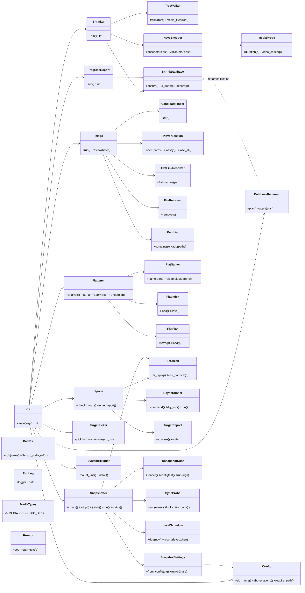{width=58%}

| Layer | Package | May import |
|---|---|---|
| interface | `mediatools.cli` (`Cli`) | all packages |
| features | `shrink`, `triage`, `flatten`, `sync`, `snapshot` | `core`; `snapshot` also `sync.fscheck` |
| foundation | `core` | standard library only |

The feature packages do not import each other, with one exception:
`snapshot` reuses `sync.FsCheck` (file-system type, free space, nesting).
Shared knowledge -- reserved directory names, media extensions, data
directory, configuration -- lives in `core`.
`triage` cooperates with `flatten` only through the file system (inodes in
`_flat`), not through imports.

## Package `core`

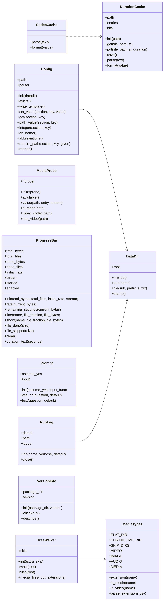{width=58% height=19cm}

| Class | Responsibility |
|---|---|
| `MediaTypes` | extensions, `_flat` / `newShrinkedFiles` names, `SKIP_DIRS` |
| `Config` | local INI file: collection root, database name, abbreviations, snapshot settings; error messages name key and expected format |
| `DataDir` | `$MEDIATOOLS_HOME` layout: logs, state, plans, reports |
| `RunLog` | logger to terminal and time-stamped file |
| `MediaProbe` | ffprobe: duration, codec, video stream |
| `DurationCache` | ffprobe durations keyed by path, size and mtime (shared by triage and shrink) |
| `ProgressBar` | one-line terminal display: percentage by bytes, files, remaining time |
| `TreeWalker` | sorted `os.walk` that never enters reserved/hidden dirs |
| `Prompt` | yes/no and text questions, `--yes` support |

## Package `shrink`

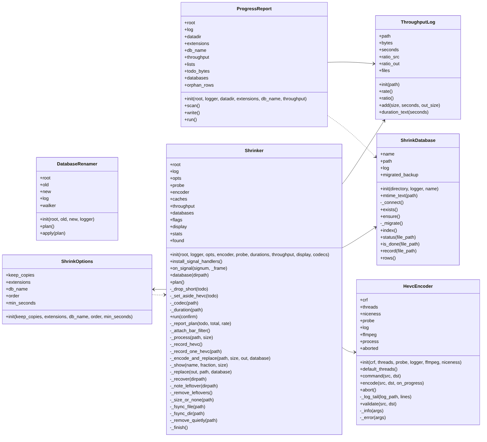{width=95% height=19cm}

| Class | Responsibility |
|---|---|
| `ShrinkDatabase` | database per directory (name configurable), matching by file name, schema migration, UPSERT |
| `DatabaseRenamer` | one-time renaming of databases and their backups, never overwrites |
| `HevcEncoder` | ffmpeg in its own process group, progress, abort, validation of exit code, stream and duration |
| `Shrinker` | plan (order, minimum duration), per-file decision, journalled in-place copy-back, two-stage Ctrl+C, summary |
| `ProgressReport` | read-only done/changed/todo lists, orphan rows, time estimate |
| `ShrinkOptions` | settings of a run (order, minimum duration, review mode, DB name) |
| `ThroughputLog` | measured encoding speed and size ratio for estimates |

## Package `triage`

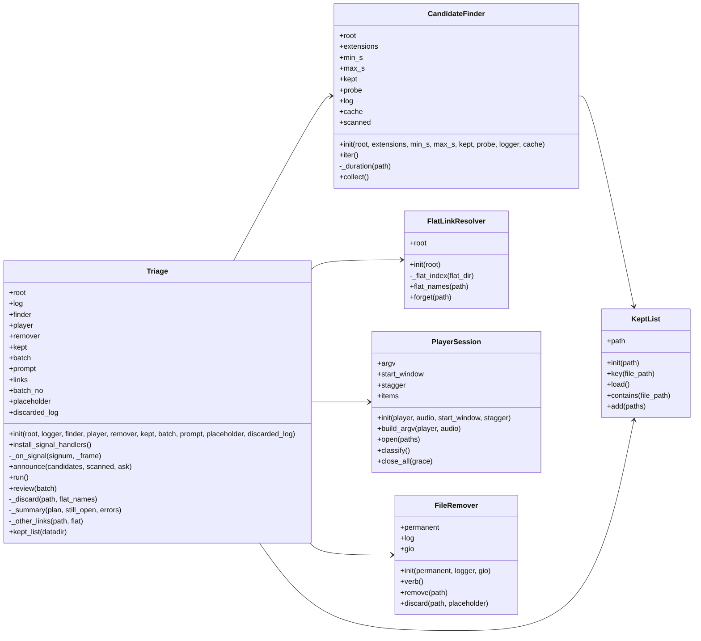{width=95% height=19cm}

| Class | Responsibility |
|---|---|
| `CandidateFinder` | search of videos within a duration range; `collect()` counts first |
| `PlayerSession` | one player process per video, classification |
| `FlatLinkResolver` | `_flat` names of a file by inode |
| `FileRemover` | `gio trash` or permanent deletion; `discard()` leaves a 0-byte placeholder |
| `KeptList` | decisions across sessions |
| `Triage` | batch workflow |

## Package `flatten`

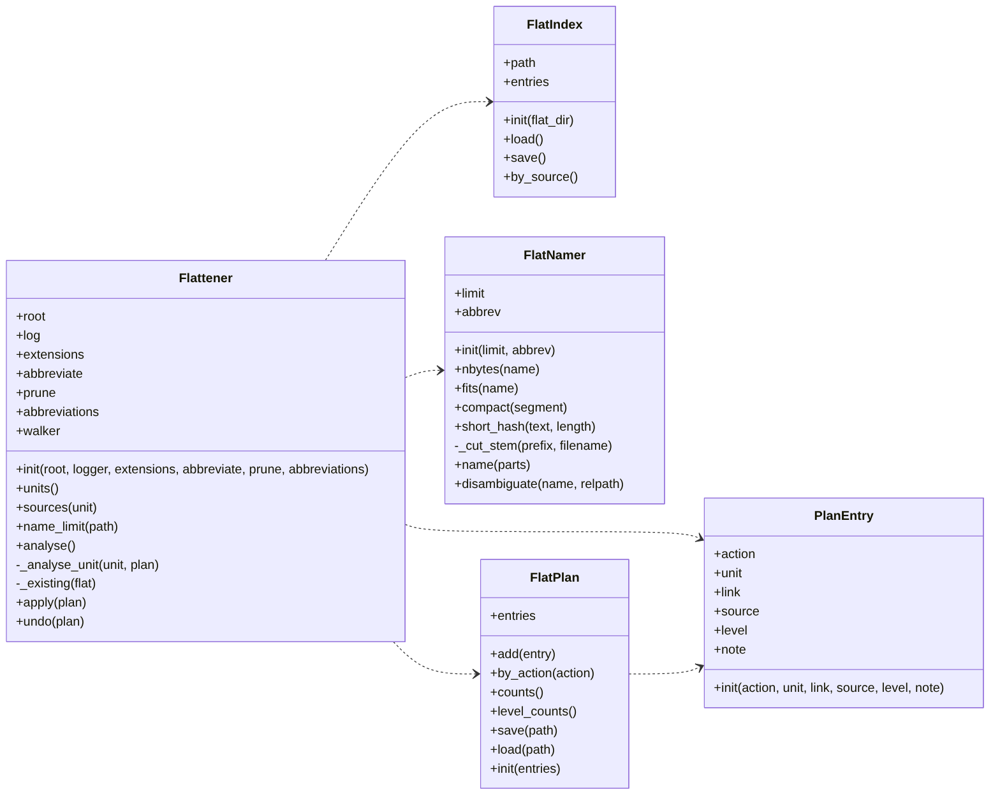{width=95% height=19cm}

| Class | Responsibility |
|---|---|
| `FlatNamer` | names within the byte limit, levels 0..3, disambiguation |
| `FlatIndex` | `_flat/_index.tsv`, atomic save |
| `PlanEntry`, `FlatPlan` | actions, counts, TSV persistence |
| `Flattener` | discovery, analysis, apply, undo |

## Package `sync`

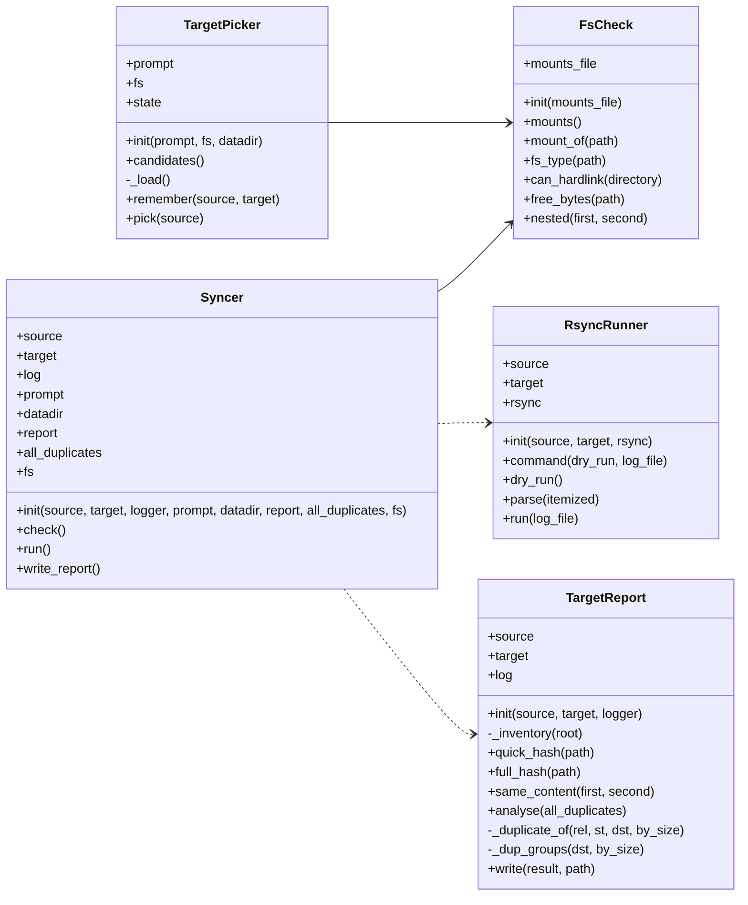{width=95% height=19cm}

| Class | Responsibility |
|---|---|
| `FsCheck` | mount table, fs type, practical hard-link test, nesting |
| `TargetPicker` | interactive disk choice, remembered per source |
| `RsyncRunner` | rsync command, dry-run parsing, real run |
| `TargetReport` | target-only files, duplicate detection by hash |
| `Syncer` | checks, dry run, confirmation, transfer, report |

## Package `snapshot`

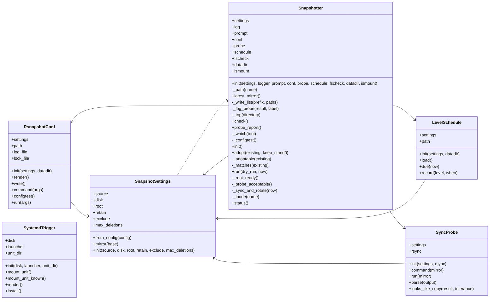{width=95% height=19cm}

| Class | Responsibility |
|---|---|
| `SnapshotSettings` | validated `[snapshot]` values, mirror path inside a snapshot |
| `RsnapshotConf` | generated `rsnapshot.conf`, `configtest`, rsnapshot calls |
| `SyncProbe` | rsync dry run: transfer volume, removals, plausibility |
| `LevelSchedule` | which higher levels are due, state file |
| `Snapshotter` | check, adopt, init, run, status |
| `SystemdTrigger` | user unit bound to the disk's mount unit |

## Package `cli`

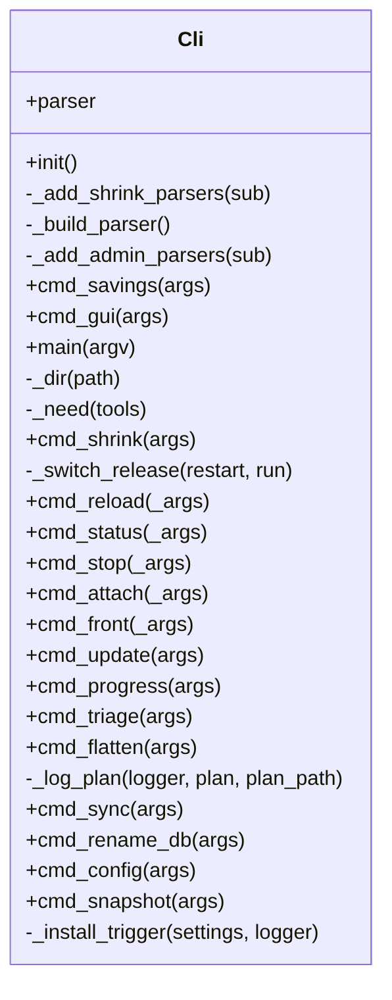{width=60% height=19cm}

`Cli` builds one `argparse` sub-parser per subcommand; `main()` dispatches
to `cmd_<name>(args)`, which creates the objects of that feature, wires
them and returns the exit code.

Arrows in the class diagrams: `-->` the class receives or creates the
collaborator in its constructor; `..>` the class uses it inside a method.
The diagrams are generated by `tools/gen_docs.py` from the code, so they
cannot drift from the implementation.

# Dynamic behaviour

## shrink

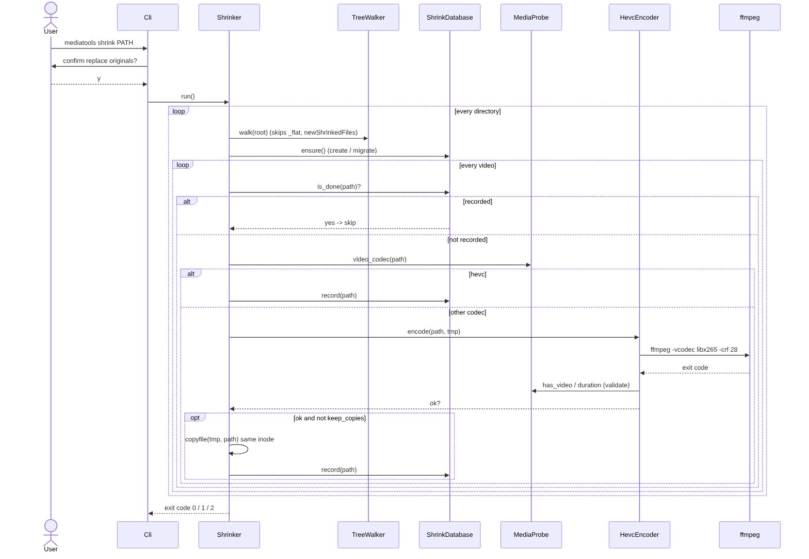{width=92%}

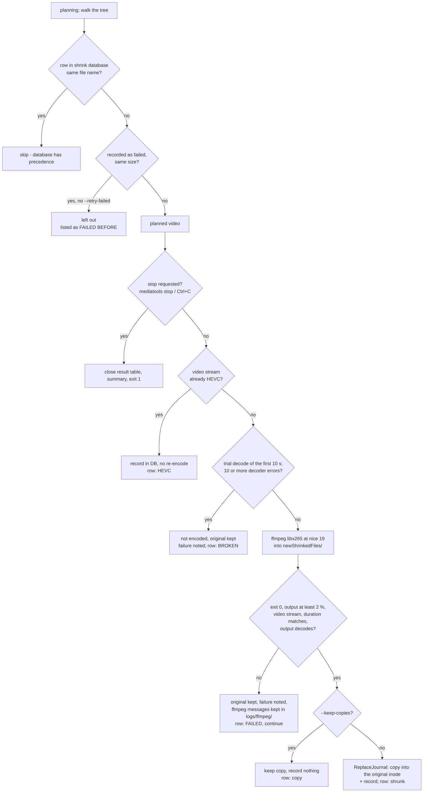{width=62%}

Invariants:

* the database is consulted before anything else;
* copy-back uses `shutil.copyfile`, which writes into the existing inode;
* copy-back and `record()` are not separated by a stop check.

## triage

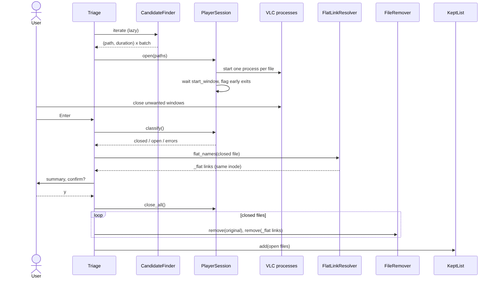{width=92%}

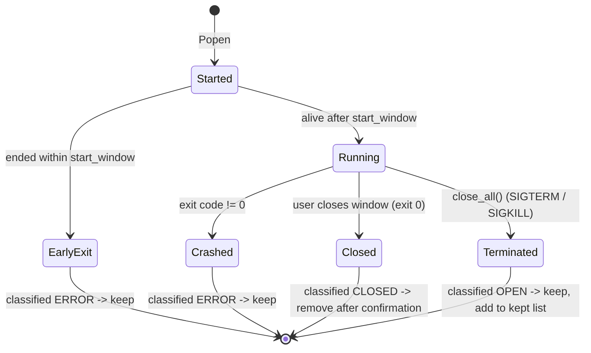{width=80%}

## flatten

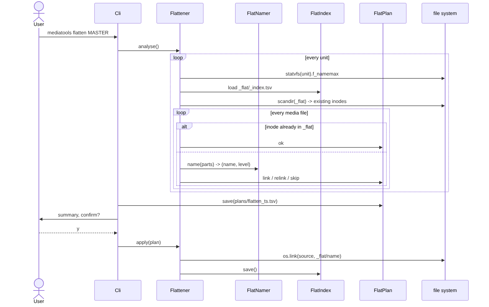{width=92%}

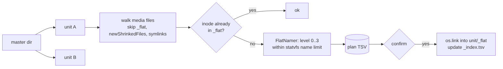{width=92%}

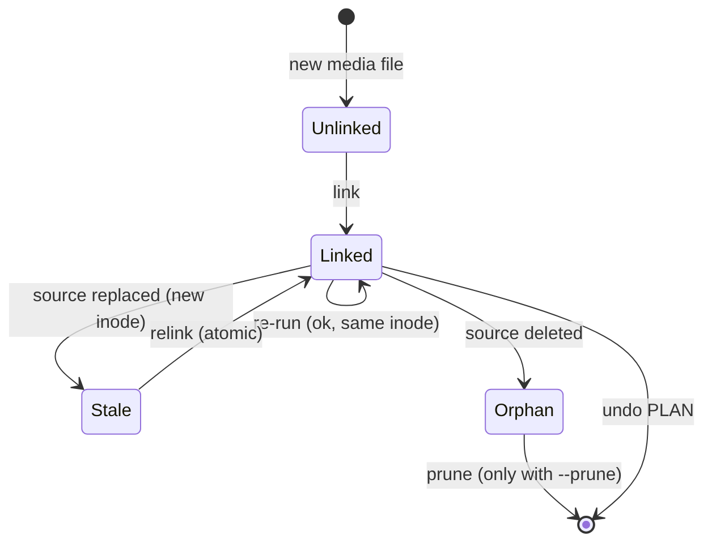{width=70%}

## sync

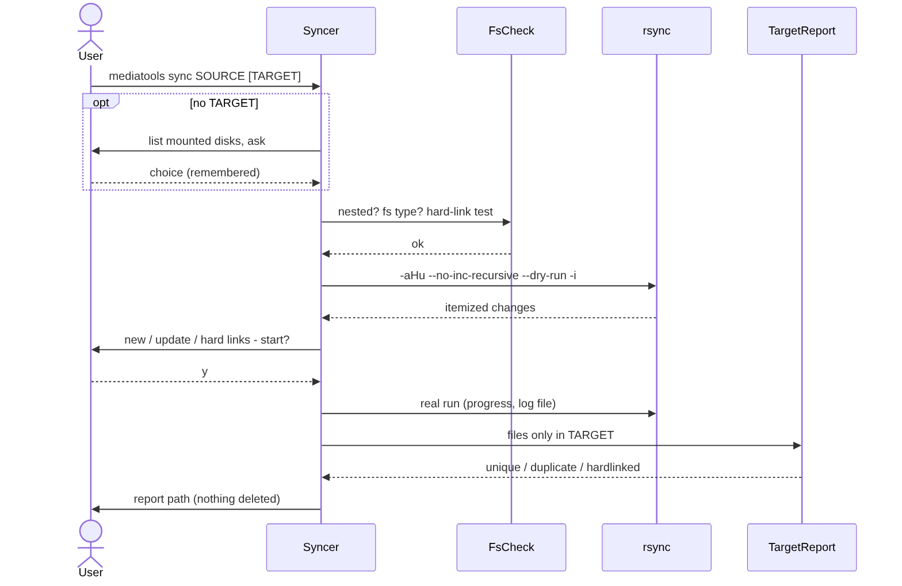{width=92%}

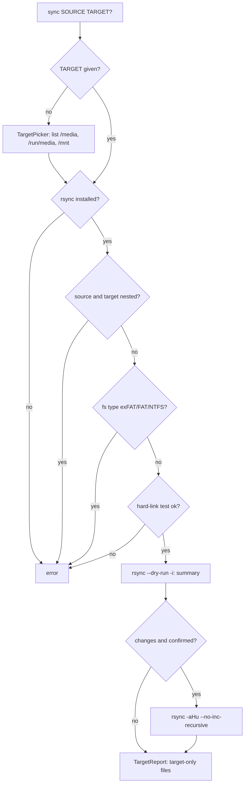{width=40%}

## snapshot

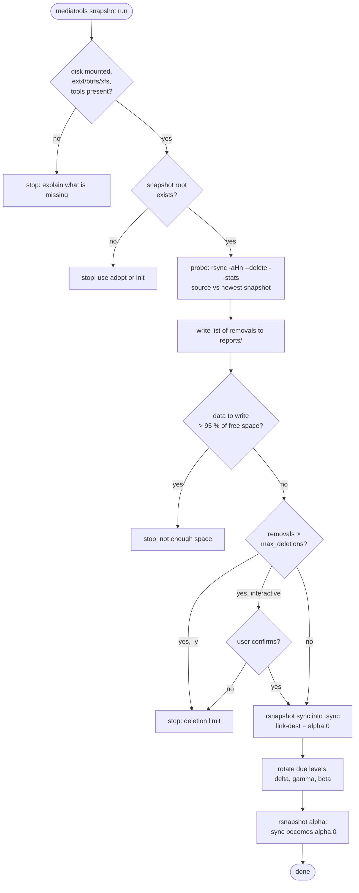{height=20cm}

Invariants:

* nothing on the disk is changed before a probe has run;
* `adopt` only renames within one file system and only after the probe has
  shown that at most 25 % of the source volume differs;
* `stand0` is a hard-link copy of `alpha.0`, never a rename (the next sync
  needs `alpha.0` as link destination);
* a level counts as rotated only if the inode of `<level>.0` changed.

# Data formats

~~~text
<data>/mediatools.ini                 Config           INI, see the handbook
<dir>/<db_name>                       ShrinkDatabase   SQLite, files(path PK, size, modified)
<dir>/<db_name>.bak_<ts>              ShrinkDatabase   copy before schema migration
<unit>/_flat/_index.tsv               FlatIndex        link name TAB relative source path
<data>/plans/flatten_<ts>.tsv         FlatPlan         action unit link source level note
<data>/state/triage_kept.tsv          KeptList         path TAB size TAB mtime
<data>/state/triage_discarded.tsv     Triage           time TAB size TAB path
<data>/state/triage_durations.tsv     DurationCache    path TAB size TAB mtime_ns TAB seconds
<data>/state/sync_targets.json        TargetPicker     {source: target}
<data>/reports/progress_*_<ts>.txt    ProgressReport   one path per line
<data>/state/shrink_throughput.json   ThroughputLog    {bytes, seconds}
<dir>/newShrinkedFiles/<n>.replace    Shrinker         journal marker during copy-back
<data>/reports/sync_target_only_*.tsv TargetReport     status size path same_as
<data>/logs/<command>_<ts>.log        RunLog           timestamp level message
<data>/snapshot/rsnapshot.conf        RsnapshotConf    generated, tab separated
<data>/state/snapshot_levels.json     LevelSchedule    {level: ISO time}
<data>/reports/snapshot_*_<ts>.txt    Snapshotter      removed paths, one per line
<disk>/<root>/<level>.<n>/...         rsnapshot        snapshot; source at localhost/<path>
<disk>/<root>/stand0/...              Snapshotter      first state, kept permanently
~~~

All text files are UTF-8; file names that are not valid UTF-8 are written
with `surrogateescape`, so they round-trip unchanged.

# Error handling, signals, exit codes

| Situation | Behaviour |
|---|---|
| missing external tool | `Cli._need` raises `SystemExit` with the tool names |
| ffmpeg fails / output invalid | file logged as FAILED, original kept, run continues, exit 2 |
| Ctrl+C in shrink | flag set; current ffmpeg stops; original untouched; exit 1 |
| Ctrl+C in triage | all players closed, nothing removed, exit 130 |
| link creation fails | logged, counted as `error`, flatten exits 1 |
| rsync exit 24 (vanished files) | accepted as success |
| target cannot hold hard links | sync refuses before copying anything |
| configuration value missing or invalid | `SystemExit` naming key, file and expected format |
| snapshot probe implausible | adopt/run refuse; top-level listings shown |
| deletion limit exceeded with `-y` | snapshot run aborts, exit 1 |

# Testing

## Strategy

* **Unit tests** per class with real files in `tmp_path`.
* **Test doubles** replace interaction: `FakePrompt` (fixed answers),
  `FakePlayer` (first window "closed"), the `fake_player` fixture (a shell
  script that behaves like a GUI player: SIGUSR1 = window closed, exit 0).
* **Integration tests** use the real ffmpeg, rsync and rsnapshot; they are
  skipped via `needs_ffmpeg` / `needs_rsync` / `needs_rsnapshot` when the
  tool is missing. Snapshot tests replace the mount check
  (`ismount=`) and the mount table (`FsCheck(mounts_file)`), so they run in
  a temporary directory.
* **End-to-end tests** call `Cli().main([...])`.
* Every test gets its own `MEDIATOOLS_HOME` (autouse fixture `datadir`).

## Coverage of the safety rules

~~~text
database precedence, HEVC skip, inode kept   test_shrinker_full_cycle
truncated output rejected                     test_encoder_rejects_duration_mismatch
progress is read-only                         test_progress_is_read_only
early player exit never deletes               test_player_early_exit_is_error
_flat link removed with the original          test_triage_removes_original_and_flat_link
no removal without confirmation               test_triage_not_confirmed_removes_nothing
database rows of a moved collection count     test_database_matches_by_name_after_move
1st Ctrl+C finishes, 2nd keeps the original   test_first_ctrl_c_finishes_current_file,
                                              test_second_ctrl_c_aborts_without_touching_original
interrupted copy-back is completed            test_interrupted_replacement_is_completed
private terms never reach a push              test_finds_terms_in_files_paths_and_messages
placeholder left, never overwrites a file     test_triage_removes_original_and_flat_link,
                                              test_placeholder_never_overwrites
placeholder never replaces a backup copy      test_sync_placeholder_keeps_backup_copy
originals untouched by flatten                test_flatten_never_touches_originals
hard links preserved, nothing deleted         test_sync_preserves_hardlinks_and_never_deletes
newer receiver file kept (rsync -u)           test_sync_update_does_not_overwrite_newer_target
wrong directory never adopted                 test_adopt_refuses_wrong_directory
adopt copies nothing, removals kept in stand0 test_adopt_then_run_keeps_removed_files
deletion limit stops unattended runs          test_adopt_then_run_keeps_removed_files
unmounted disk stops every action             test_check_requires_mounted_disk
database rename never overwrites              test_renamer_renames_and_respects_conflicts
~~~

# Quality gates

All gates live in one script, `tools/check.sh`. The pre-push hook and the CI
workflow call the same script, so a green local run predicts a green
pipeline. Everything runs as normal user; no root privileges are needed.
A full run requires ffmpeg, ffprobe, rsync and rsnapshot: without them the
integration tests would be skipped and the coverage would drop, so the
script stops with an installation hint instead.

~~~bash
pip install -e '.[dev]'                 # tools: pytest, pytest-cov, pylint,
                                        #        mypy, pycodestyle, bandit
git config core.hooksPath .githooks     # once per clone
tools/check.sh                          # all gates
tools/check.sh --fast                   # gates 1-4 only
~~~

| No. | Gate     | Tool        | Pass criterion                                     |
|-----|----------|-------------|----------------------------------------------------|
| 0   | privacy  | privacy_scan | no locally listed term in files, paths, commits   |
| 1   | format   | pycodestyle | PEP 8 layout, max line length 100                  |
| 2   | lint     | pylint      | 10.00/10, docparams/docstyle (Google style)        |
| 3   | types    | mypy        | no error; `check_untyped_defs`, `warn_unreachable` |
| 4   | security | bandit      | no finding                                         |
| 5   | tests    | pytest      | all pass, branch coverage >= 90 %                  |

**Privacy gate.** `tools/privacy_scan.py` searches all tracked files (PDFs
via `pdftotext`), file paths and commit messages for terms that would allow
conclusions about the processed data. The terms are never in the
repository; they come from `$MEDIATOOLS_HOME/privacy_denylist.txt` (one term
per line) and from the unit directory names below `[collection] root`.
Matching ignores case and whole words only (`cat` does not match `concatenate`);
terms shorter than three characters are ignored. Without local terms the
gate is skipped, which keeps CI neutral.

Ordinary words can be on the deny list and still be needed in technical
text. Instead of rewording, such uses are permitted by **allowed phrases**
in `$MEDIATOOLS_HOME/privacy_allowlist.txt` (same format, one phrase per
line). They are blanked out before the search: the term stays forbidden
everywhere else. Both lists stay outside the repository.

~~~bash
"${EDITOR:-nano}" ~/scripts/mediatools.d/privacy_denylist.txt
"${EDITOR:-nano}" ~/scripts/mediatools.d/privacy_allowlist.txt
python3 tools/privacy_scan.py
~~~

Notes on the configuration (`pyproject.toml`):

- **bandit** skips B404 and B603: the package calls ffmpeg, ffprobe, rsync,
  the player and gio deliberately via `subprocess` with fixed argument
  lists and never with `shell=True`. B324 (SHA-1) was fixed with
  `usedforsecurity=False`; the hash only shortens file names.
- **pytest** turns `ResourceWarning` and unraisable exceptions into errors.
  This gate found two real leaks during development: SQLite connections that were
  committed but never closed (`with sqlite3.connect()` does not close),
  and log handlers of recycled loggers that were dropped without `close()`.
- **coverage** compares with two decimals (`precision = 2`); with the
  default precision 0, 79.66 % is rounded to 80 % and passes a threshold of
  80 % although the report prints "FAIL".
- **mypy** runs in the moderate mode above; `--strict` is not a gate yet
  (34 findings, mostly missing generic parameters in tests).
- `python3 tools/gen_docs.py` followed by an unchanged `git status` shows
  that diagrams and API reference are up to date.

The pre-push hook (`.githooks/pre-push`) runs only when branches are
pushed, not for tag-only pushes. `git push --no-verify` bypasses it in an
emergency; CI still enforces all gates.

# Branching model

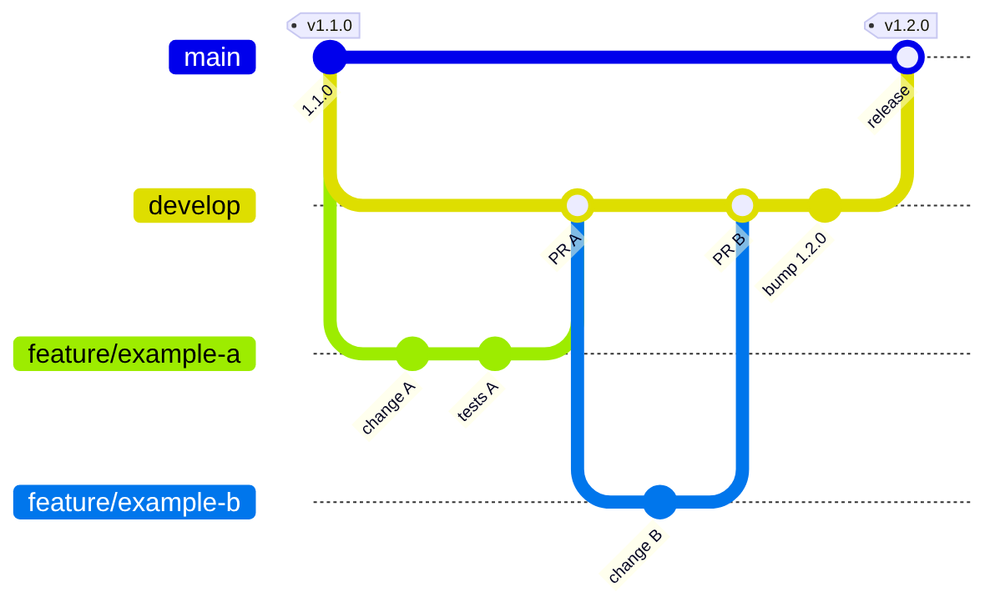{width=95%}

| Branch        | Purpose                               | From      | Into               |
|---------------|---------------------------------------|-----------|--------------------|
| `main`        | released states only, each one tagged | -         | -                  |
| `develop`     | integration of finished features      | `main`    | `main`             |
| `feature/<x>` | one feature or fix                    | `develop` | `develop` (PR)     |
| `release/<x>` | version, CHANGELOG and PDFs           | `develop` | `main` (PR)        |
| `hotfix/<x>`  | urgent fix of a release               | `main`    | `main` + `develop` |

Roles: developers work on `feature/*` and open pull requests into
`develop`. The **integrator** reviews and merges them, checks `develop` as
a whole and decides when a release is cut.

CI (`.github/workflows/tests.yml`) runs the gates on pull requests into
`main` and `develop`, on pushes to `main` and `develop` (the merges) and on
tags `v*`. Work branches are checked through their pull request only; a
push trigger for them as well would run every gate twice. A branch without
a pull request can be checked on demand:
`gh workflow run quality-gates --ref BRANCH`. For a tag, the extra job
`release-check` verifies that the tagged commit lies on `main` and that the
tag equals `v` + `__version__`.

## Branch protection

`main` and `develop` are protected on GitHub: changes only by pull request,
merge only with all three `gates` jobs green and the branch up to date, the
rule applies to administrators too, no force push, no deletion. Set once
per branch by the repository owner (normal user; `gh` acts with the owner's
token):

~~~bash
for branch in develop main; do
gh api -X PUT "repos/peddanet/mediatools/branches/$branch/protection" --input - <<'EOF'
{
  "required_status_checks": {
    "strict": true,
    "contexts": ["gates (3.10)", "gates (3.12)", "gates (3.13)"]
  },
  "enforce_admins": true,
  "required_pull_request_reviews": { "required_approving_review_count": 0 },
  "restrictions": null,
  "allow_force_pushes": false,
  "allow_deletions": false
}
EOF
done
~~~

`required_approving_review_count: 0` demands a pull request but no second
person's approval (single maintainer). Tags are not affected by branch
protection; the integrator pushes release tags directly.

## Feature cycle

~~~bash
git switch develop && git pull --ff-only
git switch -c feature/<name>
# ... edit, commit ...
tools/check.sh
git push -u origin feature/<name>        # hook runs the gates again
gh pr create --base develop --fill       # or in the web UI
# after review and green CI: merge the PR, then
git switch develop && git pull --ff-only
git branch -d feature/<name>
git push origin --delete feature/<name>
~~~

# Building the documentation

~~~bash
sudo apt install pandoc texlive-xetex texlive-latex-extra fonts-dejavu
npm install -g @mermaid-js/mermaid-cli
~~~

`sudo` is needed because apt and a global npm installation write to system
directories. The build itself runs as normal user:

~~~bash
cd ~/Projects/mediatools
python3 tools/gen_docs.py
cd docs/img && for f in *.mmd; do mmdc -i "$f" -o "${f%.mmd}.png" -s 2 -b white; done
cd .. && pandoc developer.md api.md -o developer.pdf --pdf-engine=xelatex \
  --highlight-style=tango --resource-path=.
pandoc handbook.md -o handbook.pdf --pdf-engine=xelatex --highlight-style=tango \
  --resource-path=.
~~~

# Release procedure

Performed by the integrator. Because `main` and `develop` are protected,
every step that changes a branch goes through a pull request.

1. Release branch from an up-to-date `develop`; set `__version__` in
   `src/mediatools/__init__.py` (Semantic Versioning), turn the
   `[Unreleased]` section of `CHANGELOG.md` into `[X.Y.Z] - date`, rebuild
   diagrams and PDFs, run `tools/check.sh`, commit "mediatools X.Y.Z":

~~~bash
git switch develop && git pull --ff-only
git switch -c release/X.Y.Z
# ... version, CHANGELOG, PDFs ...
git commit -am "mediatools X.Y.Z"
git push -u origin release/X.Y.Z
gh pr create --base main --title "Release X.Y.Z" --fill
gh pr checks --watch && gh pr merge --merge --delete-branch
~~~

2. Tag the merge commit on `main` and push the tag; CI runs
   `release-check` for it:

~~~bash
git switch main && git pull --ff-only
git tag -a vX.Y.Z -m "mediatools X.Y.Z"
git push origin vX.Y.Z
~~~

3. Bring the release back into `develop` (pull request from `main`):

~~~bash
gh pr create --base develop --head main --title "Merge release X.Y.Z into develop" \
  --body "Back-merge of release X.Y.Z."
gh pr checks --watch && gh pr merge --merge
git switch develop && git pull --ff-only
~~~

4. Install the release on the own machine: `./install.sh` (newest tag).

Merge commits (no squash, no rebase) keep every commit; `git log
--first-parent main` lists exactly the releases. A hotfix branches from
`main`, goes into `main` by pull request (tag `vX.Y.Z+1`) and back into
`develop` as in step 3.

# Adding a subcommand

1. Create `src/mediatools/<feature>/` with one class per module and an
   `__init__.py` that exports the classes.
2. Import only from `mediatools.core`.
3. Add a sub-parser in `Cli._build_parser` and a method `cmd_<name>` that
   wires the objects and returns an exit code.
4. Add tests (unit, integration, CLI).
5. Run the quality gates; regenerate diagrams and API reference.
6. Document the command in `README.md`, `docs/handbook.md` and here.

# Glossary

**Bandit** -- static security analyser for Python (PyCQA).
[bandit configuration](https://bandit.readthedocs.io/en/1.9.3/config.html)

**Activity diagram** -- UML diagram of a decision flow (here Mermaid
flowcharts). [UML specification (OMG)](https://www.omg.org/spec/UML/)

**Dependency injection** -- collaborators are passed in instead of being
created inside a class.

**docparams** -- pylint extension that checks parameter, return, yield and
raise documentation.
[pylint docparams](https://pylint.readthedocs.io/en/latest/user_guide/checkers/extensions.html)

**git-flow** -- branching model with the long-lived branches `main`
(releases) and `develop` (integration) plus short-lived feature, release
and hotfix branches (V. Driessen, 2010).
[A successful Git branching model](https://nvie.com/posts/a-successful-git-branching-model/)

**Google-style docstring** -- docstring layout with `Args:`, `Returns:`,
`Raises:` sections.
[Google Python Style Guide](https://google.github.io/styleguide/pyguide.html)

**Integrator** -- role that reviews and merges pull requests into
`develop` and cuts releases (merge into `main`, tag).

**mypy** -- static type checker for Python.

**pre-push hook** -- script in the hooks directory (`core.hooksPath`) that
git runs before a push; a non-zero exit code aborts the push.

**Branch protection** -- GitHub rule that blocks direct pushes, force
pushes and merges without passing status checks on a branch.
[About protected branches](https://docs.github.com/en/repositories/configuring-branches-and-merges-in-your-repository/managing-protected-branches/about-protected-branches)

**Mermaid** -- text format for diagrams, rendered by GitHub and `mmdc`.
[mermaid.js.org](https://mermaid.js.org/)

**Sequence diagram** -- UML diagram of messages between participants over
time.

**State diagram** -- UML diagram of the states of one object and the
transitions between them.

**Test double** -- replacement object used in tests instead of a real
collaborator.

# Sources

| Source | Status |
|---|---|
| [pylint extensions (docparams)](https://pylint.readthedocs.io/en/latest/user_guide/checkers/extensions.html) | standard reference; behaviour checked with pylint 4.1.3 |
| [Google Python Style Guide, section 3.8 Comments and Docstrings](https://google.github.io/styleguide/pyguide.html) | standard reference, not retrieved in this session |
| [Mermaid documentation](https://mermaid.js.org/) | standard reference; diagrams rendered with mermaid-cli |
| [UML specification (OMG)](https://www.omg.org/spec/UML/) | standard reference, not retrieved in this session |
| [V. Driessen: A successful Git branching model (2010)](https://nvie.com/posts/a-successful-git-branching-model/) | found via search 2026-11-03; original domain not fetchable from the build sandbox, content confirmed through mirrors |
| [GitHub Docs: About protected branches](https://docs.github.com/en/repositories/configuring-branches-and-merges-in-your-repository/managing-protected-branches/about-protected-branches) | found via search 2026-11-03; required status checks and PR requirement confirmed |
| [bandit configuration (1.9.3)](https://bandit.readthedocs.io/en/1.9.3/config.html) | found via search 2026-11-03; `[tool.bandit]` requires `-c pyproject.toml` |
| [Python docs: sqlite3, connection context manager](https://docs.python.org/3/library/sqlite3.html#sqlite3-connection-context-manager) | not fetchable from the sandbox; note "neither ... opens a new transaction nor closes the connection" confirmed via the quote in [discuss.python.org #41663](https://discuss.python.org/t/sqlite3-connection-and-general-concepts/41663) |
| [mypy configuration file](https://mypy.readthedocs.io/en/stable/config_file.html) | standard reference, not retrieved; behaviour checked with the installed mypy |
| [git: githooks(5)](https://git-scm.com/docs/githooks) | standard reference, not retrieved; pre-push stdin format checked against local git |
| User handbook `docs/handbook.md` | sources for rsync, eCryptfs, ffmpeg, SQLite |

\newpage
