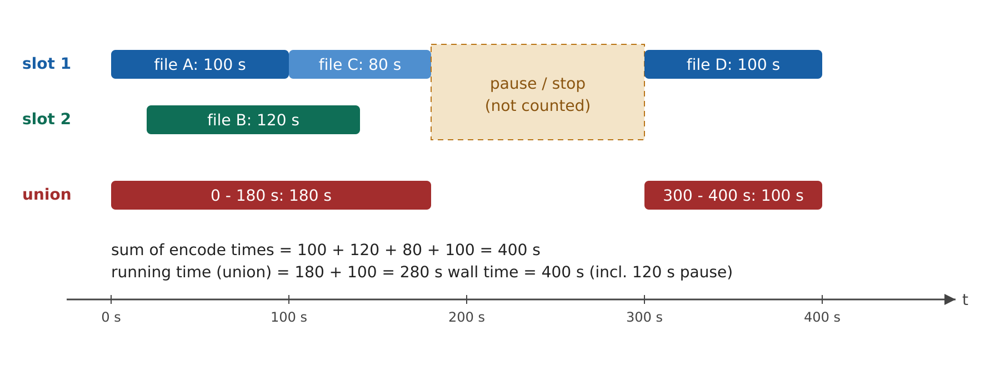

# Reading guide

Section 2 says what the ETA is and where it appears. Section 3 introduces
the data (the ledger) and the one idea everything rests on: **running
time**. Section 4 is the formula used up to 1.17.0, section 5 what was wrong
with it and the fix in 1.17.1. Section 6 explains how a forecast is checked
against the past, section 7 the measured results, column by column. Section 8
is the proposed model for a later release. Section 9 lists the limits of the
measurement. Every term set in *italics* on first use is explained in the
glossary (section 10).

All numbers in this document use **decimal** units for speeds
(1 MB = 1,000,000 bytes) and **binary** units for amounts of data, as the
progress display does (1 GiB = 1,073,741,824 bytes = 1.074 GB). The figures
come from about 17,000 videos of earlier runs on one laptop; they describe
that machine and those settings, not a general law.

# What the ETA is

During `mediatools shrink` the progress display shows a line like

~~~text
job  [######################.]  98.4 % | ETA 4h33m | ...
~~~

**ETA** is the time the job still needs to finish *the videos of its plan*,
if nothing is paused. Two other times appear elsewhere and must not be
confused with it:

| Where | Name | Computed | Changes during the run |
|---|---|---|---|
| line "to encode: N files, X GiB, about T (at plan time)" | plan estimate | once, when the plan is made | no |
| progress line "ETA ..." | ETA | every refresh | yes |
| queue list "done / to go" | amounts, no time | every refresh | yes |

The ETA is a quotient:

$$\text{ETA} = \frac{\text{source bytes still to go}}{\text{speed}}$$

The numerator is exact: the planner knows the size of every video it has not
finished yet. All difficulty lies in the **speed**: how many source bytes the
machine turns into shrunk videos per second. The rest of this document is
about measuring that speed well.

# The data: ledger and running time

## The ledger

Every finished video adds one line to `~/.local/share/mediatools/ledger.tsv`
(the *ledger*). Its columns:

| No. | Column | Meaning | Example |
|---|---|---|---|
| 1 | when | date and time the video **ended** | `2026-01-01 12:00:00` |
| 2 | session | name of the shrink log of the run that did it | `shrink_2026-01-01_11-00-00` |
| 3 | status | `shrunk`, `copy`, `HEVC` (already small codec, skipped), `FAILED`, `BROKEN` | `shrunk` |
| 4 | source bytes | size of the original | `41000000` |
| 5 | result bytes | size after shrinking (empty if none) | `8200000` |
| 6 | seconds (*took*) | wall-clock seconds this video occupied one encoder slot | `24.0` |
| 7 | playing seconds | length of the video when played | `95.0` |
| 8 | mtime | modification time of the original | - |
| 9 | path | where the video lies | - |

Only rows with status `shrunk` or `copy`, a positive *took* and positive
source bytes are used for the speed; skipped and failed videos cost (almost)
no encoding time.

## Encode interval

From columns 1 and 6 follows when a video was being encoded: it ended at
`when` and took `took` seconds, so it occupied the *interval*

$$[\,\text{end} - \text{took},\ \text{end}\,]$$

## Running time: the union of the intervals

With `--jobs 2` two videos are encoded at the same time, in two *slots*. Their
intervals overlap. If one simply added up the *took* values, one second in
which two videos were encoded would count twice, and the speed would come out
half as large as it really is. If one used the clock time from the first to
the last video instead, a stop, a crash or a night with the laptop closed
would count as working time, and the speed would again be too small.

mediatools therefore uses the **running time**: the length of the *union*
of all encode intervals - every second in which **at least one** video was
being encoded counts exactly once; seconds with no encode count not at all.

{width=100%}

In the picture: slot 1 encodes A (0-100 s) and C (100-180 s), slot 2 encodes B
(20-140 s), then nothing runs for 120 s, then D (300-400 s). The union is
0-180 s and 300-400 s, together 280 s. The union is computed by sorting the
intervals by their start and merging every interval that begins before the
previous one ends (`RecentSpeed.busy`).

## Speed

The speed of a set of videos is

$$v = \frac{\sum \text{source bytes}}{\text{running time}} \quad\text{in bytes per second}$$

It is the rate at which the *whole machine* works through the queue, with
all parallel slots together - exactly the rate at which the "to go" amount
shrinks.

# The method up to 1.17.0

## Formula

`RecentSpeed.rate()` walks through the ledger **backwards**, from the newest
row to older ones, and collects rows until their running time covers a
*window* of three hours:

| Constant | Value | Meaning |
|---|---|---|
| `WINDOW` | 3 × 3600 s | running time that makes up the speed |
| `MIN_FILES` | 5 | with fewer usable rows there is no speed (the display falls back to the average since the start) |
| `MAX_ROWS` | 2000 | at most this many rows are looked at |

The speed is the source bytes of the collected rows divided by their running
time, and

$$\text{ETA} = \frac{\text{bytes to go}}{v_{\text{window}}}$$

The window has a purpose: material changes during a run (codec, resolution,
bitrate), and the speed should follow such a change within hours instead of
averaging over days. Because the ledger survives the process, the speed does
not start from zero after `mediatools reload` or a restart.

## What went wrong

The ledger contains the videos of **every** job, and up to 1.17.0 the window
took the newest rows regardless of which job had produced them. When a job
starts right after another one, its window is for hours filled mostly with
the other job's videos.

A real case (rounded): job 1 had finished with very small videos at a low
speed; job 2 started right after it.

| Run | Videos | Average size | Speed |
|---|---|---|---|
| job 1 (ended) | 1286 | 10.1 MB | 1.01 MB/s |
| job 2 (running) | 565 | 41.1 MB | 3.38 MB/s |

About 80 minutes into job 2, the three-hour window still held about 100
minutes of job 1. With 30.3 GiB (32.5 GB) still to go:

| Speed used | Value | ETA |
|---|---|---|
| window over all jobs (shown) | 1.99 MB/s | 4 h 33 min |
| only job 2 | 3.38 MB/s | 2 h 40 min |

The shown ETA was about 1.7 times too long. It would have corrected itself
only after job 1 had left the window, and while that happens the ETA falls
*faster* than the clock - which is why a test "the ETA falls by 60 minutes
per hour" failed.

# The fix in 1.17.1: only the running job

Since 1.17.1 `RecentSpeed` receives a test `belongs(row)` and skips every row
for which it is false. The shrinker passes:

| Case | Test | Meaning |
|---|---|---|
| the run belongs to a job (normal case) | `JobSpec.matches` | the video lies below the job's folder, has a processed extension and passes its filters (minimum size, minimum playing time, date) |
| no job known | `row.session == <this session>` | only videos of this run |
| neither | none | every row (the old behaviour) |

`MAX_ROWS` now counts rows *of the job*. A job continued after a stop or
with other settings keeps its earlier rows, because the job is defined by
what it selects, not by how it encodes. Section 7 shows what the fix changes
in numbers (method A against A').

# How a forecast is checked: the backtest

## Idea

A *backtest* replays the past: for a finished run we know when every video
ended, so we can stop the film at any moment, let a method predict the
remaining time **using only what was known at that moment**, and compare the
prediction with what really happened afterwards.

## Checkpoints

For every run with at least 150 videos and the dominant settings (2 jobs,
preset `faster`, 11 threads), checkpoints were set after 10 %, 20 %, ... 90 %
of its videos. Nine runs gave 81 checkpoints.

## True remaining time

At a checkpoint the **true remaining time** is the running time (union of
the encode intervals, section 3) of all videos of that run that ended after
the checkpoint. Pauses after the checkpoint are therefore not counted -
fairly, because no method can foresee a pause.

## Relative error

For each checkpoint and method:

$$e = \frac{\text{predicted} - \text{true}}{\text{true}} \times 100\,\%$$

| e | Meaning | Example (true 2 h) |
|---|---|---|
| 0 % | exact | predicted 2 h |
| +50 % | 1.5 times too long | predicted 3 h |
| +100 % | twice too long | predicted 4 h |
| +114 % | 2.14 times too long | predicted 4 h 17 min |
| -50 % | half as long as real | predicted 1 h |
| -100 % | predicted zero | predicted 0 h |

A too short forecast can be at most 100 % wrong; a too long one has no upper
limit. Large percentages therefore always mean "far too long".

## Summary figures

81 errors are too many to read one by one; each method is summarised by
four figures:

| Figure | How it is computed | What it tells |
|---|---|---|
| **median of abs(e)** | sort the 81 absolute errors, take the middle one (the 41st) | the typical error: half of the forecasts are better than this |
| **90th percentile of abs(e)** | sort, take the value below which 90 % lie (about the 73rd) | the bad cases: only 1 forecast in 10 is worse than this |
| **bias** | median of e **with** its sign | a systematic tendency: negative = too short, positive = too long; near 0 = no tendency |
| **within +-20 %** | share of checkpoints with abs(e) of 20 % or less | how often the ETA is "about right" |

The median is used instead of the average because single wild forecasts would
dominate an average.

# Results

## Methods compared

| Name | What it predicts with |
|---|---|
| A | up to 1.17.0: three-hour window over **all** rows of the ledger |
| A' | since 1.17.1: three-hour window over rows of the **running job** (in the backtest: of the same run) |
| C | proposal (section 8): model of the time per video from size and playing time, updated after every video (RLS, forgetting factor 0.999) |
| A' + C | proposal: the mean of the forecasts of A' and C |

## Overall

| Method | Median abs(e) | 90th percentile abs(e) | Bias | Within +-20 % |
|---|---|---|---|---|
| A | 21 % | 114 % | -9 % | 49 % |
| A' | 14 % | 29 % | -13 % | 74 % |
| C | 12 % | 39 % | +1.5 % | 69 % |
| A' + C | 12 % | 27 % | -5.5 % | 82 % |

How to read the first row: with method A a typical forecast was 21 % off;
one in ten was more than 114 % off, i.e. more than twice too long; across
all checkpoints the forecasts were slightly too short (-9 %), and only about
every second forecast was within +-20 %.

What the rows say together:

1. **A' removes the bad cases.** The 90th percentile falls from 114 % to
   29 %: the forecasts that were twice too long came from other jobs in the
   window.
2. **A' is too short by about 13 %.** Within a job, the speed of the recent
   past is usually higher than that of the rest - presumably because the
   material changes in the order of the job (with `--order largest` the
   large videos, which take fewer seconds per MB in the model of section 8,
   come first). A window of the past cannot see that change coming.
3. **C has almost no bias** (+1.5 %), because it predicts every remaining
   video from its own size and playing time instead of extrapolating a past
   speed.
4. **The mean of A' and C** is the best compromise: four out of five
   forecasts within +-20 %.

## By order of the job

Median abs(e):

| Order | A | A' | C |
|---|---|---|---|
| `largest` | 15 % | 17 % | 9 % |
| `smallest` | 82 % | 8 % | 13 % |

With `--order smallest` method A was off by 82 % in the typical case - the
situation of the incident in section 4.

## By progress of the job

Median abs(e) at each checkpoint:

| Progress | A | A' | C | A' + C |
|---|---|---|---|---|
| 10 % | 15 % | 15 % | 10 % | 12 % |
| 30 % | 13 % | 9 % | 4 % | 7 % |
| 50 % | 28 % | 17 % | 9 % | 9 % |
| 70 % | 17 % | 14 % | 15 % | 15 % |
| 90 % | 24 % | 22 % | 30 % | 17 % |

Near the end the remaining time is short, so a few minutes of difference
make a large percentage.

# Proposal for a later release: a model per video

Not part of 1.17.1. This section explains the method so that the decision
can be made with full information.

## Linear regression

Instead of one speed for all videos, the time of **each** video is predicted
from properties it has before it is encoded. A *linear regression* writes
that time as a weighted sum:

$$t = a + b \cdot S + c \cdot L$$

| Symbol | Meaning | Unit |
|---|---|---|
| $t$ | predicted *took* of the video (time in one slot) | s |
| $S$ | source size | MB |
| $L$ | playing time | s |
| $a$ | fixed time per video (start of ffmpeg, check, database) | s |
| $b$ | time per MB | s/MB |
| $c$ | time per second of video | s/s |

$a$, $b$ and $c$ are the *parameters*: unknown at first, determined from the
ledger.

## Least squares

For every finished video the model makes an error, the *residual*
$r = t_{\text{real}} - t_{\text{model}}$. The *method of least squares*
chooses $a$, $b$, $c$ so that the sum of the squared residuals over all
videos is as small as possible. Squaring makes large misses count much more
than small ones and makes plus and minus errors not cancel each other.

Fitted on about 17,000 videos of the dominant settings:

| Model | Formula | R² |
|---|---|---|
| size only | $t = 8.5 + 0.74 \cdot S$ | 0.74 |
| playing time only | $t = 27.7 + 0.29 \cdot L$ | 0.67 |
| **both** | $t = -0.2 + 0.49 \cdot S + 0.16 \cdot L$ | **0.86** |

*R²* (coefficient of determination) is the share of the variation of the real
times that the model explains: 1 would be perfect, 0 no better than always
predicting the average. Both properties together explain 86 %. The fixed time
$a$ is practically zero: what makes a small video slow is a long playing
time (a low bitrate), not a fixed cost per file.

## From the model to the ETA

The planner knows size and playing time of every remaining video. With $k$
parallel slots:

$$\text{ETA} = \frac{1}{p}\sum_{\text{remaining videos}} \left(a + b \cdot S_i + c \cdot L_i\right)$$

$p$ is the *parallel factor*: the sum of the *took* values divided by the
running time, measured on earlier runs (with 2 jobs close to 2; less when
slots wait for each other).

## Recursive least squares and the forgetting factor

A fit over all past videos cannot follow a change of the machine (a hot
processor running slower, another program using the cores). *Recursive least
squares* (RLS) updates $a$, $b$, $c$ after **every** finished video with a
small correction instead of refitting everything. A *forgetting factor*
$\lambda$ slightly below 1 gives every older video a little less weight:
with $\lambda = 0.999$ a video 1000 videos back counts about
$0.999^{1000} \approx 0.37$ times as much as the newest one.

| $\lambda$ | Median abs(e) | 90th percentile abs(e) |
|---|---|---|
| 0.995 | 32 % | 232 % |
| 0.998 | 44 % | 363 % |
| 0.999 | 12 % | 39 % |
| 0.9995 | 16 % | 41 % |

A smaller $\lambda$ forgets faster - and in this test became unstable.

## Covariance matrix and why RLS can become unstable

RLS keeps, besides $a$, $b$, $c$, a 3 × 3 table $P$, the *covariance matrix*
of the parameters. *Covariance* measures how two quantities vary together
(positive: both tend to be large together; negative: one large, the other
small). In RLS, $P$ says how uncertain each parameter still is and how the
uncertainties of two parameters depend on each other; RLS uses it to decide
how large the correction after a new video is: large while uncertain, small
once the parameters are well known.

The forgetting factor divides $P$ by $\lambda$ after every video, so the
uncertainty grows again. When the videos for a while vary little in size
and playing time (`--order smallest` produces long series of almost equal
videos), the data no longer contain information to reduce $P$ in every
direction, and $P$ grows in those directions without limit (*windup*). The
next unusual video then causes a huge correction. That is what happened with
$\lambda$ = 0.995 and 0.998. Remedies, needed before C can be built in:

1. *Normalise* the inputs (feature scaling): MB and seconds have very
   different ranges; scaled to similar ranges, $P$ is better conditioned.
2. Limit $P$ (an upper bound on its entries, or a reset when it grows).
3. Keep $\lambda$ close to 1 (0.999).

## Combination

Averaging the forecasts of A' and C (*ensemble averaging*) works because
their errors are of different kinds: A' follows the current machine speed
but does not know the remaining material; C knows the remaining material but
reacts slowly to the machine. Where one is wrong the other often is less.

# Limits of the measurement

1. **Selection on the same data.** The variants ($\lambda$, mean of A' and C)
   were chosen on the same 81 checkpoints on which they are judged; on new
   runs the figures will probably be somewhat worse.
2. **Dependent checkpoints.** The nine checkpoints of one run are not
   independent; in effect there are nine observations, not 81.
3. **One machine, one setting.** The parameters belong to one laptop with
   2 jobs, preset `faster`, CRF 28 and 11 threads; other settings need their
   own parameters.
4. **Backtest of A' by run, implementation by job.** The backtest restricted
   A' to the rows of the same run; 1.17.1 uses the rows of the same job,
   which also keeps the rows of earlier runs of that job. That can only add
   useful rows, but it was not measured separately.

# Glossary

**Backtest** - checking a forecasting method on past data, using at each
moment only what was known then. <https://en.wikipedia.org/wiki/Backtesting>

**Bias** - a systematic tendency of forecasts to be too high or too low; here
the median of the signed relative errors.
<https://en.wikipedia.org/wiki/Forecast_bias>

**Checkpoint** - a moment in a past run at which a forecast is made and later
compared with reality (here after 10 %, 20 %, ... 90 % of the videos).

**Covariance** - a measure of how two quantities vary together.
<https://en.wikipedia.org/wiki/Covariance>

**Covariance matrix** - a square table of the covariances of every pair of
quantities; in RLS the uncertainty of the parameters.
<https://en.wikipedia.org/wiki/Covariance_matrix>

**Encode interval** - the time span `[end - took, end]` in which one video
occupied an encoder slot.

**Ensemble averaging** - combining the outputs of several models instead of
relying on one. <https://en.wikipedia.org/wiki/Ensemble_averaging_(machine_learning)>

**ETA** - estimated time of arrival; here the time a shrink job still needs.

**Feature scaling (normalisation)** - bringing inputs of different units and
ranges to comparable ranges before fitting.
<https://en.wikipedia.org/wiki/Feature_scaling>

**Forgetting factor ($\lambda$)** - in RLS, the factor by which the weight of
every older observation is reduced per new one; 1 forgets nothing.
<https://en.wikipedia.org/wiki/Recursive_least_squares_filter>

**GiB, MB** - binary and decimal units: 1 GiB = 2^30 bytes, 1 MB = 10^6 bytes.
<https://en.wikipedia.org/wiki/Byte>

**Interval, union of intervals** - an interval is all points between two
ends; the union of several intervals is every point lying in at least one of
them. <https://en.wikipedia.org/wiki/Interval_(mathematics)>

**Job** - the set of videos a shrink run works on: a folder plus filters
(`JobSpec`); it may span several runs.

**Least squares** - choosing model parameters so that the sum of squared
differences between observed and predicted values is minimal.
<https://en.wikipedia.org/wiki/Least_squares>

**Ledger** - `ledger.tsv`, one line per finished video (section 3.1).

**Linear regression** - a model that describes a quantity as a weighted sum of
other quantities plus a constant. <https://en.wikipedia.org/wiki/Linear_regression>

**Median** - the middle value of sorted data: half lie below, half above.
<https://en.wikipedia.org/wiki/Median>

**Parallel factor** - sum of the encode times divided by the running time;
about 2 with two encoder slots that are always busy.

**Percentile (90th)** - the value below which 90 % of the data lie.
<https://en.wikipedia.org/wiki/Percentile>

**R² (coefficient of determination)** - the share of the variation of the
observed values that a model explains; 1 is perfect.
<https://en.wikipedia.org/wiki/Coefficient_of_determination>

**Recursive least squares (RLS)** - least squares that updates its parameters
with every new observation instead of refitting all data.
<https://en.wikipedia.org/wiki/Recursive_least_squares_filter>

**Relative error** - (predicted - true) / true, in percent; the basis of the
mean absolute percentage error.
<https://en.wikipedia.org/wiki/Mean_absolute_percentage_error>

**Residual** - the difference between an observed value and the value the
model predicts for it. <https://en.wikipedia.org/wiki/Residual_(numerical_analysis)>

**Running time** - the length of the union of the encode intervals: every
second in which at least one video was encoded, counted once.

**Session** - one shrink run, named after its log file; `mediatools reload`
continues the session.

**Slot** - one of the `--jobs` encoders that run at the same time.

**Took** - wall-clock seconds one video occupied a slot (ledger column 6).

**Window** - the newest three hours of running time from which the speed is
taken.

**Windup** - unlimited growth of the covariance matrix in RLS when the data
carry too little information in some direction; makes the next correction
huge.

# Sources

1. Least squares - Wikipedia. <https://en.wikipedia.org/wiki/Least_squares>
2. Recursive least squares filter - Wikipedia.
   <https://en.wikipedia.org/wiki/Recursive_least_squares_filter>
3. Coefficient of determination - Wikipedia.
   <https://en.wikipedia.org/wiki/Coefficient_of_determination>
4. Covariance - Wikipedia. <https://en.wikipedia.org/wiki/Covariance>
5. Covariance matrix - Wikipedia. <https://en.wikipedia.org/wiki/Covariance_matrix>
6. Median - Wikipedia. <https://en.wikipedia.org/wiki/Median>
7. Percentile - Wikipedia. <https://en.wikipedia.org/wiki/Percentile>
8. Backtesting - Wikipedia. <https://en.wikipedia.org/wiki/Backtesting>
9. Linear regression - Wikipedia. <https://en.wikipedia.org/wiki/Linear_regression>
10. Forecast bias - Wikipedia. <https://en.wikipedia.org/wiki/Forecast_bias>
11. Mean absolute percentage error - Wikipedia.
    <https://en.wikipedia.org/wiki/Mean_absolute_percentage_error>
12. Feature scaling - Wikipedia. <https://en.wikipedia.org/wiki/Feature_scaling>
13. Byte - Wikipedia. <https://en.wikipedia.org/wiki/Byte>
14. Ensemble averaging (machine learning) - Wikipedia.
    <https://en.wikipedia.org/wiki/Ensemble_averaging_(machine_learning)>
15. Interval (mathematics) - Wikipedia.
    <https://en.wikipedia.org/wiki/Interval_(mathematics)>
16. Residual (numerical analysis) - Wikipedia.
    <https://en.wikipedia.org/wiki/Residual_(numerical_analysis)>
17. Source code: `src/mediatools/shrink/recentspeed.py`,
    `src/mediatools/shrink/jobspec.py`, `src/mediatools/shrink/shrinker.py`.

All links were checked on 2026-11-28.
