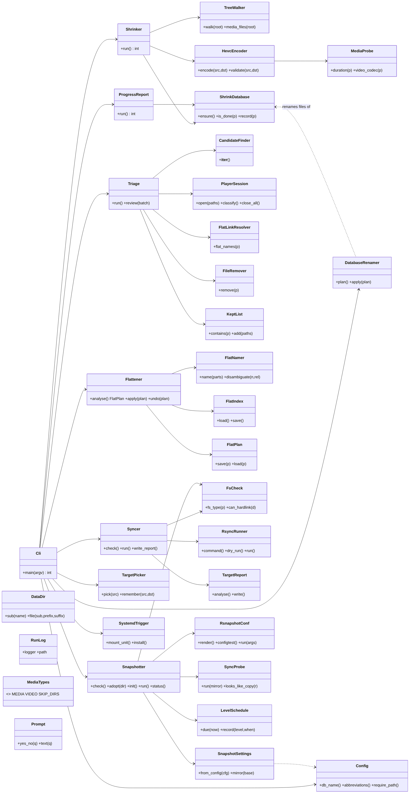
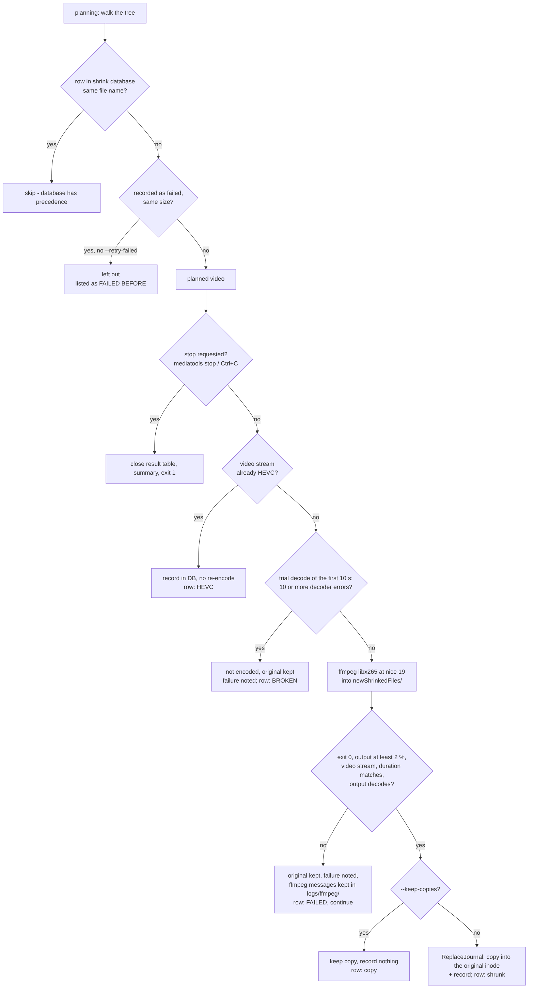
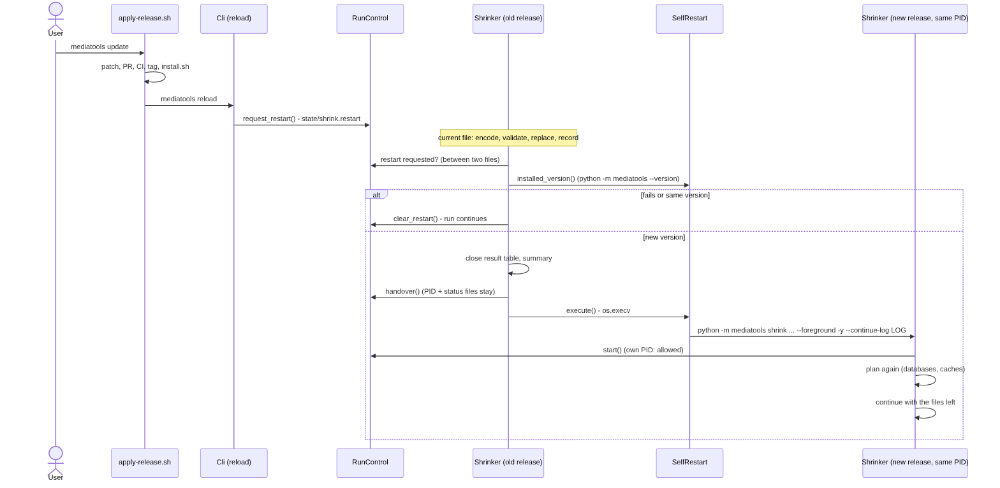
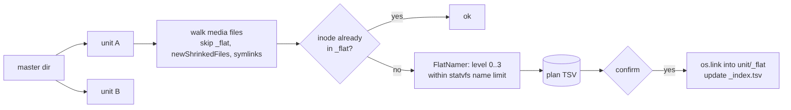
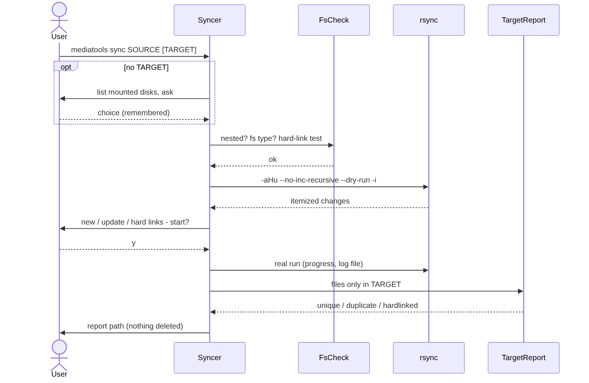
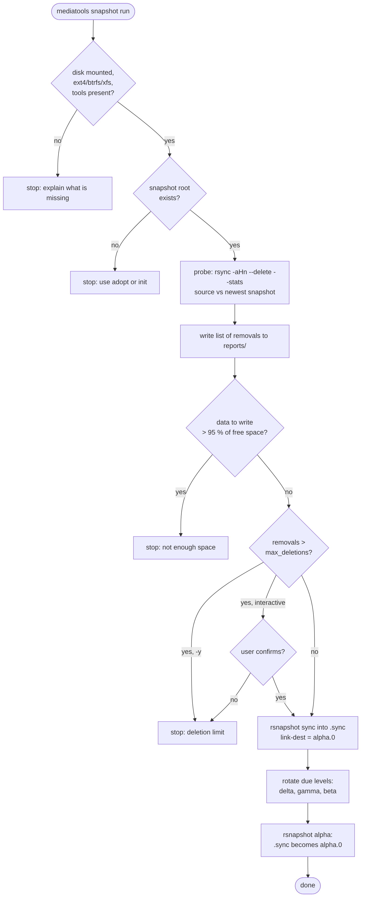
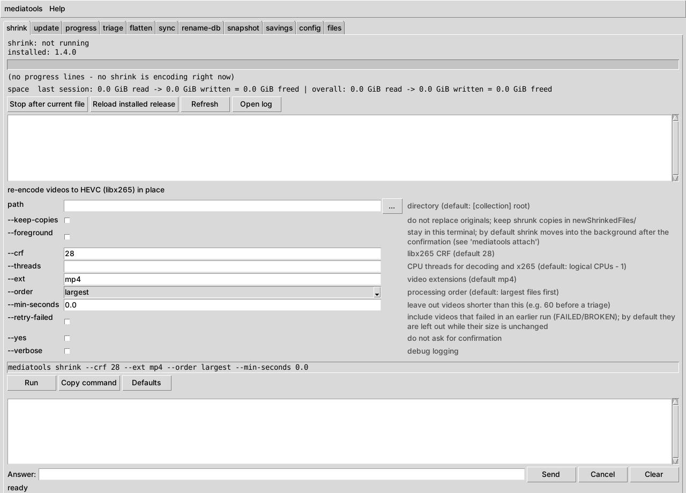
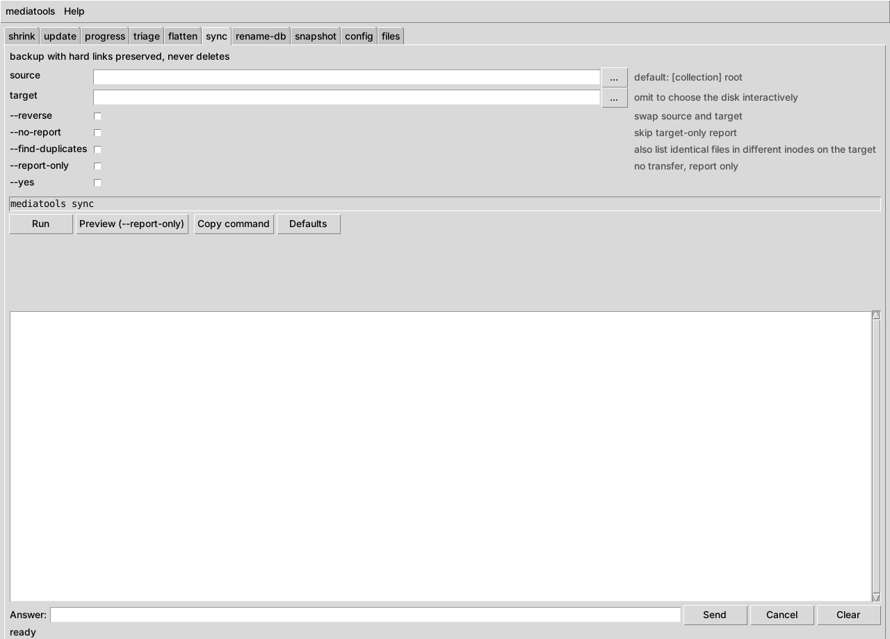

# Overview

## Purpose

mediatools keeps a dynamically growing video collection manageable - on disk
space first. Such a collection is organised in one folder per source and
keeps growing, whether it is filled by hand, by a camera import or by a
download tool. It turns into a deeply nested tree with large H.264 videos,
many unwanted short clips and backups that silently turn hard links into
full copies.

The central design rule follows from how tools that fill a collection work:
download and sync tools usually decide by **file name** whether a file is
already present. mediatools therefore
never takes a name away -- a shrunk video keeps its name, a discarded clip
leaves an empty placeholder, a flat view consists of additional names (hard
links), and `sync` never deletes. The next download run fetches only what
is really new.

`shrink` re-encodes lossy and replaces the original; the only undo is a
backup. The recommended order for a new user is therefore: configure, look
(`progress`, `--dry-run`), judge the quality with `shrink --keep-copies` on
a test folder, back up, then work (section "First steps").

## Subcommands

| Subcommand | Purpose | Writes to |
|---|---|---|
| `shrink` | HEVC re-encode in place, name kept | original files (same inode), `shrink.db` |
| `progress` | which videos are recorded as done | data directory only |
| `triage` | review short clips, discard by closing the window | trash (or delete), kept list |
| `flatten` | flat hard-link view per unit | `<unit>/_flat/` only |
| `sync` | backup preserving hard links, no deletions | target directory, reports |
| `snapshot` | versioned backups with rsnapshot | snapshot root on the backup disk |
| `config` | show or create the configuration file | data directory only |
| `rename-db` | rename shrink databases to the configured name | database files only |
| `savings` | freed space per session or per day, from the shrink logs | nothing |
| `gui` | window with a tab per task; runs the commands above | `state/gui.json`, optional menu entry |

Shared rules, implemented once in `mediatools.core`:

* `_flat`, `newShrinkedFiles` and hidden directories are never entered by a
  scan (`TreeWalker`, `MediaTypes.SKIP_DIRS`).
* Symbolic links are never followed or processed.
* Every run writes `logs/<command>_<timestamp>.log` into the state folder
  (default `~/.local/state/mediatools`; see [Data directory](#data-directory)).
* External programs are called with argument lists, never through a shell,
  so file names with spaces, quotes or `$` are safe.

# Installation

Everything except the system packages runs as a **normal user**.

## Prerequisites

~~~bash
sudo apt install ffmpeg vlc libglib2.0-bin rsync rsnapshot git python3-venv python3-tk
ffmpeg -hide_banner -encoders | grep libx265
~~~

`sudo` is needed because apt writes to `/usr` and the package database;
from the user context it is sufficient, a root shell is not required. Only
the packages of the subcommands in use are needed (README, table
"System packages"). The second command runs as normal user and must print a
line containing `libx265`.

## Option A: installer (recommended)

mediatools is installed from a **release tag** (`vX.Y.Z`) on GitHub, never
from the working files of a clone, so `mediatools --version` always shows
the installed release:

~~~bash
curl -fsSLO https://raw.githubusercontent.com/peddanet/mediatools/main/install.sh
bash install.sh
mediatools --version
~~~

* `curl -fsSLO URL` -- download the installer into the current directory
  (`-f` fail on HTTP errors, `-sS` quiet but show errors, `-L` follow
  redirects, `-O` keep the remote file name). A clone contains the same
  script; running it from there makes no difference, because it installs
  from GitHub, not from the clone.
* `bash install.sh` -- reads the release tags with `git ls-remote`, picks
  the newest `vX.Y.Z` (or the tag given as argument), installs it with pip
  into `~/scripts/mediatools.d/venv`, checks that the program reports the
  tag's version and links `~/scripts/mediatools` to it. It replaces only a
  link it created itself or the launcher of version 1.1.0 and refuses any
  other file.
* `bash install.sh --list` -- list the releases; `bash install.sh v1.2.0`
  -- install a given release, also an older one.
* `BIN_DIR=~/.local/bin bash install.sh` -- link the command elsewhere.

Everything runs as normal user; the installer writes only below
`~/scripts/mediatools.d` (or `$MEDIATOOLS_HOME`) and `BIN_DIR`. It needs
`git` and the venv module (`sudo apt install git python3-venv`).

Update: run `bash install.sh` again. Remove:
`rm -rf ~/scripts/mediatools.d/venv ~/scripts/mediatools`.

## Option B: pipx

~~~bash
pipx ensurepath
pipx install git+https://github.com/peddanet/mediatools.git@v1.2.0
~~~

* `pipx ensurepath` -- adds `~/.local/bin` to `PATH` (once; open a new
  terminal afterwards).
* `pipx install git+URL@TAG` -- builds the given release into a virtual
  environment of its own; replace `v1.2.0` with the newest tag. Update with
  `pipx install --force git+URL@NEWTAG`, remove with
  `pipx uninstall mediatools`.

Ubuntu 24.04 and later block `pip install --user` for the system Python
(PEP 668); both options use a virtual environment instead.

## Development checkout

Code imported from a clone (development venv with `pip install -e`) is
marked by `--version`:

~~~text
mediatools 1.2.0 (source checkout /home/USER/Projects/mediatools, not an installed release)
~~~

The installed release is not affected by anything in the clone.

## Data directory

Since 1.5.0 mediatools follows the XDG Base Directory Specification
(freedesktop.org): configuration, runtime state and kept data each have
their own base folder, and below it a folder named `mediatools`. Absolute
values of `XDG_CONFIG_HOME`, `XDG_STATE_HOME` and `XDG_DATA_HOME` replace
the defaults.

| Kind | Default folder | Content |
|---|---|---|
| configuration | `~/.config/mediatools` | `mediatools.ini`, `privacy/denylist.txt`, `privacy/allowlist.txt` |
| runtime state | `~/.local/state/mediatools` | `logs/`, `state/`, `reports/`, `snapshot/` |
| kept data | `~/.local/share/mediatools` | `plans/` (flatten undo), `releases/` (applied archives) |
| installed release | `~/scripts/mediatools.d/venv` | the program itself (`install.sh`) |

`mediatools where` prints every place with its full path, the layout in
use and the size of the privacy lists, so no folder has to be remembered.

**Moving the data of older releases.** Releases before 1.5.0 kept
everything in `~/scripts/mediatools.d`. While data is there, mediatools
keeps using that folder and `mediatools where` says so. The move is one
command; it refuses while any mediatools process runs (a running shrink
would keep writing into the old folder) and never overwrites an existing
target:

~~~bash
mediatools stop                  # only if a shrink runs; wait until it has stopped
mediatools where --migrate
mediatools where                 # check: "layout: XDG layout (since 1.5.0)"
~~~

Only data moves. The installed release (`venv/`) and unknown files stay;
a note `WHERE-IS-THE-DATA.txt` in the old folder names the new places and
marks the move as done: from then on the old folder is never used again,
even if an older tool recreates something in it.
Moved configuration files and privacy lists get mode 600.

**One folder instead.** With `MEDIATOOLS_HOME` set, everything is kept in
that folder with the old names (`mediatools.ini`, `privacy_denylist.txt`,
`privacy_allowlist.txt`, `logs/`, `plans/` ...). Set it in `~/.profile`
before installing:

~~~bash
echo 'export MEDIATOOLS_HOME="$HOME/mediatools-data"' >> ~/.profile
~~~

## First steps

Nothing in the first block changes a file:

~~~bash
mediatools config --set collection.root=~/Videos/collection
mediatools config
mediatools progress
mediatools triage --dry-run --max-seconds 30
mediatools flatten --dry-run
~~~

Judge the shrink quality on a copy (`--keep-copies` leaves the originals
untouched and records nothing; a smaller `--crf` means higher quality):

~~~bash
mkdir -p ~/shrinktest && cp ~/Videos/collection/projectA/some/video.mp4 ~/shrinktest/
mediatools shrink --keep-copies ~/shrinktest
~~~

Then back up and work; every step asks before it changes anything:

~~~bash
mediatools sync
mediatools triage --max-seconds 30
mediatools shrink
mediatools flatten
~~~

## Running the tests on the target machine

~~~bash
cd ~/Projects/mediatools
sudo apt install python3-pytest
python3 -m pytest -q
~~~

Expected: all tests pass. Tests that need ffmpeg, rsync or rsnapshot are
skipped when the tool is missing. `sudo` is needed only for the apt
installation; the tests run as normal user.

# Configuration

Everything that describes a concrete collection -- paths, the database
name, folder names worth abbreviating, the backup disk -- is kept in one
INI file outside the repository, so neither the code nor its history allows
conclusions about the data:

~~~text
~/.config/mediatools/mediatools.ini     ($MEDIATOOLS_HOME/mediatools.ini if set)
~~~

~~~bash
mediatools config --init        # write the commented template (never overwrites)
mediatools config --path        # print the file location
mediatools config               # print the effective values incl. defaults
~~~

| Section / key | Default | Used by |
|---|---|---|
| `[collection] root` | -- | every command called without a path |
| `[sync] source` | `[collection] root` | `sync` called without a source |
| `[shrink] db_name` | `shrink.db` | shrink, progress, rename-db |
| `[flatten] abbreviations` | `Videos=V, Images=I, Audios=U` | flatten, naming level 1 |
| `[snapshot] source`, `disk` | -- | snapshot (required) |
| `[snapshot] root` | `rsnapshot` | directory on the disk |
| `[snapshot] retain_*` | alpha 7, beta 4, gamma 12, delta 2 | snapshots per level; 0 disables a level |
| `[snapshot] exclude` | `newShrinkedFiles/` | rsync exclude patterns |
| `[snapshot] max_deletions` | 500 | abort threshold of a run |

A missing or invalid value stops the command with a message that names the
key and the expected format.

**Which directory is used.** A path on the command line always wins; the
file only provides defaults. Different jobs usually start at different
levels -- for example the collection for `shrink`, `triage` and `flatten`,
but the whole home directory for `sync` and `snapshot` -- hence the separate
keys. Change a default without an editor:

~~~bash
mediatools config --set collection.root=~/Pictures/collection
mediatools config --set sync.source=~ --set snapshot.source=~
mediatools config                      # show the effective values
~~~

`--set SECTION.KEY=VALUE` replaces only that line and keeps all comments;
a missing file is created from the template first.

For `flatten`, `root` must be the **master level**: each direct
sub-directory is treated as one unit with its own `_flat`.

## Renaming existing databases

If the shrink databases of an existing collection carry another file name,
set `[shrink] db_name` and rename them in one pass. The old name is passed
on the command line only:

~~~bash
mediatools rename-db OLDNAME.db NEWNAME.db PATH --dry-run     # list, change nothing
mediatools rename-db OLDNAME.db NEWNAME.db PATH               # rename
~~~

`OLDNAME.db` and its backups `OLDNAME.db.bak_*` become `NEWNAME.db` and
`NEWNAME.db.bak_*`; there is no further question. Afterwards `NEWNAME.db` is
stored as `[shrink] db_name` (comments in the file are kept), so `shrink` and
`progress` find the renamed databases. `PATH` defaults to `[collection] root`
and may also follow the options. Renaming within a directory keeps the inode; content and
time stamps are unchanged. A directory that already contains the new name
is reported as a conflict and left alone -- nothing is overwritten.

# Architecture

{height=19cm}

~~~text
src/mediatools/
  cli.py              Cli
  core/
    config.py         Config           local INI file (paths, names)
    datadir.py        DataDir          location of logs, state, plans, reports
    runlog.py         RunLog           logger to terminal and time-stamped file
    runcontrol.py     RunControl       PID/stop/status files, background mode
    runstatus.py      RunStatus        mediatools status: running release, advice, log
    attachview.py     AttachView       live view of a background run (attach)
    sleepinhibitor.py SleepInhibitor   systemd sleep/idle lock during a run
    progressbar.py    ProgressBar      progress lines, status file
    mediatypes.py     MediaTypes       extensions, reserved directory names
    probe.py          MediaProbe       ffprobe wrapper (duration, codec)
    decodecheck.py    DecodeCheck      trial decode: finds videos that cannot be decoded
    selfrestart.py    SelfRestart      switch a running job to the installed release
    walker.py         TreeWalker       sorted os.walk with skip rules
    prompt.py         Prompt           yes/no and text questions, --yes support
  shrink/
    database.py       ShrinkDatabase   per-directory database, schema migration
    dbrenamer.py      DatabaseRenamer  one-time renaming of databases
    encoder.py        HevcEncoder      ffmpeg call and result validation
    shrinker.py       Shrinker         per-file decision, failures, summary
    planner.py        ShrinkPlanner    planning: DB, failures, durations, codecs, order
    journal.py        ReplaceJournal   crash-safe copy-back with marker file
    shrinkstate.py    ShrinkState      caches, throughput, result table of a run
    fileresult.py     FileResult       outcome of one video
    resulttable.py    ResultTable      framed result table, report file
    progress.py       ProgressReport   read-only done/todo lists
  triage/
    candidates.py     CandidateFinder  lazy search by duration
    player.py         PlayerSession    one process per clip, classification
    linkresolver.py   FlatLinkResolver _flat names of a file (by inode)
    remover.py        FileRemover      gio trash or permanent delete
    keptlist.py       KeptList         decisions across sessions
    triage.py         Triage           batch workflow
  update/
    updater.py        ReleaseUpdater   mediatools update (runs apply-release.sh)
    apply-release.sh  -                applies delivered patch archives
  flatten/
    namer.py          FlatNamer        names within the byte limit
    flatindex.py      FlatIndex        _flat/_index.tsv
    planentry.py      PlanEntry        one planned action
    plan.py           FlatPlan         actions, TSV persistence, undo input
    flattener.py      Flattener        analyse / apply / undo
  sync/
    fscheck.py        FsCheck          fs type, hard-link test, nesting
    target_picker.py  TargetPicker     interactive disk choice, remembered
    rsync_runner.py   RsyncRunner      rsync command, dry-run parsing
    target_report.py  TargetReport     target-only files, duplicate check
    syncer.py         Syncer           checks, dry run, transfer, report
  snapshot/
    settings.py       SnapshotSettings validated [snapshot] values
    rsnapconf.py      RsnapshotConf    generated rsnapshot.conf, configtest
    syncprobe.py      SyncProbe        rsync dry run: volume, removals
    schedule.py       LevelSchedule    which levels are due
    snapshotter.py    Snapshotter      check / adopt / init / run / status
    trigger.py        SystemdTrigger   user unit started by the disk mount
~~~

Design principles:

* **One responsibility per class**, every public class and method has a
  docstring (shown with `python3 -m pydoc mediatools.flatten.namer`).
* **Dependency injection** -- logger, prompt, probe, player and remover are
  constructor arguments; the tests replace them with fakes.
* **Plan before action** where actions are irreversible or numerous
  (`flatten`, `sync`, `triage`): analysis, summary, confirmation, execution.

# shrink

## Invocation

~~~bash
mediatools shrink ~/Pictures/collection                       # largest first
mediatools shrink ~/Pictures/collection --min-seconds 60      # skip short clips
mediatools shrink ~/Pictures/collection --order path --keep-copies
mediatools shrink ~/Pictures/collection --crf 26 --threads 8 -y
mediatools shrink ~/Pictures/collection --foreground          # stay in this terminal
mediatools attach                                             # (alias: front) watch the background run
mediatools stop                                               # finish the current file, then end
mediatools reload                                             # switch a running shrink to the installed release
mediatools status                                             # running? release, current or not, log
~~~

| Option | Default | Meaning |
|---|---|---|
| `--order` | `largest` | `largest`, `smallest` or `path` (directory order) |
| `--min-seconds S` | 0 | leave out videos shorter than S seconds |
| `--keep-copies` | off | do not touch originals; keep copies in `newShrinkedFiles/`; record nothing |
| `--retry-failed` | off | include videos that failed in an earlier run (`FAILED`/`BROKEN`) |
| `--crf N` | 28 | libx265 constant rate factor (lower = better quality, larger) |
| `--threads N` | CPUs - 1 | decoder threads and size of the x265 thread pool |
| `--ext LIST` | `mp4` | extensions to process |
| `-y` | off | no confirmation question |
| `-v` | off | debug logging |

## Plan

Before anything is encoded, the whole tree is walked once:

1. Interrupted replacements are completed (see *Interruption*); remaining
   `newShrinkedFiles/` folders are noted as leftovers of aborted runs.
2. Every video is checked against the database of its directory; recorded
   files are counted as processed and left out. 0-byte placeholders are
   ignored. **Exception -- regrown:** a recorded video that is now at least
   1.2 times as large as every size recorded for its name, and whose video
   stream is not HEVC, is planned again. This is what happens when an
   original is copied back over its shrunk version, e.g. by a sync from the
   backup disk in the wrong direction; the plan summary reports the
   number (`recorded as shrunk, but larger again and not HEVC`). A video recorded as failed in an earlier run (`FAILED` or
   `BROKEN`, table `failures`) is left out while its size is unchanged;
   the plan summary and the end of the run list it as `FAILED BEFORE`.
   `--retry-failed` includes these videos again; a successful retry
   deletes the failure row.
3. With `--min-seconds`, the durations of the remaining videos are read
   (cached in `state/triage_durations.tsv`, shared with `triage`) and short
   ones are left out.
4. The codec of every remaining video is read (cached in
   `state/shrink_codecs.tsv`); videos that are already HEVC are set aside.
   They are recorded after the start question without encoding and are not
   counted in volume, time estimate and progress.

   Both caches are keyed by path, size and modification time: a value is
   reused as long as the file is unchanged, so only new or changed videos
   are probed again. New values are written every 500 files, so an
   interrupted first check keeps its work. The messages show the share
   answered from the cache, e.g.
   `checking codecs: 1000 of 3076 (998 from cache)`.
5. The rest is sorted (`--order`), and the run reports, for example (numbers illustrative):

~~~text
already processed (database): 12000 | shorter than 60 s: 1500 | already HEVC,
recorded without encoding: 40 files, 85.0 GiB
to encode: 6500 files, 560.0 GiB, about 4 d 15 h at the measured 1.5 MB/s
expected afterwards: about 215.6 GiB, saving about 344.4 GiB (output 38 % of the
source, measured on 25 file(s))
leftover work folders of aborted runs: 18 folder(s), 3 file(s), 0.4 GiB - deleted
after confirmation
Start encoding and REPLACE the originals? [y/N]
~~~

The estimates use `state/shrink_throughput.json`: source bytes and encoding
seconds (speed) and, since 1.2.1, source and output bytes of the encoded
files (size ratio). Before the first measured file the line says "not yet
known". During the run the measured speed of the run itself takes over.
Leftover folders are listed one by one with `-v`; answering "no" keeps
them.

## Decision per file

{width=70%}

1. **Database first.** A recorded file name means "already processed",
   regardless of the codec it was processed with; the file is skipped
   without probing.
2. **Codec.** If the first video stream is already HEVC, the file is
   recorded but not re-encoded (re-encoding HEVC costs quality for little
   gain).
3. **Encode and validate.** `HevcEncoder` runs

   ~~~text
   nice -n 19 ffmpeg -nostdin -y -hide_banner -nostats -progress pipe:1 \
          -threads N -i SRC -vcodec libx265 -crf 28 -x265-params pools=N TMP
   ~~~

   `N` is the number of logical CPUs minus one (`--threads`). `-threads`
   before `-i` sets the decoder threads; libx265 runs its own thread pool,
   which ffmpeg's `-threads` does not limit and which would otherwise use
   every CPU, so `pools=N` caps it. One CPU stays free for the desktop.
   `nice -n 19` gives ffmpeg the lowest CPU priority: it still uses idle
   CPUs, but yields at once to interactive programs.

   in its own process group and accepts the result only if the exit code
   is 0, the output is not empty and at least 2 % of the input's size, has
   a video stream, its duration equals the input within `max(1 s, 2 %)`,
   and **the whole output decodes without a single error line**
   (`ffmpeg -v error -i OUT -f null -` at `nice` 19; time limit
   `max(600 s, 2 × duration)`; a timeout or a missing ffmpeg counts as
   failure). Measured cost: a full decode takes about 5--10 % of the encode
   time of the same file. A tiny or undecodable output
   is typical of an input whose data the decoder could not use -- the
   encoder then writes little more than grey frames. ffmpeg's messages go
   to `TMP.ffmpeg.log`; on failure its last lines are logged and the
   complete file is kept as
   `logs/ffmpeg/<timestamp>_<name>.ffmpeg.log` in the data directory.
4. **Copy back in place.** `shutil.copyfile` writes into the existing
   inode. All hard links of the file -- `_flat` entries, deduplication
   links -- therefore show the shrunk content immediately, and no second
   encode happens via another name.

## Progress display

(numbers illustrative)

~~~text
total [#############...........]  37.5 % | ETA 2d21h | since 2026-11-09: 210.0 GiB read (-> 33.6 GiB after shrinking), 350.0 GiB to go | 2500 files done, 4000 to go
file   63 % of 1.20 GiB (0.76 GiB encoded) | 8m left | clip.mp4
space  session since 2026-11-12 04:56: 210.0 GiB read -> 33.6 GiB written = 176.4 GiB freed | since 2026-10-20: 912.0 GiB read -> 141.4 GiB written = 770.6 GiB freed
~~~

The first line covers the whole job (since 1.4.2): the source GiB read
since the first shrink log, with their size after shrinking in brackets,
and the source GiB still to go; the percentage is read / (read + to go),
the ETA the GiB to go divided by the measured speed. Read and files done
include all earlier runs (taken from the shrink logs), so they do not
start at zero after a start or a `mediatools reload`. Files shrunk before
the first shrink log (e.g. by older scripts) are not part of `read`. The second line shows
the file being encoded:
its percentage, its size, the part already encoded and its remaining time
at the current speed. The third line (since 1.2.16) shows the disk space.
All lines are redrawn in place and cut to the terminal width (a long file
name is shortened in the middle), so a narrow window does not fill up with
lines.

**Read, written, freed.** The GiB of the first line are *source* bytes:
how much was read and encoded (every encoded file, also failures and kept
copies) and how much is still to go, not how much space became free. The space
line keeps the three quantities apart:

| Quantity | Meaning |
|---|---|
| read | source size of the replaced originals |
| written | size of their shrunk versions |
| freed | read minus written: the space returned to the file system |

`session` covers everything shrunk since `mediatools shrink` started this
session (the time is shown). A session is one log file; `mediatools
reload` continues the log, so the session survives a release switch,
while the progress counts of the first line start again after it. The
second view adds all sessions and names the date of the first shrunk file
(`since 2026-10-20`). Both views come from the result tables of the shrink
logs (sizes in MB, rounded: exact to about 0.5 MB per file) and are then
counted on per replaced file. Copies kept with `--keep-copies` free no space
and are not counted. At the end of a run both views are written to the log,
with the output share in percent of the source.

`mediatools savings` lists the freed space per session or per day
(read-only):

~~~bash
mediatools savings              # one row per session
mediatools savings --by day     # one row per calendar day
~~~

~~~text
session                     from    to  files  read GiB written GiB  freed GiB  output
2026-11-12 04:56           04:56 11:38     38      38.9         6.3       32.6   16.1%
total since 2026-10-20                    412     ...
~~~

The GUI shows the same table in its *savings* tab.

Percentage, volume and remaining time are measured in source bytes,
because the encoding time grows with the file size, not with the number of
files. Files that need no encoding -- HEVC by now, e.g. a second hard link
of a file shrunk earlier in the run -- are removed from the totals instead
of being counted as done, so they do not inflate progress and speed. The
lines are drawn only on a terminal; the log file receives the normal
messages.

## Result table

Each finished video adds one row to a framed table: row number, time of
completion, size before and after, ratio, playing time, wall-clock time
spent, status (`shrunk`, `copy`, `HEVC`, `FAILED`, `BROKEN`) and the path relative to
the shrink root. The figures have fixed columns; the path takes the rest of
the width and wraps inside its cell, after a `/` or a space, so a long name
makes the row taller instead of breaking the frame:

~~~text
results (also in reports/shrink_results_<ts>.txt):
┌──────┬───────┬──────────┬──────────┬─────────┬──────────┬──────────┬────────┬──────────┐
│   no │ end   │   source │   result │   ratio │   length │     took │ status │ file     │
├──────┼───────┼──────────┼──────────┼─────────┼──────────┼──────────┼────────┼──────────┤
│    1 │ 10:25 │  2815 MB │   284 MB │  10.1 % │ 26.5 min │ 21.3 min │ shrunk │ unit_a/  │
│      │       │          │          │         │          │          │        │ Videos/  │
│      │       │          │          │         │          │          │        │ long     │
│      │       │          │          │         │          │          │        │ clip     │
│      │       │          │          │         │          │          │        │ name.mp4 │
├──────┼───────┼──────────┼──────────┼─────────┼──────────┼──────────┼────────┼──────────┤
│    2 │ 10:25 │  2303 MB │        - │       - │ 60.0 min │  0.5 min │ FAILED │ unit_b/  │
│      │       │          │          │         │          │          │        │ clip.mp4 │
└──────┴───────┴──────────┴──────────┴─────────┴──────────┴──────────┴────────┴──────────┘
~~~

| Copy | Width | Where |
|---|---|---|
| terminal (and log file) | terminal width, at least 90 columns | rows printed as files finish |
| report | 160 columns | `reports/shrink_results_<ts>.txt`, written and flushed per row |

The report is complete up to the last finished file, even after a crash.
The details behind a row (ffmpeg command, validation, database record)
are written to the log file only; `--verbose` also shows them on the
terminal. Errors (e.g. the last lines of a failed ffmpeg run) stay visible.

## Sleep and idle lock

`shrink` takes a systemd inhibitor lock for its whole run, the same as
wrapping it in `systemd-inhibit --what=sleep:idle`:

~~~bash
systemd-inhibit --list     # lists: mediatools ... mediatools shrink  sleep:idle  block
~~~

The lock is held by a helper process
(`systemd-inhibit ... tail --pid=<shrink pid> -f /dev/null`) in its own
session: Ctrl+C in the terminal does not reach it, and it ends at the
latest when the shrink process ends, even after `kill -9`, so no lock is
left behind. No root rights are needed in a local session: the polkit
defaults of systemd allow `org.freedesktop.login1.inhibit-block-sleep` for
active and inactive local sessions and `-idle` for everyone (see
`/usr/share/polkit-1/actions/org.freedesktop.login1.policy`). If
the lock is refused or `systemd-inhibit` is missing, shrink logs a warning
and runs anyway.

## Database

~~~sql
CREATE TABLE files (path text NOT NULL PRIMARY KEY,
                    size integer, modified text);
CREATE TABLE failures (name text NOT NULL PRIMARY KEY, size integer,
                       status text, reason text, at text);
~~~

* One database per directory with videos; file name `[shrink] db_name`
  (default `shrink.db`).
* **Matching uses the file name**, not the stored absolute path: a database
  describes the files of its own directory, and the stored path still
  points to wherever the collection was when the row was written. A row
  whose size differs from the file today is reported by `progress` as
  "size changed since" and still counts as processed -- nothing is encoded
  twice. Only a file that is at least 1.2 times as large as recorded
  (**regrown**) and not HEVC is encoded again.
* `path` and `modified` (mtime after shrinking, `YYYY-MM-DD HH:MM:SS`) are
  still written for compatibility and traceability.
* `failures` holds videos that could not be shrunk (`FAILED`, `BROKEN`)
  with their size, status, cause and time. It is kept apart from `files`,
  so `files` still means "processed" for every tool that reads it; older
  versions ignore the extra table. A row applies only while the file has
  the recorded size. Review mode (`--keep-copies`) writes no rows.
* Databases of the first script generation (no `PRIMARY KEY`) are backed up
  next to the original (suffix `.bak_` plus timestamp) and migrated in one
  transaction.

Inspection (normal user, read-only):

~~~bash
sqlite3 -readonly -header -column ~/Pictures/collection/A/Videos/shrink.db \
  "SELECT size, modified, path FROM files ORDER BY modified;"
sqlite3 -readonly -header -column ~/Pictures/collection/A/Videos/shrink.db \
  "SELECT at, status, reason, size, name FROM failures ORDER BY at;"
~~~

## Interruption and failures

| Event | Behaviour |
|---|---|
| `mediatools stop` in any terminal | the current file is finished, validated, copied and recorded; then the run stops |
| terminal closed (background mode, the default) | nothing - the run has its own session and continues |
| Ctrl+C (or Ctrl+Z) once, `--foreground` | the same as `mediatools stop` |
| Ctrl+C a second time, SIGTERM, SIGHUP (terminal of a `--foreground` run closed) | ffmpeg is stopped at once; its partial output is deleted; the original stays untouched |
| power failure, kill -9 | see the replacement journal below |
| ffmpeg cannot encode a file, or the output fails validation | logged as `FAILED`, failure row written, ffmpeg messages kept, run continues, exit code 2 |
| video data cannot be decoded (still encrypted, scrambled) | set aside as `BROKEN` before encoding: not encoded, original untouched, failure row written; exit code unchanged |
| a video failed in an earlier run, size unchanged | left out, listed as `FAILED BEFORE`; `--retry-failed` includes it |
| `mediatools shrink` while another shrink runs | refused at once with the PID and the hints `attach` / `stop`, exit code 3 |

**Background mode.** Planning and the confirmation happen in the
terminal. Then (`RunControl.begin_work`) the process forks: the parent
prints how to follow and stop the run and exits, the prompt returns. The
child calls `setsid()` - a new session without controlling terminal, so
closing the window sends it no SIGHUP - reads from `/dev/null`, writes its
terminal output (normally empty; e.g. a Python traceback after a crash) to
`state/shrink.console` and registers its PID in `state/shrink.pid`
together with the log file path. Only then does it take the sleep lock,
so the lock belongs to the process that does the work.

~~~text
shrink continues in the background (pid 12345); the terminal may be closed.
  watch: mediatools attach   (Ctrl+C leaves the view)
  stop:  mediatools stop     (after the current file)
  log:   /home/user/.local/state/mediatools/logs/shrink_2026-11-09_11-30-00.log
~~~

`mediatools attach` (alias `front`) prints the last 30 log lines, then
every new line, and redraws the progress lines, which the run writes
to `state/shrink.status` once per second. Ctrl+C leaves the view; the run
continues. The view ends by itself when the run ends. `--foreground`
keeps the previous behaviour (run bound to the terminal, Ctrl+C stops).

`time mediatools shrink` measures only the part until the run moves into
the background; the log file has the times of the whole run.

**Stopping.** `mediatools stop` works from any terminal and does not
depend on keyboard focus:

~~~bash
mediatools stop
# stop requested: shrink (pid 12345) finishes its current file and ends
~~~

The command checks that a shrink run is alive (PID file
`state/shrink.pid` in the data directory), creates `state/shrink.stop` and
returns at once. The run checks for this file every 2 seconds, shows
`STOPPING after this file` at the start of its first progress line, completes the
current file and ends with exit code 1. If no run is active, the command
prints `no shrink run is active - nothing to stop`, returns 1 and leaves no
file behind, so a later run is not stopped by mistake. A stop file left by
a crash is removed when the next run starts.

**Only one run.** While a shrink run is alive, a second `mediatools shrink`
is refused before it plans anything:

~~~text
shrink is already running (pid 12345) - watch it with 'mediatools attach', stop it with 'mediatools stop'
~~~

A PID file left by a crashed run does not block: only a living process
counts.

**New release during a run.** `mediatools update` installs a new release
and then calls `mediatools reload`; the command can also be given by hand
after any installation. The running shrink finishes its current file and
then switches, without ending the run:

1. Between two files -- never during an encode or a replacement -- it finds
   the request file `state/shrink.restart`.
2. It starts the installed release once with `--version`. If that fails, or
   the version is the one already running, the request is dropped, a line
   is logged and the run continues unchanged.
3. Otherwise it closes its result table, logs its summary and the line
   `switching from mediatools A to B now`, and replaces itself
   (`os.execv`) by `python -m mediatools shrink` of the same installation
   with the same options plus `--foreground -y`. The process keeps its PID,
   session and console file; `mediatools attach` and `mediatools stop` keep
   working, the log file is continued.
4. The new release plans again. Every file finished so far is in the
   databases, durations and codecs come from the caches, so planning takes
   seconds and the run continues with the files left. It asks no question
   (the run was confirmed) and starts a new result table.

The first switch is possible from a running 1.2.10 on: a run of an older
release does not know the request and simply finishes with its own code
-- nothing is mixed, because mediatools loads all its modules at start.
{width=100%}

`mediatools reload` without a running shrink prints `no shrink run is
active - nothing to reload` and returns 1.

**Which release is running?** `mediatools status` answers it in one
command (normal user, reads only):

~~~text
shrink: running (pid 459729)
running:   1.2.12  (started 2026-11-10 03:21:47)
installed: 1.2.15
status:    'mediatools reload' switches to the installed release after the current file
log:       /home/<user>/.local/state/mediatools/logs/shrink_2026-11-10_03-21-47.log
pending:   reload requested, takes effect after the current file
~~~

The running release is the last line `mediatools X (pid N)` in the log
of the running job, the one the PID file names; a switch appends such a
line to the same log. Older log files keep the release of their own run
and say nothing about the current one. The status line says what to do:
`up to date`, `'mediatools reload' ...` (running release 1.2.10 or newer),
or `X cannot switch releases: 'mediatools stop', ...` (older than 1.2.10).
Exit code 0 while a shrink runs, 1 otherwise. `mediatools update` prints
this report at its end.

Because ffmpeg runs in its own process group, a Ctrl+C in the terminal
reaches only mediatools, which decides what happens. The signal handler only
sets flags and never raises an exception, so a replacement in progress
always completes.

**Replacement journal.** Overwriting an original is the only moment in
which data could be lost. The sequence is:

1. flush the validated output to disk (`fsync`),
2. write the marker `newShrinkedFiles/<name>.replace` and flush it,
3. flush the directory `newShrinkedFiles/`, so that the marker's directory
   entry is on disk as well,
4. copy the output into the original (same inode),
5. flush the original,
6. record it in the database,
7. delete the output, delete the marker.

Steps 1-3 guarantee that a marker found after a power failure always comes
with a complete output; without them the file system could have written
the first part of the copy (step 4) while the marker or the output was
still only in memory. If the machine fails anywhere between steps 4 and 7,
the next run finds the marker next to the output and repeats the copy
before it plans anything else; repeating it is harmless. Without a marker,
the original was never touched.

Exit codes: 0 done, 1 stopped by the user, 2 at least one file failed,
3 another shrink run is active.

# progress

~~~bash
mediatools progress ~/Pictures/collection
~~~

(numbers illustrative)

~~~text
videos: 20000 | processed: 12000 (of which size changed since: 12) |
regrown: 40 | todo: 7960 | to encode: 640.0 GiB
databases: 900 | rows without a matching file: 40
estimated encoding time at the measured 1.5 MB/s: about 5 d 7 h
~~~

* **processed** -- the file name is recorded in the database of its
  directory; **size changed since** -- recorded, but the file has another
  size today (still counted as processed);
* **regrown** -- recorded, but now at least 1.2 times as large (an
  original restored over its shrunk version); `shrink` encodes it again
  unless it is already HEVC;
* **todo** -- not recorded; **to encode** is the volume of todo and
  regrown together;
* **rows without a matching file** -- the file was deleted or renamed
  after it was recorded.

The four lists go to `reports/progress_{done,changed,regrown,todo}_<ts>.txt`. The
command creates no database and changes nothing.

# triage

## Workflow

~~~bash
mediatools triage ~/Pictures/collection --dry-run
mediatools triage ~/Pictures/collection/A --batch 3
mediatools triage ~/Pictures/collection --min-seconds 10 --max-seconds 30
~~~

1. **Count first.** `CandidateFinder` collects all clips within the
   duration range that are not on the kept list; empty placeholders are
   skipped. Durations come from `state/triage_durations.tsv` when size and
   modification time are unchanged, otherwise from ffprobe. The session then
   reports, for example (numbers illustrative):

~~~text
412 of 18230 videos match: 42 batch(es) of up to 10, total clip length 196 min,
estimated review time about 75 min
CLOSE a window = REMOVE that video (an empty placeholder keeps its name);
leave it OPEN = KEEP it.
Start the review? [Y/n]
~~~

   The estimate assumes that each batch is watched once through its longest
   clip plus 15 s for the decision. `--dry-run` prints the list and this
   report and stops; `-y` skips only this start question.
2. `PlayerSession` starts one player process per clip (VLC muted and
   looping by default), then waits 3 s and flags processes that already
   ended.
3. **Close the window of every video to remove; leave the windows of the
   videos to keep open.** Then press Enter (`s` skips the batch, `q` quits).
4. Classification and summary, then confirmation -- always, also with `-y`:

| Process state | Meaning | Action after `y` |
|---|---|---|
| running (window still open) | keep | close window, add to kept list |
| ended with 0 after the start window (window closed) | remove | remove file and its `_flat` links, leave placeholder |
| ended within 3 s or with code ≠ 0 | player error | keep, not added to kept list |

## Placeholders

A removed video is replaced by an empty file (0 bytes) with the same name.
Download tools that skip files whose name already exists therefore do not
fetch it again. Details:

* The original goes to the trash (or is deleted with `--delete`); the
  placeholder is created right afterwards and never overwrites a file.
* `shrink`, `progress`, `flatten` and `triage` ignore 0-byte files.
* `sync` passes `--min-size=1` to rsync: the placeholder is not copied over
  the full file on the backup, and because the placeholder is newer, `-u`
  prevents a reverse sync from restoring the old file over it.
* `snapshot` treats the placeholder like any change: the newest snapshot
  holds the empty file, older snapshots keep the video.
* Every removal is appended to `state/triage_discarded.tsv`
  (`time<TAB>size<TAB>path`).
* `--no-placeholder` removes the name completely.

Whether a particular downloader treats a 0-byte file as "already present" or
as an incomplete download is a property of that downloader; test it with a
single file before a large session.

## Why `_flat` links are removed too

A hard link keeps the data alive. Removing only the original name of a clip
while its `_flat` link still exists frees no space.
`FlatLinkResolver` finds, by inode, all names of the file in the `_flat`
directories of its ancestors; they are removed together. Hard links outside
`_flat` (e.g. from a deduplication tool in another unit) are not touched;
the summary shows `[!N further hard link(s) elsewhere: space not freed]`.

## Recovering

~~~bash
gio trash --list
gio trash --restore "trash:///x.mp4"
~~~

Trashed files occupy space until the trash is emptied (`gio trash --empty`).

| Option | Default | Meaning |
|---|---|---|
| `--max-seconds` / `--min-seconds` | 60 / 0 | duration range |
| `--batch` | 10 | windows per batch |
| `--player` | `vlc` | e.g. `mpv`, `"flatpak run org.videolan.VLC"` |
| `--audio` | off | play with sound |
| `--delete` | off | permanent deletion instead of trash |
| `--no-placeholder` | off | do not leave an empty file under the removed name |
| `-y` | off | skip the start question; batches are still confirmed |
| `--include-kept` | off | show kept clips again |
| `--dry-run` | off | list candidates only |

# flatten

## Concept

{width=95%}

The start directory is the **master level**; each direct sub-directory is a
**unit**. Every media file below a unit (videos, images, audio; no
databases) gets a hard link in `<unit>/_flat/`. Files lying directly in the
unit are linked with their unchanged name, so `_flat` is complete.

~~~bash
mediatools flatten ~/Pictures/collection --dry-run
mediatools flatten ~/Pictures/collection
mediatools flatten ~/Pictures/collection --prune
mediatools flatten --undo \
  ~/.local/share/mediatools/plans/flatten_2026-11-03_13-12-52.tsv
~~~

## Naming

The limit is read at run time with `os.statvfs(unit).f_namemax` and counted
in **bytes** (UTF-8). eCryptfs with encrypted file names reports 143 bytes
on a lower file system with 255; ext4 and fscrypt report 255.

| Level | Rule |
|---|---|
| 0 | path components joined with `__`, original file name unchanged |
| 1 | folder names from `[flatten] abbreviations` shortened (default `Videos` V, `Images` I, `Audios` U), `<id> <date> <time>` folders compacted to `<id>-<YYYYMMDD>T<hhmmss>` |
| 2 | level 1, then the front of the file stem is cut; the tail (usually an id) is kept; `~` marks the cut |
| 3 | directory part replaced by an 8-digit SHA-1 prefix, stem cut |

Example of level 2 (limit 80 bytes, `abbreviations = footage=f, sessions=s,
Videos=V`):

~~~text
f__s__987654321-20240501T100000__V__~h_extended_commentary_and_extras_a1b2c3.mp4
~~~

In a simulation over a real collection of more than 100,000 media files
with a limit of 143 bytes, more than 99.9 % of the names fitted at level 0;
the rest needed level 1 or 2, none was impossible and no collision
occurred. If two sources would get the same name, the second gets
`~<6-digit hash>` before the extension.

The separator `__` was chosen because it hardly ever occurs in real folder
and file names; `_` alone occurs almost everywhere.

## Traceability

* `<unit>/_flat/_index.tsv` -- one line `link name<TAB>source path relative
  to the unit`, written atomically.
* By inode, independent of any file:

~~~bash
find ~/Pictures/collection/A -samefile "$HOME/Pictures/collection/A/_flat/LINKNAME"
~~~

## Re-runs, replaced sources, pruning, undo

| Situation | Action |
|---|---|
| source inode already present in `_flat` (any name) | `ok`, nothing done |
| new source | `link` |
| same source path, new inode (file was replaced, e.g. re-downloaded) | `relink` (atomic: temporary link + rename) |
| source gone, link still in `_flat` | `prune` -- only with `--prune` |
| name impossible within the limit | `skip`, listed in the plan |

Each run saves `plans/flatten_<ts>.tsv`. `--undo PLAN` removes exactly the
links of that plan that are still identical to their source.

# sync

## Workflow

{width=88%}

~~~bash
mediatools sync ~/Pictures/collection
mediatools sync ~/Pictures/collection /media/USER/backup/collection
mediatools sync ~/Pictures/collection --reverse
mediatools sync ~/Pictures/collection --report-only --find-duplicates
~~~

Without a target, mounted file systems below `/media`, `/run/media` and
`/mnt` are listed with type and free space; the choice is stored in
`state/sync_targets.json` and offered next time.

## rsync options

~~~text
rsync -aHu --no-inc-recursive --min-size=1 \
      --exclude=newShrinkedFiles/ --exclude=*.part \
      --exclude=.Trash-*/ --exclude=.mediatools-hl-* SOURCE/ TARGET/
~~~

| Option | Reason |
|---|---|
| `-a` | archive mode: recursion, times, permissions, symlinks |
| `-H` | hard links stay hard links -- `_flat` costs no space on the target |
| `-u` | a newer file on the receiver is never overwritten (protects shrunk files when copying back) |
| `--no-inc-recursive` | complete file list first; recommended by the rsync manual with `-H` |
| `--min-size=1` | empty triage placeholders never replace the full file on the target |
| no `--delete` | files that exist only in the target are kept and reported |

rsync detects hard links only inside the transfer set; therefore the unit
directories and their `_flat` must be in the same run, which is the case
when the master directory is synchronised as a whole.

## Checks before the transfer

1. rsync installed, source is a directory.
2. Source and target do not contain each other.
3. File-system type of the target; exFAT, FAT, NTFS are refused.
4. Practical test: a temporary file is created and hard-linked in the
   target.
5. Dry run with `--itemize-changes`; summary of new files, updates, hard
   links, new directories; confirmation.

## Target-only report

`reports/sync_target_only_<ts>.tsv`:

| Status | Meaning |
|---|---|
| `unique` | only copy anywhere -- keep unless known obsolete |
| `duplicate` | identical content elsewhere on the target (different inode) |
| `hardlinked` | another name of the same inode exists on the target |

Content identity: equal size, then SHA-256 of first and last MiB, then full
SHA-256. With `--find-duplicates` all groups of identical files in different
inodes on the target are listed -- space that hard-link deduplication could
reclaim.

## Both directions

`sync A B` copies A to B; `sync A --reverse` (or `sync B A`) copies back.
Since nothing is deleted, copying back restores files that were removed on
purpose (e.g. by `triage`); the dry-run summary shows how many files would
be created -- decline if that is not intended.

## When to use sync and when snapshot

`sync` keeps one mirror and never deletes -- safe, but deletions in the
source accumulate on the disk. `snapshot` (next chapter) propagates
deletions to the newest snapshot while older snapshots keep the files, so a
mistaken deletion stays recoverable. On a disk that is used for snapshots,
`sync` should no longer write into the snapshot root.

# snapshot

## Principle

[rsnapshot](https://rsnapshot.org/) stores every snapshot as a complete
directory tree. Unchanged files are hard links to the previous snapshot, so
a snapshot costs only the changed files plus directory metadata. mediatools
generates the rsnapshot configuration from the INI file
(`snapshot/rsnapshot.conf` in the data directory) and adds what rsnapshot
does not do by itself: checks, a dry-run probe before every change, a
deletion limit, adoption of an existing copy and a schedule for a disk that
is not always attached.

{height=20cm}

Fixed rsnapshot settings and why:

| Setting | Reason |
|---|---|
| `no_create_root 1` | if the disk is not mounted, rsnapshot stops instead of filling the empty mount point on the system disk |
| `sync_first 1` | `rsnapshot sync` copies into `.sync`; the level commands only rotate |
| `link_dest 1` | unchanged files become hard links to the newest snapshot |
| `-aH --no-inc-recursive` | `_flat` hard links stay hard links within each snapshot |
| `--delete --delete-excluded` | only the newest snapshot follows deletions; older ones keep the files |
| `--relative`, destination `localhost/` | snapshot path is `<level>.<n>/localhost/<absolute source path>` |

## Commands

~~~bash
mediatools snapshot check              # read-only: config, disk, tools, probe
mediatools snapshot adopt DIR_ON_DISK  # once: existing copy = first snapshot
mediatools snapshot init               # or: empty start, first run copies all
mediatools snapshot run --dry-run      # probe only, removals listed in reports/
mediatools snapshot run                # probe, confirm, sync, rotate
mediatools snapshot run -y             # no questions; aborts instead of asking
mediatools snapshot status             # snapshots, free space, last rotations
mediatools snapshot install-trigger    # systemd user unit, started on mount
~~~

All commands run as normal user. rsnapshot is usually started as root by
cron; with its own configuration file it can run as any user (rsnapshot
manual). A normal user is sufficient as long as all files of the source
belong to that user and the snapshot root on the disk is writable for him.

## Taking over an existing copy (adopt)

If the disk already holds a copy of the source made with `sync`, that copy
becomes the first snapshot without copying any data:

1. **Checks** -- disk mounted, ext4/btrfs/XFS, directory on the same file
   system as the disk, snapshot root empty or missing.
2. **Probe** -- `rsync -aHn --delete --stats` from the source to the given
   directory. If more than 25 % of the source volume would have to be
   transferred, the directory is not a copy of the source (wrong path or
   wrong level); the command stops and shows the top-level entries of both
   so the path can be corrected. The list of files that the first run would
   remove from the newest snapshot is written to `reports/`.
3. **Rename** -- after confirmation the directory is renamed to
   `.sync/localhost/<source path>` (`rename(2)` within one file system: no
   data is moved, no space needed).
4. **Rotate** -- `rsnapshot alpha` turns `.sync` into `alpha.0`.
5. **stand0** -- `cp -al alpha.0 stand0` creates a hard-link copy that is
   never rotated away, so the files that the first runs remove stay
   available permanently. Omit with `--no-stand0`.

`stand0` must be a copy, not a renamed `alpha.0`: the next run links
against `alpha.0`; without it, rsync would copy the whole source again.

## Runs and levels

`snapshot run` does, in this order: checks; probe against the newest
snapshot; refusal if the data to write exceed 95 % of the free space;
warning and question (with `-y`: abort) if more than `max_deletions` files
would leave the newest snapshot; `rsnapshot sync`; rotation of the due
levels; `rsnapshot alpha`.

| Level | Rotated | Kept (default) |
|---|---|---|
| `alpha` | every run | 7 |
| `beta` | 7 days after its last rotation | 4 |
| `gamma` | 30 days after its last rotation | 12 |
| `delta` | 365 days after its last rotation | 2 |

Because the disk is attached irregularly, the periods are measured from the
last successful rotation (`state/snapshot_levels.json`), not from calendar
dates. A higher level takes the oldest snapshot of the level below, so the
first `beta` appears only once `alpha` has reached its retain count.

## Starting automatically when the disk is mounted

~~~bash
mediatools snapshot install-trigger
systemctl --user daemon-reload
systemctl --user enable mediatools-snapshot.service
~~~

The command first asks the user's systemd instance whether the mount unit
of `[snapshot] disk` is active (the disk must be mounted) and then writes
`~/.config/systemd/user/mediatools-snapshot.service` with
`WantedBy=<mount unit>`. The service runs `mediatools snapshot run -y` with
idle I/O priority. Check afterwards:

~~~bash
systemctl --user status mediatools-snapshot.service
journalctl --user -u mediatools-snapshot.service -n 50
~~~

# gui

## Purpose and layout

`mediatools gui` opens one window with a tab per task. It adds no function
of its own: every action is a command of the command line, run as a child
process, or a request file that the command line uses as well (stop,
reload). Command line and window therefore always behave the same.

{width=100%}

| Tab | Content |
|---|---|
| shrink | state of the running shrink (`status`), progress lines and bar, space of the session and of all sessions, log end, *Stop*, *Reload*, *Open log*; start form |
| savings | freed space per session or per day, newest first, and the total |
| update, progress, triage, flatten, sync, rename-db, snapshot | form with every option, command line, *Run*, *Preview*, output pane |
| config | editor of `mediatools.ini` (checked before saving) and the effective values |
| files | `logs/`, `reports/`, `plans/`, `state/`, newest first; viewer; undo plan for flatten |

`status`, `stop` and `reload` are buttons of the shrink tab; `attach` is
replaced by the tab itself; `config --init/--path/--set` are covered by the
editor.

{width=100%}

## How a command runs

1. The form is built from the argument parser of `mediatools`
   (`CommandCatalog`): a check box per on/off option, a list for fixed
   values, an entry for text and numbers with a browse button for files and
   folders, a text box for options that may be repeated (`--set`).
2. The command line of the current values is shown; *Copy command* copies
   it, e.g. to run it later in a terminal.
3. *Run* checks required fields and numbers. If the command may change
   files (all except `progress`, `status` and the previews `--dry-run`,
   `--list`, `--report-only`), a dialog shows the command line and asks.
4. The command starts as `python -m mediatools ...` with the interpreter of
   the GUI, i.e. the same release, in its own process group
   (`JobRunner`). Its output appears live, including questions without a
   line end (`Continue? [y/N]:`); the *Answer* line sends the reply.
5. *Cancel* sends SIGINT (like Ctrl+C: the command finishes its current
   step cleanly); a second click sends SIGTERM.
6. The exit code is shown at the end; the values are kept in
   `state/gui.json` for the next start.

`--yes` is an ordinary check box. Without it, the questions of a command
appear in the output pane and wait for an answer - the GUI never answers
them by itself.

A shrink started from the GUI moves into the background like on the
command line (unless `--foreground` is ticked); closing the window does not
stop it. Commands still running in a tab are interrupted when the window is
closed, after a question.

## Requirements

| Requirement | Why | Remedy shown by `mediatools gui` |
|---|---|---|
| graphical session (`DISPLAY` or `WAYLAND_DISPLAY`) | a window needs a display | start it in a terminal of the desktop, not over SSH |
| Tk for Python | Debian/Ubuntu ship `tkinter` separately | `sudo apt install python3-tk` |

`sudo` is needed for the package only (apt writes to `/usr`); the GUI runs
as normal user.

## Application menu

~~~bash
mediatools gui --install-desktop
mediatools gui --remove-desktop
~~~

The entry is `~/.local/share/applications/mediatools.desktop`, the place
where desktops following the freedesktop.org Desktop Entry Specification
look for user applications; it starts `~/scripts/mediatools gui`. The icon
is copied to `~/.local/share/icons/hicolor/scalable/apps/mediatools.svg`
and `.../256x256/apps/mediatools.png` (Icon Theme Specification).
`StartupWMClass=Mediatools` is the window class of the GUI, so the dock or
panel groups the open window with the entry. The same can be done in the
GUI: menu *mediatools > Add to application menu*. Both commands run as
normal user and touch only these three files. A desktop may need a new
login, or a moment, before it shows a new entry.

# Testing

~~~bash
cd ~/Projects/mediatools
python3 -m pytest -q
PYTHONPATH=src:tests pylint src tests tools
~~~

| File | Covers |
|---|---|
| `test_core.py` | media types, data directory, walker skip rules, prompt |
| `test_shrink.py` | database lookup, schema migration, full shrink cycle (HEVC skip, broken file, in-place inode, `_flat` skipped, DB precedence), keep-copies, duration validation, read-only progress |
| `test_triage.py` | kept list, player options, closed/open/early-exit classification with a stand-in player, `_flat` link resolution, removal of original plus link, no removal without confirmation |
| `test_flatten.py` | naming levels and byte limit, idempotency, relink, prune, undo, originals untouched |
| `test_sync.py` | hard-link test, rsync command without delete, itemize parsing, hard links preserved on the target, nothing deleted, duplicate classification, `-u` protection |
| `test_cli.py` | end-to-end runs of flatten, progress, sync and reverse sync |
| `test_config.py` | defaults, values and error messages of the INI file, commands without path, database renaming with conflicts |
| `test_snapshot.py` | settings validation, probe parsing, level schedule, generated rsnapshot.conf, systemd unit, refusal of a wrong directory, adoption without copying, deletion limit, removed files kept in `stand0`, hard links shared between snapshots, rotation of `beta` |
| `test_shrink_run.py` | run loop: two-stage Ctrl+C, SIGHUP, journal order, leftovers, forecast, HEVC set-aside, codec cache, cache checkpoints |
| `test_runcontrol.py` | PID and stop files, `mediatools stop` during a run and without a run |
| `test_results_inhibit.py` | result table layout and wrapping, report file of a run, sleep lock held/refused/missing |
| `test_apply_release.py` | `mediatools update` / `apply-release.sh`: newest copy per version, pending/stale, tidying of the download folder |
| `test_release_1213.py` | `apply-release.sh`: announcement of each CI run, summary table, failed run recorded; workflow triggers and Python matrix |
| `test_release_1215.py` | `mediatools status`: advice per version pair, last version line counts, pending reload/stop, missing log, source checkout, exit codes |
| `test_release_1214.py` | `apply-release.sh`: reading GitHub calls retried and given up after five attempts, interrupted watch resumed, red run not retried |
| `test_background.py` | background mode (fork, new session, console file), status file, `mediatools attach` and its Ctrl+C |

The CI workflow (`.github/workflows/tests.yml`) runs all quality
gates (`tools/check.sh`: format, lint, types, security, tests) on Python
3.10 and 3.14 for pull requests into `main` and `develop`; a release tag
only gets the tag check (`release-check`). Which run checks what is shown in
`docs/developer.md`, section "CI runs"; the background is in
`docs/ci-guide.md`.
Architecture, UML diagrams and the API reference are in
`docs/developer.md`.

# Troubleshooting

| Symptom | Cause | Action |
|---|---|---|
| `required tool(s) not found` | ffmpeg, rsync, gio or player missing | install the package named in the message |
| shrink: `FAILED … ffmpeg exit code` | input damaged or unsupported | `ffprobe -v error FILE` |
| shrink: `BROKEN`, `video data cannot be decoded` | sample data still encrypted (encryption boxes stripped) or scrambled; container and duration look normal | `ffmpeg -v error -t 10 -i FILE -f null -` shows the decoder errors; the file cannot be repaired without the original data |
| sync refuses target: `cannot store hard links` | target is exFAT/FAT/NTFS | use ext4, btrfs or XFS |
| sync: `not writable` | target directory owned by root | see the command below |
| flatten: `other file system, skipped` | file on a different mount | hard links cannot cross file systems |
| triage: every clip `player error` | player exits immediately | start the player manually with one file |
| `no path given and [collection] root is not set` | no configuration | `mediatools config --init`, set the value |
| snapshot: `not a mount point` | disk not attached or wrong `disk` value | `lsblk -f` shows mount points |
| snapshot adopt: `does not look like a copy` | wrong directory or level | compare the two top-level listings in the message |
| snapshot run: `aborted because of the deletion limit` | many removals (or wrong `source`) | read the list in `reports/`, then run without `-y` |

~~~bash
sudo install -d -o "$USER" -g "$USER" "/media/$USER/DISK/collection"
~~~

`install -d -o USER -g GROUP DIR` creates the directory with the given
owner; it needs `sudo` because the mount point of a disk formatted as ext4
belongs to root. Afterwards everything runs as normal user.

# Glossary

**CRF** -- constant rate factor; quality-based rate control of x264/x265.
[FFmpeg H.265 guide](https://trac.ffmpeg.org/wiki/Encode/H.265)

**eCryptfs** -- stacked encrypting file system; with encrypted names the
limit is 143 bytes.
[Kernel commit "eCryptfs: Improve statfs reporting"](https://git.osmocom.org/dect/linux-2.6/commit/4a26620df451ad46151ad21d711ed43e963c004e)

**ffprobe** -- FFmpeg tool that reports stream data.
[ffprobe documentation](https://www.ffmpeg.org/ffprobe.html)

**Hard link** -- additional directory entry for the same inode; data exist
once. [link(1)](https://www.man7.org/linux/man-pages/man1/link.1.html)

**HEVC / H.265** -- video coding standard, about half the bit rate of H.264
at comparable quality.
[ITU-T H.265](https://www.itu.int/rec/T-REC-H.265-202601-I)

**Inode** -- file-system object holding data and metadata; names point to it.

**Itemize changes** -- rsync output describing each change with a code such
as `>f+++++++++` or `hf`. [rsync manual](https://download.samba.org/pub/rsync/rsync.1)

**libx265** -- open-source HEVC encoder used by ffmpeg.
[x265 CLI documentation](https://x265.readthedocs.io/en/stable/cli.html)

**mtime** -- last-modification time of a file.

**rsync -H** -- preserve hard links within the transfer set.
[rsync manual: --hard-links](https://download.samba.org/pub/rsync/rsync.1)

**statvfs / f_namemax** -- system call reporting file-system limits,
including the maximum name length.

**Trash (FreeDesktop)** -- recoverable deletion area used by `gio trash`.
[Trash specification 1.0](https://specifications.freedesktop.org/trash-spec/trashspec-1.0.html)

**UPSERT** -- `INSERT … ON CONFLICT … DO UPDATE` in SQLite; needs a unique
key. [SQLite UPSERT](https://sqlite.org/lang_upsert.html)

**PEP 668** -- marks the system Python of a distribution as "externally
managed", so `pip install --user` is refused there.
[PEP 668](https://peps.python.org/pep-0668/)

**pipx** -- installs Python command-line applications, each into a virtual
environment of its own, as a normal user. [pipx](https://pipx.pypa.io/stable/)

**Placeholder** -- empty file (0 bytes) left by `triage` under the name of
a discarded clip, so a download tool that skips existing names does not
fetch it again.

**Release tag** -- annotated git tag `vX.Y.Z` on `main` that marks a
released state; the installer installs only such tags.
[git-tag(1)](https://git-scm.com/docs/git-tag)

**rsnapshot** -- snapshot tool based on rsync and hard links.
[rsnapshot](https://rsnapshot.org/)

**Snapshot level** -- rsnapshot retention class (`alpha`, `beta`, …); each
level keeps a fixed number of snapshots.

**Source checkout** -- code run directly from a clone (launcher or
`pip install -e`) instead of an installed release; `--version` names it.

**systemd user unit** -- service managed by the user's own systemd
instance, without root.

**Virtual environment (venv)** -- self-contained Python installation
directory with its own packages, created by `python3 -m venv`.
[venv documentation](https://docs.python.org/3/library/venv.html)

**Unit** -- direct sub-directory of the master directory (e.g. one project).

# Sources

Link check of 2026-11-03. "verified" = page content retrieved on that date.

| Source | Status |
|---|---|
| [rsync manual source, `--hard-links` and incremental recursion text](https://mattmccutchen.net/rsync/rsync.git/blobdiff/643b018cfbe464525d57842394f60e5234e65ff6..f96bac8468f483d99cd150d22f235e2e8dc5ed92:/rsync.yo) | verified |
| [rsync manual (samba.org)](https://download.samba.org/pub/rsync/rsync.1) | official reference, not retrieved in this session |
| [eCryptfs statfs patch, `ENC_NAME_MAX_BLOCKLEN_8_OR_16 143`](https://git.osmocom.org/dect/linux-2.6/commit/4a26620df451ad46151ad21d711ed43e963c004e) | verified |
| [SQLite UPSERT](https://sqlite.org/lang_upsert.html) | verified |
| [FFmpeg H.265 guide](https://trac.ffmpeg.org/wiki/Encode/H.265) | verified via search index (site uses bot protection) |
| [ffprobe documentation](https://www.ffmpeg.org/ffprobe.html) | verified |
| [x265 CLI documentation](https://x265.readthedocs.io/en/stable/cli.html) | verified |
| [ITU-T H.265 (01/26)](https://www.itu.int/rec/T-REC-H.265-202601-I) | verified |
| [FreeDesktop Trash specification 1.0](https://specifications.freedesktop.org/trash-spec/trashspec-1.0.html) | verified |
| [VLC command-line help](https://wiki.videolan.org/VLC_command-line_help) | verified |
| [link(1), man7.org](https://www.man7.org/linux/man-pages/man1/link.1.html) | verified |
| `gio help trash` (libglib2.0-bin 2.80, Ubuntu 24.04) | checked locally |
| rsync 3.2.7 behaviour (`-H`, `-u`, itemize codes) | checked by automated tests |
| [rsnapshot manual page (mankier.com)](https://www.mankier.com/1/rsnapshot) | found via search; `sync_first`, `link_dest`, retain levels |
| [rsnapshot](https://rsnapshot.org/) | project home page, not retrieved in this session |
| [rsnapshot(1), FreeBSD manual pages](https://man.freebsd.org/cgi/man.cgi?manpath=FreeBSD+Ports+15.1.quarterly&query=rsnapshot&sektion=1) | found via search; running as a normal user with an own configuration file |
| [pipx documentation](https://pipx.pypa.io/stable/) | found via search; `pipx install git+URL` and `pipx reinstall` checked locally with pipx 1.4.3 |
| [PEP 668](https://peps.python.org/pep-0668/) | found via search |
| [git-tag(1)](https://git-scm.com/docs/git-tag), [venv documentation](https://docs.python.org/3/library/venv.html) | standard references, not retrieved in this session; `install.sh` behaviour checked by automated tests and an end-to-end installation from a local repository |
| rsnapshot 1.4.5 behaviour (adopt, rotation, link sharing) | checked end to end on ext4 and by automated tests |
